# Validation report

Every time we say a part of the flow "matches" the traditional tool, the proof is here: the test design, how our browser version was built, how the traditional tool was run, the numbers, and what we did not check. Test designs only check the tools. They do not show a design is good.

Logs are in `docs/validation/logs/`, pictures in `docs/validation/img/`. Runs were done between 2026-10-18 and 2026-11-22; each section says which (section 2 rmult20 and sections 8.x to 27 are later than 2026-10-20). Section 9 lists what is open, and the last section, "Claims under review", lists reviewer points that need a new run.

## Summary: what is and is not validated

Two place-and-route flows exist in Studio:
- **OpenROAD (TritonRoute)**: the main flow. Section 8.
- **graywolf + qrouter**: the older option, still selectable. It is not DRC clean (Magic still reports errors). Sections 3, 6 and 7.

| Stage | Browser engine (WebAssembly) | Compared with | Result | Not validated |
|---|---|---|---|---|
| Clock tree (section 1) | OpenROAD TritonCTS 61932e8 | native OpenROAD, same commit | identical output DEF on tiny8 (553 of 553 cells); the current default 6f3f28c also puts every cell at the same spot as native 6f3f28c (section 8.x) | other designs and multi-clock designs for this commit (section 25 ran 6f3f28c on two bigger designs, one with two clocks: clock buffers there differ from native, 275 against 261 and 452 against 434) |
| LVS (section 2) | Netgen 3cb047b (v1.5.324) | native Netgen 1.5.318 | same verdict and counts on 3 designs; swapped-net and rail-fault controls give the same failing report as native (section 2.1) | many kinds of mismatch; a real drawn short |
| Magic DRC, extraction, GDS (section 5) | Magic bed8d4f | native Magic 8.3.636 | same DRC count and rule texts, same SPICE, GDS XOR area 0 | DRC tile positions |
| Timing and power (section 4) | OpenSTA defec0b (3.1.0) | native `sta` 3.1.0 | full report text identical on 2 designs; with OpenRCX SPEF on tiny8, all 9 corners identical (sections 14, 15); with Magic SPEF on tiny8 (all register-bit nets now annotated, #215) and with a virtual clock on adder2, full text identical (section 4.1) | other designs with Magic SPEF (OpenRCX SPEF on afifo, afifo small and sha1 also gave 0 differing lines, section 25) |
| OpenROAD place and route (section 8) | OpenROAD 61932e8 | native OpenROAD, same commit, 1 thread | same netlist; on tiny8 (native against browser) HPWL +1.2%, wire +0.1%, vias -0.6%, but 127 of 305 cells (41.6%) sit elsewhere and the router's first-iteration violations differ (33 against 50); both end at 0 violations; not bit-identical | large or hard designs; why cells move |
| OpenROAD 6f3f28c, the current default (section 8.x, run in Node) | OpenROAD 6f3f28c | native OpenROAD built from 6f3f28c (first run without `-threads 1`; the 2026-11-10 re-run with `-threads 1` gave the same numbers) | placement and clock tree: every cell at the same spot, HPWL equal; routed wire +0.4%, vias -0.05% (browser against native); both end at 0 violations | other designs; in-page run. Native OpenRCX and timing on the native route: run 2026-11-23 on tiny8 at 24 ns, setup 11.6175 native against 11.6006 browser ns (close, routes differ), DRC 0, LVS match |
| OpenROAD flow vs LibreLane (section 8B) | Studio recipe | LibreLane 3.0.2 | both clean (0 violations, 0 DRC tiles, LVS match), but cell count, clock buffers, wire length, vias and setup path time differ by 14% to 37%; not the same steps; numbers given as percentages | why LibreLane's wire is 29% longer |
| graywolf + qrouter (section 6) | graywolf 33fbcaa, qrouter c8f1111 | same sources built natively | placement files identical; routed DEF differs in wire choices | clocked designs |
| Formal equivalence (sections 7, 8) | section 7: native Yosys 0.64 in the container (not WebAssembly); section 8: YoWASP Yosys | RTL | netlists proven equal to the RTL (tiny8, adder2) | not a general proof |
| Analog Lab features (section 18C) | ngspice-46 WASM: `.step`, diode/BJT/E parts, junction parasitics (ad/as/pd/ps) | native ngspice-46, same decks | `.step` R and temperature, diode clipper, BJT stage, E source, ring5 and OTA with parasitics: same numbers on both sides (the first five come from issue comments: their decks and logs are not in the repo, so they cannot be re-run from here; for the parasitics rows only the browser script is kept); five starter circuits are examples, not compared | parasitic formula vs layout extraction, pnp/F/G/H, op table under `.step`, starter circuits, other browsers |
| Analog simulation (sections 18 and 18B; Node and Lab page in Edge) | ngspice-46 (KLU compiled in; these runs used SPARSE, as native did) | native ngspice-46 (KLU build, SPARSE used), same models | 13 decks total (5 in section 18, Node only; 8 in section 18B, Node and Edge Lab page, incl. OTA at tt/ss/ff and a -40 to 125 C sweep): all printed numbers and 378 device probes identical; raw files agree to 2.7e-7 (section 18) and 2.0e-13 (section 18B) relative, per vector | KLU on big circuits, fs/sf corners, BJT/resistor/cap models, Monte Carlo, noise, big circuits (>80 devices), Chrome/Firefox/Safari |
| RTL grader | Yosys miter + k-induction | native Yosys 0.64 | 12 references proven, 29 wrong designs fail, same in both (42 cases); a design differing only after cycle 45 passes as "first 40 cycles" (section 10) | CDC problems, x-handling, unreachable-state fallback |
| OpenCDC CDC check, early (section 20) | OpenCDC 4101730 (WebAssembly, 5.2 MB) | native OpenCDC 4101730 | same output on all 13 cases (the 13-case runs, scripts and logs are archived in `logs/opencdc/`; the repo selftest covers 2 cases); agrees with our CDC grader on 8 of 13 | grader integration; the 5 differences; in-browser click-through |
| No-arithmetic rule, adder problems (section 21) | Yosys 0.68.1207 (WebAssembly) | none (Node run only) | all 24 adder checks as expected (log `logs/grader/grader.validation-2026-11-23.txt`; all 140 checks of that run as expected); `+`, `-` and `/` rejected on all 4 problems | network depth and cell count; native Yosys |
| Gate-level simulation, early (section 23, Node + one Edge page run) | Icarus 14.0 (devel) WebAssembly + stripped gf180 models | native Icarus 14.0 (devel) + the PDK's own models | all signals, all time steps identical on 3 designs and 1 seeded fault | timing models, multi-clock, latches |
| Equivalence check, early (section 24) | Yosys 0.68.1207 WebAssembly | native Yosys 0.64 (two model sources) and EQY | same verdicts on 4 cases; on gf180mcuD, tiny8 (236 cells) gave no verdict in either (issue #200); #200 was fixed on main (28fda34, 2026-11-22) and tiny8 shows `proven` in sections 28 and 29; the gf180 tiny8 equivalence step was re-run after the fix on 2026-11-23 and is `proven` in the browser and native (section 24, logs `logs/lec-tiny8-2026-11-23/`) | anything above 13 cells proven in this section's runs (before the #200 fix); more fault kinds |
| OpenSTA + OpenROAD on sha1 (6.8k cells) and a two-clock FIFO (2.9k cells) (section 25, Node only, 14 GB heap) | OpenSTA defec0b, OpenROAD 6f3f28c | native sta 3.1.0, native OpenROAD 6f3f28c | 0 of 47,660 STA lines differ; both route to 0 violations; placement differs (50 to 60% of cells elsewhere on the two big designs), HPWL native +0.1 to +0.3% against browser | native DRC/LVS, why placement differs, an in-page run (the default heap ran out on sha1 in Node) |
| Scan + ATPG, early (section 27) | Yosys 0.68.1207 + `dft-core.js` + Quaigh 0.0.6 (WASM) | native Quaigh 0.0.6 + native Difetto (`difetto.so` + `nl2bench` 0.13.0 on gf180mcuD) | on the same `.bench` (re-run with both flows' files), faults and coverage match native Quaigh on all 6 designs on both sides, simulated outputs match byte for byte, pattern counts equal or close (random fill differs) (c17 bench, counter, acc, s27, s298, s344); scan-flop counts match Difetto on all 6; 4 bugs found (#194, #201, #202, #203); #194 is fixed on main (`fd28be1`), so `s344` now runs through WASM Kissat and matches native; the other three are not fixed in this report (`c17.v` and `s298` fail full Studio `handle()`) | silicon/gf180 cell coverage in Studio, full LibreLane `DifettoPNR`/`BoundaryScan`/`DifettoTest`, SAT-ATPG path beyond these 6 small designs, multi-clock/negedge/large designs, Chrome/Firefox/Safari |
| SkyWater `sky130A` digital flow (`sky130_fd_sc_hd`, section 28; Node + Edge) | Studio browser stack (`@yowasp/yosys` 0.68.1207, Icarus `a275a9a`, OpenROAD `6f3f28c-viz`, OpenSTA `defec0b`, Magic `bed8d4f`, Netgen `3cb047b`) + open_pdks `7b70722` | native LibreLane 3.0.2 Classic in `hpretl/iic-osic-tools:chipathon26` (`tiny8`, `counter10`) + native KLayout 0.30.8 DRC | 0 TritonRoute DRC, 0 Magic DRC, Netgen LVS match, LEC proven, GLS 0 mismatches (`shreg4`, `counter10`), 9-corner STA run (`nom/min/max` × `ss/tt/ff`), setup order ss < tt < ff shown with 3 corners printed for `tiny8` and `counter10` (the other corner numbers and the run logs are not stored in the repo); on `tiny8` `nom_tt_025C_1v80` setup slack is 12.100 ns (Studio) / 11.843 ns (LibreLane Classic) vs 12.265 ns native; native KLayout `sky130A_mr.drc` on the browser GDS: 0 on `counter10` and `tiny8` (an earlier `tiny8` layout had 3 `nsdm.1`/`psdm.1` implant flags, so it depends on the layout); Edge `counter` passes all 13 stages with KLayout 3D (11 layers) and cell delay lookup; an Edge `counter10` run with 18 stage chips passed is also shown (why 13 and 18 differ is not recorded) | large designs (>500 cells), macros, SRAM, multi-clock, native-vs-browser STA on identical SPEF/netlist, analog `sky130A` SPICE in Analog Lab, Chrome/Firefox/Safari |
| IHP `ihp-sg13g2` digital flow (`sg13g2_stdcell`, section 29; Node + Edge) | same Studio browser stack + IHP-Open-PDK `be443da` | native LibreLane 3.0.2 Classic in `hpretl/iic-osic-tools:chipathon26` (`tiny8`, `counter10`) + native KLayout 0.30.8 DRC (`ihp-sg13g2.drc`, 581 rules) | 0 TritonRoute DRC, 0 Magic DRC (after adding `sg13g2_decap_8`/`4` fillers like LibreLane), **0 native KLayout DRC violations** on browser GDS (`shreg4`, `counter10`, `tiny8`), Netgen LVS match, LEC proven, GLS 0 mismatches, 3-corner STA run (`nom_slow/typ/fast`), slow < typ < fast setup shown for `counter10` (per-corner numbers for the other designs and the run logs are not stored in the repo); on `tiny8` the Studio recipe lands at 11,274 µm wire / 2,477 vias / 14.321 ns setup / 0.187 ns hold, the LibreLane Classic recipe at 10,102 µm / 2,284 vias / 13.734 ns, and native at 9,414 µm / 2,263 vias / 13.415 ns / 0.302 ns hold; the 0 KLayout DRC is on the Studio-recipe GDS only (not run on the Classic GDS); Edge `counter` passes all 13 stages with KLayout 3D (13 layers); an Edge `counter10` run with 18 stage chips passed is also shown (why 13 and 18 differ is not recorded) | **analog SPICE (blocked: IHP models need OpenVAF/OSDI dynamic libs, unsupported in `ngspice-46.wasm`)**, large designs, macros, multi-clock, Chrome/Firefox/Safari |
| Tiny Tapeout Explorer 3D view (section 12) | TT Explorer 59a43fb (upstream binary) | KLayout shape counts on the same GDS | via and Metal5 counts equal on 4 designs (the KLayout script was not saved and there is no stored comparison log) | other layers one to one (the explorer cuts polygons into rectangles, so its counts are higher) |
| Formal tab, SymbiYosys (section 13) | SBY 0.64 under Pyodide, YoWASP Yosys/ABC, Boolector 3.2.3 | native SBY 0.64, ABC, Yices 2.7.0 | same status and step on 15 tasks (the 14 rows of the table); traces identical except one valid PDR start value | other solvers and engines, multi-clock, large designs |
| Pre-PnR and post-route STA, multi-corner (sections 14, 15) | OpenSTA defec0b | native `sta` 3.1.0, same inputs | setup and hold equal, full text identical on all 9 corners (tiny8) | other designs; the place-and-route steps (sections 8 to 8.z) |
| Cell delay lookup (section 16) | liberty parse + OpenSTA interpolation in JS | native `sta` 3.1.0 | 64 delays + 64 slews equal to 4 digits; one post-route path row differs | clicking a row in the Timing tab |
| Verilator simulation (section 17, Node only) | verilator-wasm 5.051 + clang WASM | native Verilator 5.046 | VCD byte-identical for a C++ and an SV testbench (tiny8) | other designs, DPI, large designs, an in-page VCD comparison |
| Parasitic extraction, Magic vs KLayout-PEX (section 19) | not compared (both native) | each other | coupling caps close (-2.4%); totals differ (-22%) | nothing claimed |
| LibreLane Classic recipe, early, opt-in (section 26) | LibreLane 3.0.2 Tcl in OpenROAD 6f3f28c WASM | native LibreLane 3.0.2 Classic (OpenROAD `26Q1-1024-gdcf36133a`) | adder2: cells and area equal, wire -1.0%; tiny8 with the nine-corner option (not the default), re-measured after #213: cells +0.3%, area +0.08%, wire +2.7%, vias +0.3%, nom_tt setup -0.5% / hold +1.9% (OpenRCX + sta 3.1.0); the default single-corner tiny8 was last measured at -11.3% wire, before the legaliser fix; `repair_design` inserts 24 buffers vs 23, and the logs show the native 61932e8 and 6f3f28c binaries also insert 24 on the browser's DEF while LibreLane's own binary inserts 23 | more designs, multi-clock, macros, signoff vs LibreLane's own |
| Threaded OpenROAD, early (section 30) | OpenROAD 6f3f28c-mt (pthreads) | single-thread browser build 6f3f28c-viz | identical DEFs (sha256) at 1, 4, 8 threads on tiny8 and rmult16 | Firefox, Safari, >1,500 cells, low-memory machines |

**Scope.** Validated: single-clock digital designs on gf180mcuD (7-track cells), up to 48 flip-flops, 50% density, one corner (tt, 25 C, 5.00 V; multi-corner STA is in section 15); STA and place and route on two bigger gf180 designs, one with two clocks (section 25); small single-clock digital designs (tiny8 and smaller) on sky130A and ihp-sg13g2 (sections 28, 29; no analog on IHP); plus 13 small analog decks on gf180mcuD (sections 18 and 18B, incl. ss/ff on the 5T OTA and a -40 to 125 C sweep). LVS was compared with native Netgen on old-flow tiny8 (3,100 devices, 1,537 nets), on the OpenROAD-flow tiny8 layout with tap cells (3,148 devices, 1,558 nets, match) and on old-flow rmult20 (17,885 devices, 10,145 against 9,067 nets, both say mismatch); see section 2. Most runs were made in Node with the same WebAssembly files the page loads; where a real browser page was used, the section says so (section 8 browser run, a few checks in 12 and 13, and all 8 Lab decks in Edge in section 18B).

**Not validated:** browsers other than Chrome (Studio) and Edge (Analog Lab in section 18B and a few Studio checks), more than one clock outside section 25 (clock tree, simulation and equivalence on multi-clock designs are not checked), digital ss/ff corners outside STA (section 15) and analog fs/sf corners (analog ss/ff checked on the 5T OTA in section 18B only), extraction against a signoff extractor or silicon (OpenRCX was compared with native OpenRCX on tiny8 only, sections 8.y and 15), designs above about 1,600 nets for DRC, LVS and extraction (STA and place and route on two bigger designs are in section 25, without native DRC or LVS; rmult20 LVS is in section 2), congestion, antenna checks, IR drop beyond tiny8 (native PDNSim, default activity, section 8.y), Firefox and Safari.

### Terms
- **Studio**: the browser IDE (`web/studio.html`). It runs every tool in this report in WebAssembly.
- **Old flow**: graywolf (placement) + qrouter (routing). **OpenROAD flow**: OpenROAD placement, clock tree and TritonRoute.
- **Runner**: a program on the user's PC that runs real LibreLane for Studio. It is not used anywhere in this report.
- **Grader**: the practice page's checker for RTL answers.
- **DRC error tile**: Magic reports each violation as one or more rectangles ("tiles"). One rule broken in one place can be several tiles, so tile counts are not rule counts. We report tile counts, and compare the rule texts separately (section 5).
- **`$SUB`**: the name Magic gives the substrate net in extracted SPICE. Only this name differs between browser and native.

### Test host
AMD Ryzen 9 6900HS (8 cores, 16 threads), 15.2 GB RAM, Windows 11 Home (10.0.26200). Docker 29.6.2 on WSL2 with 16 threads and 10 GB RAM + 8 GB swap. Node v26.7.0. Chrome 155. WebAssembly builds use Emscripten 3.1.74. Times in this report come from this PC, often with other programs running.

### Tool versions: native (container) and browser
Native: image `hpretl/iic-osic-tools:chipathon26`, container `gf180`, PDK gf180mcuD, read from inside the container.

| Tool | Native (container) | Browser build | What we changed |
|---|---|---|---|
| OpenROAD | 26Q2-254-g61932e897 (`/foss/tools/openroad`); LibreLane's own runs use 26Q1-1024-gdcf36133a (`/foss/tools/openroad-librelane`); 6f3f28c built natively for section 8.x | commit 61932e8; 6f3f28c is the current default | 33-file patch (section 8); 6f3f28c: see its `SOURCE.md` |
| OpenSTA | `sta` 3.1.0 | commit defec0b (3.1.0) | none |
| Netgen | 1.5.318 | 3cb047b (1.5.324) | one use-after-free fix in `netcmp.c` |
| Magic | 8.3.636 | bed8d4f (version number not recorded in `SOURCE.md`) | relinked with two flags (stack size, function pointer casts) |
| Yosys | 0.64 | `@yowasp/yosys` 0.68.1207 | none |
| LibreLane | 3.0.2 (native only) | not in browser | none |
| graywolf | built from commit 33fbcaa with gcc | 33fbcaa | `wasm.patch` (old C code fixes, `system()` emulated); same patch used natively |
| qrouter | built from commit c8f1111 with gcc | c8f1111 and `c8f1111-drc` | `c8f1111-drc` adds one call to upstream's `apply_drc_blocks()` |

The browser and native versions differ for Yosys, Netgen and Magic. Where that could matter it is said in the section. Each browser build has a `web/vendor/<tool>/<version>/SOURCE.md`.

### Benchmark designs
| Design | Function | Cells (Yosys) | Clock | Die used | Sections |
|---|---|---|---|---|---|
| adder2 | 8-bit adder + XOR, no clock | 43 (old flow) / 35 (OpenROAD flow) / 45 (LibreLane) | none | 77.28 x 74.48 um (parity, 8); auto-sized in 3, 5 | 2, 3, 5, 6, 7, 8 |
| adder | same logic as adder2, different RTL names | 43 | none | auto | 2 |
| tiny8 | small 8-bit CPU, 48 flip-flops (`squeeze-tiny8` problem) | 236 / 255 / 287 (see 8B) | 24 ns | 135.52 x 133.28 um (7, 8A, 8B); 250 x 250 um (8 browser run); auto 103.6 x 101.9 um (2, 3, 5) | 1, 2, 3, 5, 7, 8 (not 4 or 6: those use other designs) |
| mult8 | 8x8 multiplier | not recorded | none | auto | 2, 3 |
| shreg4, sr8 | 4-bit and 8-bit shift registers (`sr8` made by `pd.selftest.mjs 8`, the number is the width) | not recorded | 10 ns (shreg4) | auto | 4, 5 |
| cnt8 | 8-bit counter | not recorded | 10 ns | auto | 4 |
| twoclk | two clocks, two flops, reset | not recorded | two clocks | auto | 2 |
| pins40 | 40 inputs, 2 outputs (pin placement test) | not recorded | none | auto | 2 |

RTL for all of them is in `web/studio/engines/pd.flow.mjs` (`DESIGNS`); tiny8 is also the `squeeze-tiny8` problem file. "Auto" means the flow chose the die from the cell area.

## 1. Clock tree (TritonCTS) matches native OpenROAD on tiny8

**Claimed:** the browser clock tree gives the same result as native OpenROAD.

**Test design:** tiny8 (48 flops), the placed DEF LibreLane wrote (`web/studio/demo/34-openroad-detailedplacement/tiny8.def`: 544 components, of which 343 are logic and buffer cells and 201 are tap and endcap cells; 544 + 9 clock buffers = 553 in the output) and the SDC LibreLane used (`web/studio/engines/cts.tiny8.sdc`).

**Our flow:** OpenROAD commit 61932e8 built to WebAssembly (`web/vendor/openroad-cts/61932e8/SOURCE.md`). Same commit as the container's OpenROAD. Since 6f3f28c became the default, `node web/studio/engines/cts.selftest.mjs` runs 6f3f28c and checks skew 0.01 ns (section 8.x); the 0 ns skew below is from the 61932e8 build, still in `web/vendor/openroad-cts/61932e8/`, and how to point the selftest at it is not recorded.

**Traditional flow:** native OpenROAD 26Q2-254-g61932e897 in the container (run between 2026-10-18 and 2026-10-20; the exact date was not recorded), TritonCTS run from `cts_golden.tcl` on the same placed DEF. Studio's browser build carries the 33-file patch of section 8. Skew is 0 ns here with 61932e8; the 6f3f28c build gives 0.01 ns (section 8.x). Its output DEF is kept at `web/studio/demo/35-openroad-cts/tiny8.def`.

**Result:**

| | Native | Browser |
|---|---|---|
| Clock buffers | 9 (clkbuf_8) | 9 |
| Sinks | 48 | 48 |
| Latency | 0.67 ns | 0.67 ns |
| Skew | 0 ns | 0 ns |
| Components in output DEF | 553 | 553 |
| Same cell, position and orientation | 553 of 553 (baseline) | 553 of 553 |

The self-test prints `cts selftest ok`. `node docs/validation/ctsdiff.mjs` does the DEF comparison (log: `logs/ctsdiff.txt`).

**Why section 8 shows 7 buffers, not 9:** this section runs the clock tree on LibreLane's placed DEF (343 cells, from LibreLane's netlist). Section 8 runs it on Studio's own placed DEF (271 cells, from Studio's netlist). Different input, so a different tree. Same code.

| Native OpenROAD | Browser TritonCTS |
|---|---|
| 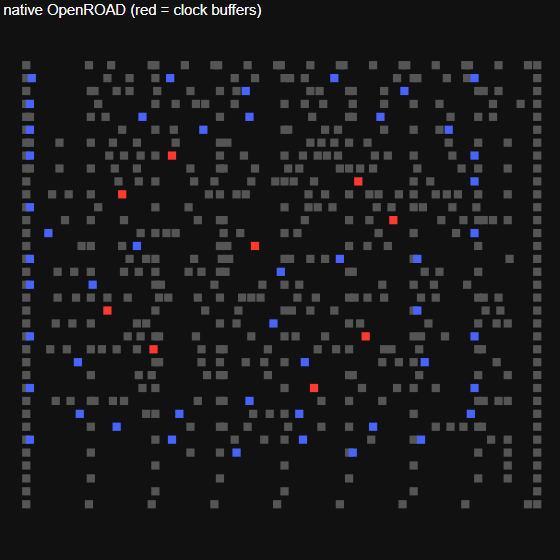 |  |

Red squares are clock buffers, blue are flops, grey are other cells. The pictures are the same because the DEFs are the same.

**Not validated:** only tiny8 and the single-clock case. Wires are not compared (routing happens later). Only clkbuf_8/4/2 are allowed.

Log excerpt (rendered from `logs/cts.txt`, see the note at the end):

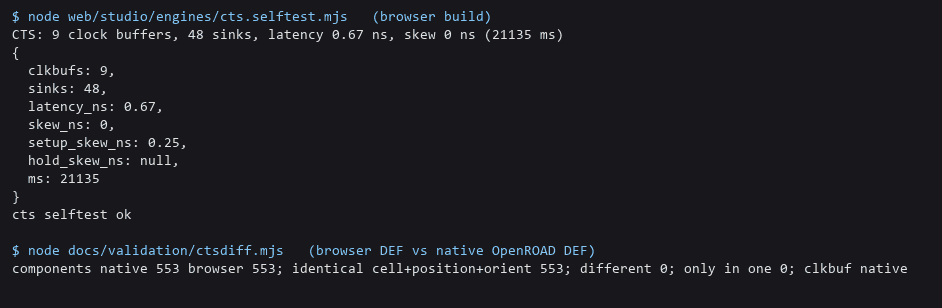

## 2. Netgen LVS matches native Netgen

**Claimed:** the browser Netgen says match or mismatch the same way as native Netgen, and the old browser flow gives LVS match on adder2, mult8 and tiny8 (rmult20 does not, see below).

**Test design:** adder2, mult8, tiny8 through the old flow (Yosys, graywolf, qrouter, Magic extract), at the flow's automatic die size. Also adder, twoclk and pins40 in `pd.cases.selftest.mjs`.

**Our flow:** Netgen commit 3cb047b (v1.5.324) with Tcl 8.6.14 built to WebAssembly, with one fix for a use-after-free in `netcmp.c` (`web/vendor/netgen/3cb047b/SOURCE.md`). Run `node web/studio/engines/lvs.selftest.mjs` and `node web/studio/engines/pd.cases.selftest.mjs`.

**Traditional flow:** `node docs/validation/lvs-dump.mjs <design> <folder>` writes the exact files the browser Netgen compared (`lay.spice`, `cells.spice`, `pg.v`, `setup.tcl`, `run.tcl`). Then in the container, in that folder (set `MSYS_NO_PATHCONV=1` in Git Bash):
`docker exec gf180 bash -lc "cd /foss/designs/nishkam_val/<design> && netgen -batch source run.tcl"`.
Logs: `logs/netgen-native-*.log`. One command re-runs both sides: `bash docs/validation/netgen-compare.sh` (re-run 2026-10-18, same numbers).

**Result (same inputs):**

| Design | Browser devices / nets | Native devices / nets | Both say |
|---|---|---|---|
| adder2 | 256 / 146 | 256 / 146 | match uniquely |
| mult8 | 2321 / 1180 | 2321 / 1180 | match uniquely |
| tiny8 | 3100 / 1537 | 3100 / 1537 | match uniquely |

The tiny8 counts here (3100 / 1537) are from the automatic die (103.6 x 101.9 um). Section 7 and 8B use the larger die 135.52 x 133.28 um and get 3098 / 1536 with the old flow. Different die, different run; both are match.

Other `pd.cases.selftest.mjs` results (all PASS, 0 failed nets, LVS true): twoclk 56/32, adder 256/146, pins40 20/20. `lvs.selftest.mjs`: sr8 matches (224/224 devices, 109/109 nets) and a deliberately broken layout is caught (216 vs 224 devices). These cases, and the open-net control below, were first run in the browser build only; native Netgen was run on them on 2026-11-10 (table "Added 2026-11-10" below) and matched.

**Flatten check:** `run.tcl` uses `catch {netgen::flatten class {<cell> <file index>}}`, and `catch` hides errors, so we checked that it works. Native Netgen 1.5.318 on adder2 prints 18 "Flattening instances of ..." lines (both files) and compares 256 devices / 146 nets; with the flatten lines removed it prints none and compares 43 devices / 61 nets (still "match uniquely"). So the syntax is right. Logs: `logs/netgen-native-adder2-flatten.log`, `-noflatten.log`.

**Version note:** native Netgen is 1.5.318; the browser build is 1.5.324 plus one fix. Netgen 1.5.324 native was not available.

**rmult20 (2595 cells, issue #20, 2026-10-26).** The browser flow (graywolf + qrouter, Studio options, die 243.6 x 243.0 um) ends with 360 failed nets, and LVS says mismatch: 17885/17885 devices, 10145 layout nets against 9067 netlist nets (the extra nets are the unrouted wires cut into pieces). Native Netgen 1.5.318 with the PDK's own `gf180mcuD_setup.tcl` on the same extracted SPICE and the same netlist gives the same counts and the same verdict ("failed pin matching"). So the browser LVS is right; the layout is open. The 2026-10-20 note that the counts were equal with 0 failed nets came from an older router build and cannot be reproduced. A larger die (72% full) still fails 13 nets and gives 9196 against 9067 nets, again a mismatch. rmult20 therefore has no LVS match in the old flow; the cause is the router, not Netgen. The OpenROAD flow on rmult20 was not measured (memory).

| rmult20, old flow | Browser Netgen | Native Netgen 1.5.318 |
|---|---|---|
| Devices (layout / netlist) | 17885 / 17885 | 17885 / 17885 |
| Nets (layout / netlist) | 10145 / 9067 | 10145 / 9067 |
| Verdict | mismatch | mismatch |

An open-net control (one pin moved to a new net, same device count) is now in `lvs.selftest.mjs` and is caught.

**Added 2026-11-10 (issue #40, review steps 1 and 2).** Same method as above (`netgen-compare.sh` for adder, twoclk, pins40; `lvs-dump-sr8.mjs` for sr8 and its two negative controls; `lvs-dump-files.mjs` for the OpenROAD-flow layout). Native Netgen 1.5.318, image `hpretl/iic-osic-tools@sha256:b3a754709b6d71bf11ce9357c07d2d63b6a4562c2a36b20c1dde33dd0079a9b4`. Logs: `logs/netgen-native-*.log`, `logs/netgen-browser-*.txt`.

| Design (old flow unless noted) | Browser devices / nets, verdict | Native devices / nets, verdict | Result |
|---|---|---|---|
| adder | 256 / 146, match | 256 / 146, match uniquely | match |
| twoclk | 56 / 32, match | 56 / 32, match uniquely | match |
| pins40 | 20 / 20, match | 20 / 20, match uniquely | match |
| sr8 | 224 / 109, match | 224 / 109, match uniquely | match |
| sr8, one transistor removed | 216 vs 224 devices, mismatch | 216 vs 224 devices, MISMATCH | match |
| sr8, one net opened | 224 / 109, mismatch | 224 / 109, "Netlists do not match" | match |
| tiny8, OpenROAD flow (6f3f28c, Node) | 3148 / 1558, match | 3148 / 1558, match uniquely | match |
| tiny8, route made by NATIVE OpenROAD 6f3f28c (section 8.x, `-threads 1`), Magic 8.3.636 extraction | 3148 / 1558, match | 3148 / 1558, match uniquely | match |

The OpenROAD-flow tiny8 now counts 3148 devices / 1558 nets (the 3150 / 1559 quoted elsewhere came from the older 61932e8 build). The browser Netgen result in the last row was obtained by feeding the same files to browser Netgen; the extraction itself was native Magic. The same Netgen version difference (1.5.318 native, 1.5.324 browser) applies. Still not tested (see 2.1 for the swapped net and ground-on-VDD cases): a power-to-ground short.

**Not validated:** native Magic extraction of the rmult20 GDS (only Netgen was run natively, on the browser's SPICE); a swapped net and a cell-ground-on-VDD fault are in section 2.1, a real drawn power-to-ground short is not tested (section 9), so native and browser may differ on other mismatch reports. This section's flow has no well-tap cells and LVS assumes wells are tied to power. The OpenROAD flow (section 8) adds tap cells and its LVS includes them (compared with native Netgen on 2026-11-10, table above).

Log excerpts (rendered from the stored logs). Browser Netgen, then native Netgen on the same files:

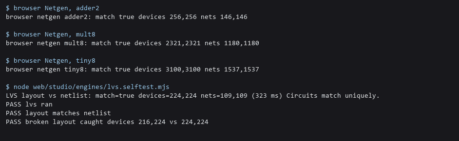

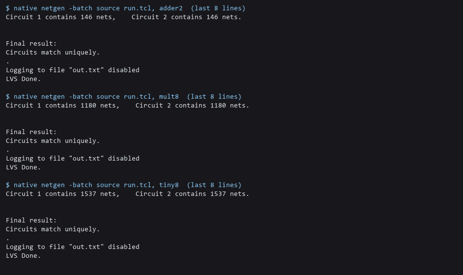

### 2.1 LVS negative controls: swapped net and cell ground on VDD (sr8, 2026-11-23, issue #212)

No screenshots: Node and command-line runs. Section 2 says only a missing device and an open net were tested; this adds two more kinds of fault.

- **Setup.** `docs/validation/lvs-controls.mjs` builds sr8 (8 flip-flops) with the old browser flow and Magic, then writes four versions of the layout SPICE: `good`; `swap` (the D nets of flip-flops f2 and f4 exchanged, so the shift chain is no longer a chain); `short` (the VSS pin of every flip-flop wired to VDD, the VSS rail left connected to no cell); `short1` (the same for f3 only). Browser Netgen (3cb047b, v1.5.324) compares each against the netlist. `docs/validation/lvs-controls.sh` then runs native Netgen 1.5.318 (container `gf180`, `netgen -batch source run.tcl`, PDK setup file `gf180mcuD_setup.tcl`) on the same files.
- **Command.** `bash docs/validation/lvs-controls.sh`. Logs: `logs/lvs-controls/` (`native-<case>.log`, native `out.txt` as `native-<case>.out.txt`, browser report as `browser-<case>.txt`).
- **A control must first fail natively.** Native Netgen result: `good` matches uniquely; `swap` "Netlists do not match"; `short` "Top level cell failed pin matching"; `short1` still "Circuits match uniquely", so `short1` is not a control and is listed here only as a result (see "Not validated").

| Case | Browser verdict | Native verdict | Browser report against native `out.txt` | Result |
|---|---|---|---|---|
| good | match, 224/224 devices, 109/109 nets | match uniquely, same counts | identical (56 lines) | match |
| swap (control) | mismatch, 224/224 devices, 109/109 nets; 3 net classes listed (f3/D, f4/D, f5/D against q4, q3, q2) | "Netlists do not match", same counts and same 3 net classes | identical (79 lines) | match |
| short (control) | mismatch; pins VSS/VDD flagged `**Mismatch**`; 2 net classes listed | "Top level cell failed pin matching", same pins flagged and same classes | identical (69 lines) | match |
| short1 (NOT a control) | match | match uniquely | identical | match (both pass) |

The browser report text is byte for byte the text native Netgen writes to `out.txt` in all four cases (`cmp` in the script), so verdict, counts and mismatch lines all agree.

**Not validated (this subsection).** One small design (sr8, 224 devices); one swap (two flip-flop D pins) and one rail fault (all flip-flops); the shorts are made by rewiring cell VSS pins in the SPICE, not by a real metal short drawn in the layout and extracted by Magic (a real short would merge the VDD and VSS nets and Netgen would then see fewer nets; that case is not tested); a single flip-flop's VSS pin on VDD (`short1`) is accepted by both Netgen builds, a blind spot of this comparison and probably of LVS with these cell pin lists, not investigated; the Netgen versions still differ (1.5.318 native, 1.5.324 browser plus one fix); no screenshots.

## 3. qrouter fix: fewer Magic DRC errors (old flow)

**Claimed:** blocking wires near vias on Metal1-3 cuts DRC error tiles (adder2 18 to 3, mult8 118 to 39, tiny8 197 to 66) and keeps LVS matching.

**Test design:** adder2, mult8, tiny8 through the old flow at the automatic die, then Magic DRC.

**Our flow:** qrouter commit c8f1111 (unmodified build) and `c8f1111-drc` (one change: call upstream's own `apply_drc_blocks()` on Metal1-3). Details in `web/vendor/qrouter/c8f1111-drc/SOURCE.md`. `node docs/validation/drc-count.mjs <design>` runs one design. To compare with the unmodified build, point `qf` in `web/studio/engines/place.worker.js` at the old qrouter folder, run, then put it back.

**Traditional flow:** none. This is a before/after on our own browser flow, so nothing here says it matches a traditional router. Run date and the adder2/mult8 auto die sizes were not recorded (the log is `logs/drc.txt`). Native LibreLane gives clean routing on these designs, which is the target we have not reached.

**Result (`logs/drc.txt`):**

| Design | Before | After | Failed nets | LVS |
|---|---|---|---|---|
| adder2 | 18 | 3 | 0 | match |
| mult8 | 118 | 39 | 0 | match |
| tiny8 | 197 | 66 | 0 | match |

`pd.selftest.mjs 8` (sr8) now gives 0 error tiles. The same routed DEFs were also run through native Magic (section 5).

**Why other sections show different DRC numbers for the same designs.** The numbers above are at the flow's automatic die. Section 7 uses a forced, larger die (adder2 77.28 x 74.48 um, tiny8 135.52 x 133.28 um) and the old flow gives 2 (adder2) and 88 (tiny8) there. The die is the only input that changed (tiny8: the automatic die is 103.6 x 101.9 um per `parity/stress.mjs`, whose "studio-default" case also gave the 197 before the fix). Each number is right for its own run.

**Not validated:** the remaining tiles are real errors, so the old flow is not DRC clean. The DRC count is Magic's, not signoff. The number of distinct rules broken was not recorded.

Log excerpt (rendered from `logs/drc.txt`):

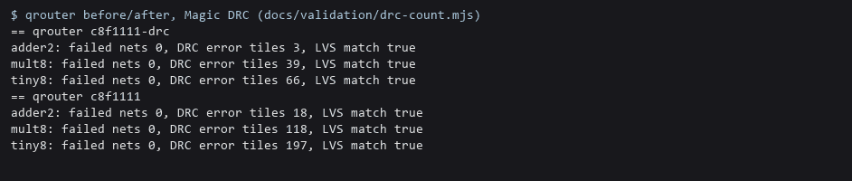

## 4. OpenSTA timing and power match native OpenSTA

**What is checked:** the browser OpenSTA and native `sta` 3.1.0 read the same netlist, liberty and Tcl, and the complete output text is compared: every max and min path report, wns/tns, worst slack and the power report. `bash docs/validation/sta-compare.sh` (native side needs the container). Logs: `logs/sta-native-*.txt`, `logs/sta-browser-*.txt`.

**Test design:** shreg4 and an 8-bit counter (cnt8), clock 10 ns, input/output delay 2 ns, load 0.05 pF.

**Our flow:** OpenSTA commit defec0b (3.1.0) built to WebAssembly, the commit bundled in the container's OpenROAD (`web/vendor/opensta/defec0b/SOURCE.md`). Liberty is the unmodified gf180mcu tt 25C 5V file. Also `node web/studio/engines/opensta.selftest.mjs`.

**Traditional flow:** `/foss/tools/openroad/bin/sta` (3.1.0) in the container, run by the same script (2026-10-18).

| Design | Lines compared | Result | Setup worst slack | Hold worst slack | Total power |
|---|---|---|---|---|---|
| shreg4 | 434 | identical | 6.7093 ns | 0.5372 ns | 279 uW |
| cnt8 | 1172 | identical | 6.0215 ns | 1.2837 ns | 1710 uW |

Only the licence banner differs.

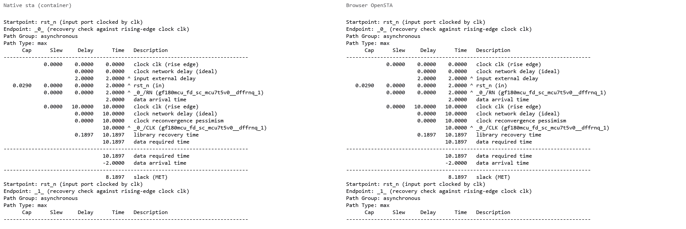

**Not validated:** one liberty corner, two small designs. No wire-parasitic (SPEF) file was used in this base comparison; the SPEF reader and RC delay calculation are compared with native in sections 4.1 (Magic SPEF), 14, 15 and 25 (OpenRCX SPEF). Post-route timing on tiny8 (section 8) uses SPEF but only the OpenSTA build is used there.

Log excerpt (rendered from `logs/opensta.txt`):

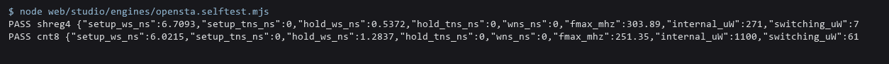

### 4.1 Magic SPEF on tiny8, and combinational timing on adder2 (2026-11-23, issue #212)

No screenshots: both runs are Node and command-line runs; the stored logs are the evidence.

**A. Magic's SPEF (tiny8).**

- **Setup.** `docs/validation/sta-magic-spef.mjs` runs tiny8 through the old browser flow (Yosys, graywolf, TritonCTS, qrouter, Magic flatten + extract + extresist, `spef.js`). It writes the netlist after the clock tree (`tiny8_cts.v`) and Magic's SPEF (278 nets). Browser OpenSTA (defec0b, 3.1.0) then runs the same Tcl twice: without and with the SPEF. `docs/validation/sta-magic-spef.sh` runs native `sta` 3.1.0 (container `gf180`, `/foss/tools/openroad/bin/sta`) on the very same files and diffs the full text.
- **Commands.** `bash docs/validation/sta-magic-spef.sh` (from the repo root, with `@yowasp/yosys` in `node_modules`). Inside the container: `cd /foss/designs/nishkam_magicspef/<nospef|spef> && sta -no_init -exit run.tcl`. Tcl is the one our Studio engine builds (`script()` in `opensta.worker.js`): clock `clk` 24 ns, propagated, uncertainty 0.1, in/out delay 4.8, load 0, liberty `tt_025C_5v00`, corner `nom_tt_025C_5v00`; plus two lines that print the number of drivers and run `report_parasitic_annotation`.
- **Guard against a silently ignored SPEF.** Both tools print `report_parasitic_annotation`. Without the SPEF: 281 drivers, 281 unannotated, 0 partly annotated. With the SPEF: 3 unannotated and 85 partly annotated, so 193 of 281 drivers are fully annotated (both tools, same numbers; 162 before the #215 fix). The slack also moves (table), so the SPEF is really used.
- **Logs.** `logs/sta-magic-spef/` (`native-*.txt`, `browser-*.txt`, `run-*.tcl`, `tiny8.magic.spef`).

| What | Browser OpenSTA | Native `sta` 3.1.0 | Result |
|---|---|---|---|
| Full text, no SPEF (6847 lines) | - | - | identical |
| Full text, with Magic SPEF (6861 lines) | - | - | identical, no warnings (since #215; the 32 `not found` warnings are gone) |
| Annotation without SPEF (drivers / unannotated / partly) | 281 / 281 / 0 | 281 / 281 / 0 | match |
| Annotation with SPEF | 281 / 3 / 85 | 281 / 3 / 85 | match |
| Worst setup slack, no SPEF -> with SPEF | 13.8406 -> 12.7042 ns | 13.8406 -> 12.7042 ns | match (SPEF costs 1.1364 ns) |
| Worst hold slack, no SPEF -> with SPEF | 0.7902 -> 0.8539 ns | 0.7902 -> 0.8539 ns | match (was 0.8376 with the 32 nets missing) |
| Total power, no SPEF -> with SPEF | 3.63 -> 4.07 mW | 3.63 -> 4.07 mW | match |
| Paths printed (`Startpoint`) | 196 / 196 | 196 / 196 | match |

**Finding, fixed in #215 (not an engine difference).** Before the fix both tools printed 32 warnings `net r0\[0\] not found` (the register-bit nets r0..r3, 8 bits each): the netlist declares them as Verilog escaped names `\r0[0]\ `, which OpenSTA stores as the scalar net `r0[0]` plus one trailing backslash, and our SPEF writer spelled them `r0\[0\]`. The spelling OpenSTA matches is `r0[0]\\` (brackets plain, two trailing backslashes; found by trying variants with native `sta` 3.1.0, then checked in both tools). Setup slack stays 12.7042 ns (those nets are off the worst setup path); hold slack moved 0.8376 -> 0.8539 ns and power 4.02 -> 4.07 mW.

**B. Combinational timing (adder2).** `docs/validation/sta-comb.mjs` + `sta-comb.sh`, `bash docs/validation/sta-comb.sh`. adder2 (8-bit add + XOR, no clock port) is synthesised by the browser Yosys; both tools read that netlist and the same Tcl: `create_clock -name vclk -period 10` (no port, a virtual clock), `set_input_delay 2 -clock vclk [all_inputs]`, `set_output_delay 2 -clock vclk [all_outputs]`, `set_load 0.05`, then `report_checks` max and min (`full_clock_expanded`, 50 paths per group), wns/tns/worst slack, `check_setup -verbose`, `report_power`. The liberty is the same file: md5 `5ffc99a0...` in the browser and in the container (`gf180mcu_fd_sc_mcu7t5v0__tt_025C_5v00.lib`). Logs: `logs/sta-comb/`.

| What | Browser OpenSTA | Native `sta` 3.1.0 | Result |
|---|---|---|---|
| Full text (924 lines, 34 paths) | - | - | identical |
| Worst setup slack | 1.9991 ns | 1.9991 ns | match |
| Worst hold slack | 4.5146 ns | 4.5146 ns | match |
| wns / tns | 0 / 0 | 0 / 0 | match |
| Total power | 0.460 mW | 0.460 mW | match |

**Not validated (this subsection).** One design each (tiny8 for SPEF, adder2 for the virtual clock); one corner (nom tt 25C 5V); `set_max_delay` / false paths / multicycle are not tried; 3 drivers stay unannotated (not looked into); Magic's SPEF values themselves are not checked against a second extractor in this subsection (section 19 compares Magic with KLayout-PEX); the OpenROAD-flow route is not used (this SPEF comes from the old flow).

## 5. Magic: DRC, extraction and GDS match native Magic

**Claimed:** browser Magic gives the same DRC count, extraction and GDS as native Magic.

**How:** `bash docs/validation/magic-compare.sh` runs the old browser flow, then browser Magic, then native Magic 8.3.636 in the container on the same routed DEF and the same PDK files (same command list as `magic.worker.js`). It compares the DRC total, the DRC rule texts, the extracted SPICE (apart from the `$SUB` name) and the GDS (KLayout 0.30.8 XOR, `gds-xor.py`). Logs: `logs/magic-native-*.txt`, `logs/magic-browser-*.txt`. Run 2026-10-18.

| Design | DRC tiles native / browser | Rule texts | SPICE (apart from `$SUB`) | GDS XOR area |
|---|---|---|---|---|
| sr8 | 0 / 0 | same | same | 0 (25 layers) |
| adder2 | 3 / 3 | same | same | 0 (25 layers) |
| tiny8 | 66 / 66 | same | same | 0 (25 layers) |

| adder2 | tiny8 |
|---|---|
| 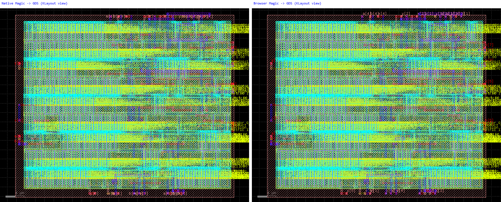 | 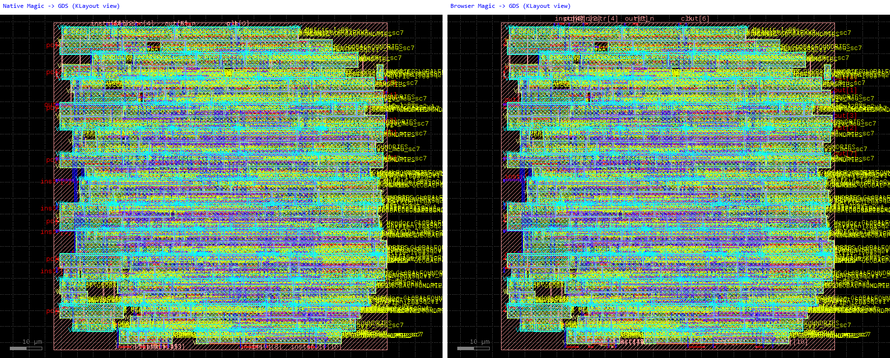 |

Left half of each picture is native Magic's GDS, right half is the browser's, both drawn by KLayout (`render-gds.py`). They match because the GDS geometry is the same.

**Not validated:** no side-by-side picture for sr8 (only adder2 and tiny8); die sizes and the Magic command lists are in `magic-compare.sh`, not repeated here; the DRC tile positions were not compared, only count and rule texts (the GDS match covers the layout itself). Same Magic tech file on both sides. Browser Magic is a different version from the container's. Only old-flow layouts were used here.

Log excerpt (rendered from the stored logs: browser lines and the last lines of the native logs):

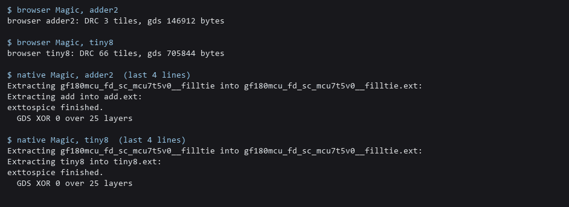

## 6. graywolf and qrouter against the same sources built natively (adder2)

**Question:** are the WebAssembly builds of graywolf, qflow's helpers and qrouter the same as the same sources built natively?

**Setup:** adder2 (run date not recorded), run in Node (`web/studio/engines/parity/browser.mjs adder2`), every tool call recorded. Each native tool got the same arguments and input files. Native tools were built in a throwaway container from the same image (`docker run --rm`, gcc and cmake from the image) at the same commits (graywolf 33fbcaa, qrouter c8f1111, qflow 52ecda1), with the same patches as our WebAssembly build. The qrouter on both sides is `c8f1111-drc` (c8f1111 plus the one-line `apply_drc_blocks()` call of section 3, see `qflow-native.md`), which is why 3 DRC tiles appear below and 18 in section 3 before the fix. Details in `qflow-native.md`.

**Result (sha256 of the whole file; "same" means byte for byte):**

| Step | File | Result |
|---|---|---|
| qrouter -i | add.info | same |
| vlog2Cel | add.cel | same |
| graywolf chain, final outputs only (the files between its steps were not compared) | add.pl1, add.pl2, add.pin | same |
| addspacers | add_filled.def, add.obsx | same |
| qrouter (route) | add_route.def | **differs** |

The routed DEF differs in 223 lines, all inside the wires of some nets (header, components and pins are identical). Native: 438 wire segments, 417 vias; browser: 443 and 425. Both report "No failed routes". Magic DRC and Netgen LVS on both routed DEFs: 3 DRC tiles and LVS match each. A native build with `-ffp-contract=off` gave the same output as the normal native build, so fused multiply-add is not the cause. A 32-bit native build was not possible in the image. The cause is not known; word size is the remaining guess.

**Not validated:** only adder2, no clocked design, graywolf intermediate files not compared one by one, no picture of the 223 differing lines, no tolerance defined for the routed DEF (byte for byte or nothing), run date and exact command lines not recorded here.

## 7. LibreLane against the old browser flow, RTL to GDS (adder2, tiny8)

Run 2026-10-18 (old-flow numbers re-measured 2026-10-20 with the same result). The old-flow numbers come from Node runs of the same WebAssembly files the page loads, not from a page; the rmult20 row is from 2026-10-26. Versions are in the version table above; the die was set with `HEADROOM` (section 11). "Same clock and clock-buffer choice" applies to tiny8 only; adder2 has no clock. Same RTL, PDK, clock, clock-buffer choice and die. Layouts differ by design: different placer and router, and LibreLane adds port, repair and tap cells. What the proof below shows is narrower: each final netlist is logically equal to the RTL under the liberty cell functions (Yosys), and each passes LVS against its own drawn layout. The old-flow layouts still have DRC spacing tiles (2 and 88).

**Dies.** adder2 77.28 x 74.48 um, tiny8 135.52 x 133.28 um. LibreLane needs more room than the old flow, so these are the smallest tried that LibreLane passed (tiny8 130 x 130 and adder2 74.48 x 68.88 failed with DPL-0036). The old flow was made to produce exactly these dies by changing only its spare-room setting, then the numbers were given to LibreLane as `DIE_AREA`.

**How LibreLane was run.** Image `hpretl/iic-osic-tools:chipathon26`, container `gf180`, LibreLane 3.0.2, in `/foss/designs/nishkam_jobs/parity_<design>_<tag>`: `librelane config.json --run-tag run`. Config written by `node web/studio/engines/parity/librelane.mjs <design> <W> <H> 50 <outdir> <tag>`; everything else is LibreLane's default (tap distance 20, routability-driven placement on):

```json
{ "meta": {"version": 3, "flow": "Classic"}, "PDK": "gf180mcuD",
  "FP_SIZING": "absolute", "DIE_AREA": [0, 0, 135.52, 133.28],
  "CLOCK_PERIOD": 24, "CLOCK_PORT": "clk",
  "CTS_CLK_BUFFERS": ["gf180mcu_fd_sc_mcu7t5v0__clkbuf_8", "gf180mcu_fd_sc_mcu7t5v0__clkbuf_4", "gf180mcu_fd_sc_mcu7t5v0__clkbuf_2"],
  "CTS_ROOT_BUFFER": "gf180mcu_fd_sc_mcu7t5v0__clkbuf_8",
  "PL_TARGET_DENSITY_PCT": 50, "DESIGN_NAME": "tiny8", "VERILOG_FILES": ["dir::tiny8.v"] }
```

For adder2, `DIE_AREA` is `[0, 0, 77.28, 74.48]` and `CLOCK_PORT` is null. LibreLane timing is its own `final/metrics.json` at corner `nom_tt_025C_5v00`. The old flow ran with `node web/studio/engines/parity/browser.mjs <design> <outdir>`.

**Formal equivalence.** Yosys 0.64 in the container, cell functions from the PDK liberty. Script `web/studio/engines/parity/equiv.sh`. Proof A: `equiv_make / equiv_simple / equiv_induct / equiv_status -assert` pairs every flop and output by name and proves by induction that they agree (tiny8: 48 of 48 points). Proof B (adder2 only): a miter circuit proved never to differ. Proof C: bounded `sat -seq` from the zero state.

| Design | Check | Proof A (unbounded) | Proof B (unbounded) | Proof C (bounded) |
|---|---|---|---|---|
| adder2 | old-flow synthesis netlist = LibreLane synthesis netlist | proven | proven | proven |
| adder2 | RTL = LibreLane final netlist | proven | proven | proven |
| adder2 | RTL = old-flow final netlist | proven | proven | proven |
| adder2 | RTL = LibreLane synthesis netlist | proven | proven | proven |
| adder2 | negative control (one gate swapped) | fails as it should | fails | fails |
| tiny8 | old-flow synthesis netlist = LibreLane synthesis netlist | proven | not run | inconclusive: no answer in 600 s |
| tiny8 | RTL = LibreLane final netlist | proven | not run | inconclusive: no answer in 600 s |
| tiny8 | RTL = old-flow final netlist | proven | not run | inconclusive: no answer in 600 s |
| tiny8 | RTL = LibreLane synthesis netlist | proven | not run | inconclusive: no answer in 600 s |
| tiny8 | negative control (one gate swapped) | fails as it should | not run | fails |

For tiny8, proof A carries the claim; B was not run and C gave no answer in 600 s (inconclusive: it neither proves nor refutes). The rows "RTL = old-flow synthesis netlist" and "old-flow final = LibreLane final" were not run (the chain through the RTL covers them only if the other rows hold). Full logs are in `logs/parity_eq/` (the LibreLane job folders themselves stay on the test PC). With LVS passing on both sides, the chain is: RTL = final netlist (proof) = drawn layout (LVS).

**Signoff, same die, tt 25 C 5.00 V:**

| | adder2 old flow | adder2 LibreLane | tiny8 old flow | tiny8 LibreLane |
|---|---|---|---|---|
| LVS | match (256/256 devices, 146/146 nets) | 0 errors | match (3098/3098, 1536/1536) | 0 errors |
| Magic DRC tiles | 2 | 0 | 88 | 0 |
| Setup WNS / TNS (ns) | no clock | no clock | 12.90 / 0 | 9.62 / 0 |
| Hold WNS / TNS (ns) | no clock | 10.5 / 0 | 0.956 / 0 | 0.665 / 0 |
| Power (uW) | not measured | 488 | 4,120 | 6,972 |
| Run time (s) | 10 | 99 | 56 | 156 |

The old flow's remaining errors are Metal1/2/3 minimum-spacing rules (M1.2a, M2.2a, M3.2a), none inside library cells. Power is not a validated number: the switching-activity assumptions were not aligned. Marks, in plain words: LVS and formal equivalence: match. DRC: differs (2 and 88 against 0). Setup and hold slack: differs (12.90 against 9.62, 0.956 against 0.665 on tiny8). Power: not validated. Cell counts, wire, vias, skew: differs. The slack gap has causes that were not separated for this old flow: a different extractor (section 8B), a different netlist and buffering (263 against 488 cells, 5 against 9 clock buffers) and a different clock tree. The adder2 hold 10.5 ns is LibreLane's own number for a design without a clock port; which constraint produced it was not checked.

**Physical comparison, tiny8** (old flow against LibreLane; the percentage is against the LibreLane value):

| tiny8 | Old flow | LibreLane | Delta |
|---|---|---|---|
| Std cells | 263 | 488 | -46% |
| Cell area (um2) | 8,610 | 11,211 | -23% |
| Wire length (um) | 13,644 | 15,669 | -12.9% |
| Vias | 3,088 | 2,546 | +21.3% |
| Clock buffers | 5 | 9 | -44% |
| Clock skew (ns) | 0.01 | 0.27 | not comparable: ours from our OpenSTA, LibreLane's from its own report |

| adder2 | Old flow | LibreLane | Delta |
|---|---|---|---|
| Std cells | 43 | 119 | -64% |
| Cell area (um2) | 812 | 2,164 | -62% |
| Wire length (um) | 1,117 | 1,903 | -41% |
| Vias | 367 | 395 | -7% |

LibreLane's extra cells, read from the LibreLane job's own stage metrics on 2026-11-10 (`logs/review/librelane-tiny8-cellsplit.txt`, job `parity_tiny8_x`): 287 cells after synthesis (17 inverters, 48 flip-flops, 222 other logic), +52 end caps and +84 tap cells (floorplan stage), +56 buffers added before the clock tree (33 port buffers and 23 from `repair_design`, section 26; the table in section 8B counts the same 56 as 54 `dlyb_1` and 2 other buffers), +9 clock buffers = 488. The earlier text left the 52 end caps out. Against our 263 (255 from synthesis + 8 added by us): LibreLane's synthesis gives 32 more cells (287 against 255); the rest is the physical-only and repair cells above (a like-for-like split of our own 263 into tap, end cap and buffer cells was not made). The 56 buffers are the whole "added before the clock tree" count, so the earlier phrase "56 cells added before the clock tree" stands. The synthesis difference (287 against 255) is a difference between LibreLane's Yosys script and ours, not an engine difference. The `parity_eq/` logs and `dobuild.sh` are now in `logs/parity_eq/` and `logs/dobuild.sh`.

Layouts, same die, same renderer (KLayout). Left old flow, right LibreLane:

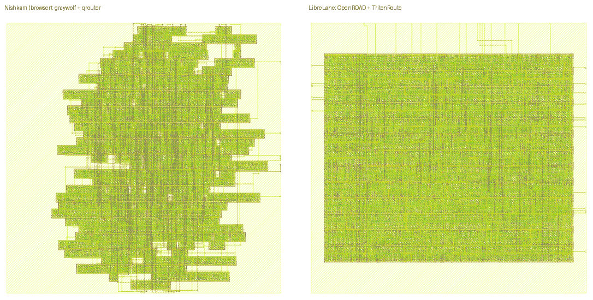

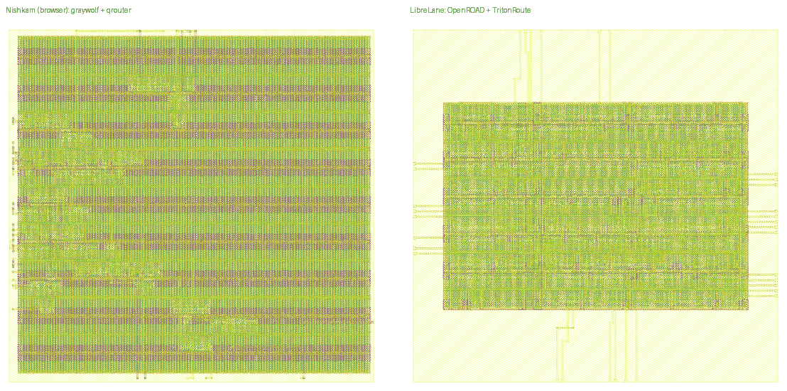

**Stress runs of the old flow** (`web/studio/engines/parity/stress.mjs`, wall time on the test PC; an old-flow-only diagnostic, no LibreLane comparison and no pictures; the 56 s of the signoff table and the 68 to 76 s here were timed by different scripts and were not reconciled; the signoff table's 2 and 88 DRC tiles are with the qrouter fix):

| Case | Die (um) | Result | Time |
|---|---|---|---|
| tiny8 x5 (parity die) | 135.5 x 133.3 | 5 of 5 give identical placement and route hashes; all LVS match | 68 to 76 s |
| tiny8, smallest die, no spare room | - | fails: clock tree stage stops (no room for clock buffers) | 41 s |
| tiny8, Studio default die | 103.6 x 101.9 (81.5% full) | passes: 0 failed nets, LVS match, 197 DRC tiles (before the qrouter fix; 66 after, section 3) | 68 s |
| adder2, smallest die | 34.2 x 31.4 | fails: 1 failed net, LVS mismatch | 10 s |
| rmult20 (2,595 cells) | 243.6 x 243.0 | fails: 360 failed nets, so LVS mismatch (10145 vs 9067 nets; native Netgen agrees, section 2) | 473 s |

**Not validated:** layout equality (not possible, different tools); old-flow DRC cleanliness (2 and 88 tiles on adder2 and tiny8 here, 66 at the automatic die; `librelane-parity.md` lists 11 to 1,272 tiles over all designs including rmult20, from an older router build); power; timing with different constraints; the formal proof covers logic function: for tiny8 only the unbounded induction (proof A) finished, B and C were completed for adder2 only; it does not cover timing, clock-domain or physical correctness, and it trusts Yosys and each cell's liberty function. Only two small designs.

## 8. OpenROAD place and route in the browser

Two separate questions:
- **A. Is OpenROAD built to WebAssembly the same tool as native OpenROAD?** Same commit (61932e8), same Tcl, same input files, one thread: native in the container against WebAssembly in Node.
- **B. Does the Studio flow (a short fixed Tcl recipe) give a layout of similar quality to a full LibreLane run?** The two flows are not the same steps (see "Differences that stay"), so this is a sanity check on quality, not a proof of equality.

Run 2026-10-20 (A and B in Node with `node web/studio/engines/pnr-flow.selftest.mjs`; browser run in Chrome, below).

**Designs and setup.** adder2 (no clock) and tiny8 (one clock, 24 ns), same RTL and dies as section 7: adder2 77.28 x 74.48 um, tiny8 135.52 x 133.28 um (the browser run below uses 250 x 250 um, and was repeated in Node at that die), target density 50%, gf180mcuD 7-track cells, tt 25 C 5.00 V. One corner.

**How OUR browser flow was built.** OpenROAD commit 61932e8 (plus OpenSTA defec0b) built to WebAssembly with the patch `tools/openroad-pnr/openroad-61932e8-wasm.patch` (`web/vendor/openroad-pnr/61932e8/SOURCE.md`, rebuild steps in `tools/openroad-pnr/BUILD.md`). One thread. Other engines as in the version table. Steps, exactly as `web/studio/engines/pnr.worker.js` runs them:
1. Floorplan: written as a DEF (die, rows, tracks) and read with `read_def -floorplan_initialize`, because this build has no `initialize_floorplan`. Core margins 12 sites left/right and 4 rows top/bottom, as in the LibreLane DEFs.
2. `tapcell` (distance 20), `pdngen` (Metal4/Metal5 stripes, Metal1 rails), `global_placement -skip_io`, `place_pins`, `global_placement`, `buffer_ports`, `repair_design`, `detailed_placement -max_displacement {500 100}`.
3. Clock tree (clocked designs): TritonCTS, same script as section 1, but run on Studio's own placed DEF.
4. `global_route -congestion_iterations 50`, `detailed_route -droute_end_iter 64 -or_seed 42`, `filler_placement`.
5. Magic GDS + DRC + extraction, Netgen LVS, OpenSTA on Magic's SPEF.

**What the WebAssembly patch changes (33 files).** Placement, routing and clock-tree algorithms are not edited. The patch removes parts of OpenROAD these steps do not call, makes everything single thread, and fixes build problems. The effect of each removed module:

| Removed | What it does | In the browser flow instead | Effect on results |
|---|---|---|---|
| `ifp` | floorplan commands (`initialize_floorplan`, `make_tracks`) | floorplan written as a DEF | expected none; the DEF carries the die, rows and tracks, but it was not compared with what native `initialize_floorplan` writes |
| `rcx` (OpenRCX) | wire parasitic extraction | Magic extraction + OpenSTA | timing differs from LibreLane's own report (hold +35.5% on our layout, +44.1% on LibreLane's, see 8B); not validated against OpenRCX (OpenRCX is back in the default build, section 8.y) |
| `psm` | IR-drop analysis | none | no IR-drop check in the browser flow |
| `mpl`, `par`, `ram`, `rmp`, `cgt`, `dft`, `exa`, `fin`, `pad`, `upf` | macro placement, partitioning, RAM generator, resynthesis, clock gating, scan, examples, fill, pads, power intent | not used | none for these designs; no macros, scan or pads |
| web server, GUI, distributed router | interface only | none | none |
| `cluster_flops` in `gpl` | needs OR-Tools | not available (error if called) | none unless called |

Other changes: OpenMP stubbed, the check in TritonRoute that expects 2 threads deleted, Tcl 8 type definitions in five `.i` files, 8-byte alignment on four odb classes, Boost.Serialization compiled from source. Every command the Studio flow calls is in the build. Applied to a clean tree, the patch gives back the built tree byte for byte (BUILD.md).

**How the TRADITIONAL flow was run.** As in section 7: LibreLane 3.0.2, OpenROAD 26Q1-1024-gdcf36133a (the container's `librelane` wrapper puts `/foss/tools/openroad-librelane/bin` first on `PATH`; confirmed 2026-11-23 with its `openroad -version` and the version line in the step logs of `parity_tiny8ref`; an earlier version of this section named 26Q2-254-g61932e897, the commit of our build, which is the container's default `openroad` but not what LibreLane runs, so "same commit as our build" holds for the direct `openroad` runs in this section, not for the LibreLane runs), `librelane config.json --run-tag run`, config from `web/studio/engines/parity/librelane.mjs`. The runs are the section 7 runs; they were not repeated, but their step logs and metrics were read again for the counts below.

### A. WebAssembly against native OpenROAD (tiny8, same Tcl, same inputs, one thread)

`docs/validation/pnr-native.mjs` (not the same script as `web/studio/engines/pnr-native.mjs` used in 8.x and 8.z, which also writes the clock tree Tcl) prepares the inputs and `docs/validation/pnr-native.sh` runs `openroad -threads 1` in the container. Place starts from the same synthesized netlist and floorplan DEF. Route starts from the same placed + clock-tree DEF (the one the WebAssembly flow made), so the router is compared on identical input.

| tiny8 | WebAssembly (Node) | Native, 1 thread | Delta |
|---|---|---|---|
| Placed netlist (after buffer_ports, repair_design) | md5 67a3591f... | md5 67a3591f... | identical file |
| Placed components at a different position | 0 of 305 (baseline) | 127 of 305 (41.6%) | not bit-identical |
| HPWL after detailed placement (um) | 8,479.5 | 8,584.3 | +1.2% |
| TritonRoute violations per iteration | 33 / 8 / 7 / 0 | 50 / 10 / 4 / 0 | different path, both end at 0 |
| Wire length (um, router log) | 10,235 | 10,247 | +0.1% |
| Vias | 1,889 | 1,878 | -0.6% |
| Time place / route (s) | 6 to 8 / 33 to 37 | 2.8 / 16.9 | WebAssembly is about 2 to 3 times slower per thread |

The WebAssembly build is not bit-identical to native OpenROAD. Wire length (+0.1%), vias (-0.6%) and HPWL (+1.2%) agree to about 1%, and both route to zero violations, but 41.6% of the placed cells are at other positions and the router's violations per iteration differ (33 against 50 at the first iteration). Marks: netlist: match; wire length, vias, HPWL: close (about 1%, a limit chosen after seeing the numbers); cell positions and violation path: differs, reason not found (section 9.1). We do not claim identical output. Which command first diverges and by how many microns cells move was not measured (section 9). The clock tree was not re-run natively on this exact run (section 1 does that).

### B. Studio flow against LibreLane (tiny8)

Each column's difference is the percentage against the LibreLane value. Marks: 0 violations, 0 DRC tiles and LVS: match; hold slack on LibreLane's netlist (-0.5%): match; cell counts, clock buffers, wire length, vias, setup path time: differs (14% to 37%), reasons in the bullets below (the 29% wire-length gap has no known reason). The cell counts "after place" and "at the end" differ by 1 to 3 cells from place plus clock buffers (for example 271 + 7 = 278 against 279); this was not reconciled. One run each. Wire length and vias come from ONE parser, `docs/validation/def-stats.mjs`, run on the final routed DEF of every flow. Timing comes from ONE tool chain, `docs/validation/pnr-timing-same-tool.mjs` (our Magic extraction + our OpenSTA), run on every flow's final DEF and netlist, LibreLane's included. "Studio OpenROAD on LibreLane's netlist" starts from LibreLane's own synthesized netlist (`NETLIST=... pnr-flow.selftest.mjs`), which removes the synthesis difference. "Old flow" is graywolf + qrouter (`parity/browser.mjs`, re-run 2026-10-20 with the same numbers as section 7).

| tiny8 | Studio OpenROAD | Delta vs LibreLane | Studio OpenROAD on LibreLane's netlist | Delta vs LibreLane | Old flow | LibreLane |
|---|---|---|---|---|---|---|
| TritonRoute violations | 0 (33/8/7/0) | same | 0 (72/13/9/0) | same | not run | 0 |
| Magic DRC tiles | 0 | same | 0 | same | 88 | 0 |
| LVS, our Netgen (transistor level) | match 3150/3150 devices, 1559/1559 nets | - | match 3156/3156, 1544/1544 | - | match 3098/3098, 1536/1536 | LibreLane's own Netgen is at cell level (356 devices, 372 nets, 0 errors); not comparable |
| Cells from synthesis | 236 | -17.8% | 287 | 0% | 255 | 287 |
| Cells after place (port + repair buffers) | 271 | -21.0% | 322 | -6.1% | 255 | 343 |
| Cells at the end (no tap, endcap, filler) | 279 | -20.7% | 330 | -6.3% | 263 | 352 |
| Cells added before CTS | 35 (33 port `buf_1` + 2 inverters) | -37.5% | 35 | -37.5% | 0 | 56 (54 `dlyb_1` + 2 buffers) |
| Buffers added by repair_timing | not run | - | not run | - | not run | 0 |
| Clock buffers | 7 | -22.2% | 7 | -22.2% | 5 | 9 |
| Wire length (um) | 10,236 | -34.7% | 11,138 | -28.9% | 13,644 | 15,670 |
| Vias | 1,889 | -25.8% | 2,167 | -14.9% | 3,088 | 2,546 |
| Setup: time the critical path uses = 24 ns - slack (ns) | 12.44 | -14.1% | 12.04 | -16.9% | 11.10 | 14.48 |
| Setup slack (ns), for reference | 11.56 | +21.4% | 11.96 | +25.6% | 12.90 | 9.52 |
| Hold slack (ns) | 0.901 | -6.0% | 0.953 | -0.5% | 0.957 | 0.958 |

All columns, LibreLane's too: same extraction (Magic) and same OpenSTA. LibreLane's own report, which uses OpenRCX and OpenSTA, gives setup 9.62 ns and hold 0.665 ns. Against that number our hold slack (0.901 ns) is +35.5% higher. That gap mixes extractor and layout. On the same LibreLane layout, Magic gives 0.958 ns against OpenRCX's 0.665 ns, +44.1%, so the extractor alone is as large as the whole gap (see the table below).

Parasitic extractor, as a 2-row table (LibreLane's final layout, same tt corner):

| Extractor | Hold slack (ns) | Setup slack (ns) |
|---|---|---|
| Magic + our OpenSTA (same-tool chain) | 0.958 | 9.52 |
| OpenRCX + OpenSTA (LibreLane's own report) | 0.665 | 9.62 |

What the table says, in plain words:
- In LibreLane, `repair_timing` added 0 buffers (setup 0, hold 0, from the step metrics). The 56 cells added before CTS: the table counts 54 `dlyb_1` and 2 buffers; an earlier reading of the same step logs said 33 port buffers (`dlyb_1`) and 23 from `repair_design`. The two splits count the same 56 cells two ways (by cell type, and by step), so they can both be true, but the cell types were not re-checked (the LibreLane job folders are on the test PC only). We add 33 port buffers (`buf_1`) and 2 inverters. So the buffers are not the main reason for LibreLane's longer wires.
- The flows do not start from the same netlist. Yosys gives 236 cells in the Studio OpenROAD flow, 255 in the old flow and 287 in LibreLane. The old-flow and LibreLane netlists are proven equal to the RTL in section 7; the OpenROAD flow's is covered by the equivalence check below. The synthesis difference comes from different Yosys scripts and versions (0.68.1207 against 0.64); which of the two matters was not tested. With LibreLane's netlist the Studio flow gets 11,138 um instead of 10,236 um, so about 900 um of the gap is the netlist. About 4,500 um (29% of LibreLane's wire) remains and we do not know why. LibreLane turns on routability-driven placement and uses different pin buffers and a different power grid; we did not test which matters.
- Timing, like with like: with the same extraction and the same OpenSTA, LibreLane's layout gives hold 0.958 ns and ours 0.901 ns (-6%), and the critical path uses 14.48 ns against our 12.44 ns (-14%). Slack as a percentage is a weak measure (it depends on the clock we picked), so setup is compared as the time the path takes; hold does not depend on the clock.
- Magic extraction was not validated against OpenRCX.

### Logic equivalence of the place-and-route netlist

`pnr-flow.selftest.mjs` also proves with Yosys (`equiv_make`, `equiv_simple`, `equiv_induct`; the proof is on the cell functions from the liberty, so it does not see power pins or physical errors; same recipe as section 7) that (1) the netlist after place + clock tree (with port, repair and clock buffers) is equivalent to the netlist Yosys made before place, and (2) it is equivalent to the RTL. A negative control (one gate swapped for its dual) makes the proof fail, as it must. tiny8 and adder2 pass all three. This closes the gap that LVS alone leaves (LVS only compares the layout with the place-and-route tool's own netlist). It checks this build's netlist edits on these two designs; it is not a general proof.

### adder2

| adder2 (no clock) | Studio OpenROAD | Delta vs LibreLane | Old flow | LibreLane |
|---|---|---|---|---|
| TritonRoute violations / Magic DRC tiles | 0 (9 / 0) / 0 | same | not run / 2 | 0 / 0 |
| LVS, our Netgen | match 382/382 devices, 209/209 nets | - | match 256/256, 146/146 | cell level (82 devices, 96 nets); not comparable |
| Cells from synthesis | 35 | -22% | 43 | 45 |
| Cells at the end (no tap, endcap, filler) | 68 | -13% | 43 | 78 |
| Wire length (um) | 1,459 | -23% | 1,117 | 1,903 |
| Vias | 315 | -20% | 367 | 395 |
| Whole flow time (s) | about 24 (Yosys 2.6, place 6.8, route 11.9, Magic 1.9, Netgen 0.3) | - | 7.5 | 99 |
| Timing | not compared | - | not compared | not compared |

adder2 has no clock and Studio's timing step needs a clock port, so no timing number is compared for it (section 9).

### Run time

LibreLane's 156 s (tiny8) is the whole container run: synthesis to signoff, including KLayout XOR and DRC, antenna checks, RCX and the IR-drop report. The comparable Studio number is the whole flow in Node: Yosys 5.5 + place 7.0 + CTS 19.2 + route 34.1 + Magic 12.0 + Netgen 0.5 + OpenSTA 4.1 = about 82 s, on the same PC (the 250 x 250 um rerun below took 107 s with other programs running). Step by step, LibreLane (default threads) took 1.8 s for global placement, 1.6 s for detailed placement, 20.2 s for CTS, 1.7 s for global route and 21.8 s for detailed route. The one-thread native run of our Tcl took 2.8 s (place) and 16.9 s (route) (table A). Peak WebAssembly memory: 100 MB placing, 249 MB routing (299 MB at 250 x 250 um); the build allows 2 GB.

### Differences that stay (so "same steps" is NOT claimed)
- Our recipe has no routability-driven placement and no `repair_timing`; LibreLane's config has routability-driven placement on and ran `repair_timing` (it changed nothing here).
- Different synthesis script and Yosys version, a different buffer cell on the ports (`buf_1` against `dlyb_1`).
- LibreLane checks several corners; we run one (tt).
- LibreLane's own timing uses OpenRCX; ours uses Magic. Only the same-tool rows are like with like.

### In the browser (Studio), and the same die in Node

Browser run (the only run in a real page in section 8), 2026-10-20, Chrome 155 on Windows 11, Studio opened from a local server (`studio.html?mock=1`), example tiny8, clock 24 ns, **die 250 x 250 um**, density 50%, "In-browser place and route = OpenROAD (TritonRoute)", "Run All". One run. Total 96 s. The Node column is the same flow at the same die (`node web/studio/engines/pnr-flow.selftest.mjs tiny8 250 250`, run 2026-10-20, log `logs/pnr-node-tiny8-250.txt`).

| tiny8, 250 x 250 um | Chrome (Studio page) | Node (same code) |
|---|---|---|
| Placement instances (with tap cells) | 696 | 696 |
| Clock buffers / sinks / latency / skew | 7 / 48 / 1.01 ns / 0 ns | 7 / 48 / 1.01 ns / 0 ns |
| TritonRoute violations per iteration | 42, 3, 3, 0 | 42, 3, 3, 0 |
| Wire length (um) / vias | 11,776 / 1,848 | 11,776 / 1,848 |
| Magic DRC tiles | 0 | 0 |
| Netgen LVS | match, 3150 devices, 1559 nets | match, 3150 devices, 1559 nets |
| Signoff setup / hold slack (ns) | 11.45 / 0.92 | 11.445 / 0.9211 |
| Time place / CTS / route (s) | 6.3 / 20.0 / 33.0 | 9.4 / 26.9 / 38.1 (PC busier) |

So the browser page and Node give the same layout at this die. The Chrome slacks are the page's rounded numbers (11.45 / 0.92); the unrounded ones were not saved. Native OpenROAD was not run at 250 x 250 um; the browser-to-native link is table A at the 135.52 x 133.28 um die, so "browser = Node = native" is shown in two steps, not one table. Other browser rows: Timing (STA after routing) setup 12.79 ns, hold 0.99 ns, Fmax 89.19 MHz; signoff timing with Magic wire delays setup 11.45 ns, hold 0.92 ns, Fmax 79.65 MHz.

No browser console errors were seen after the run started (console was read only from then on; load-time errors were not checked). Switching the select to graywolf + qrouter and running Placement still works. Only Chrome was tried.

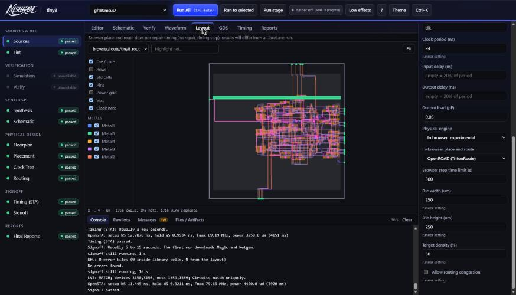

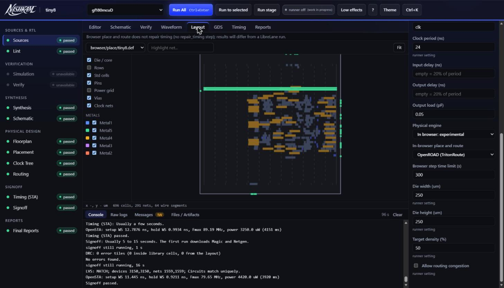

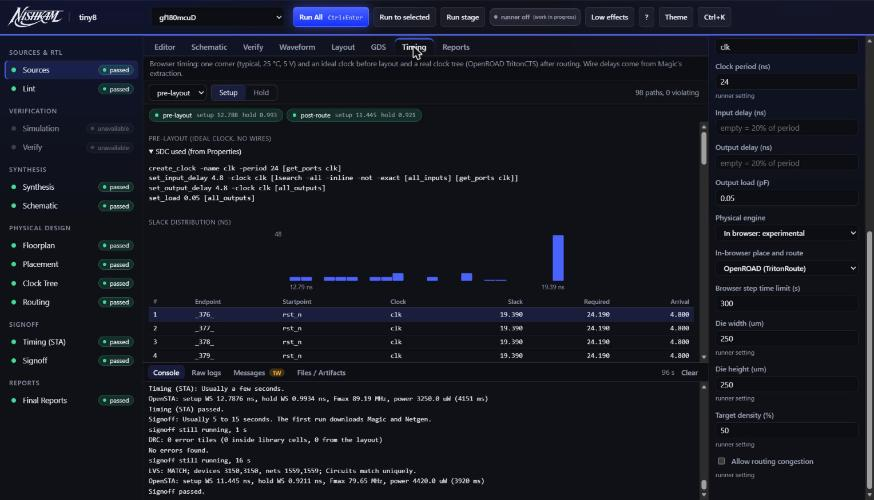

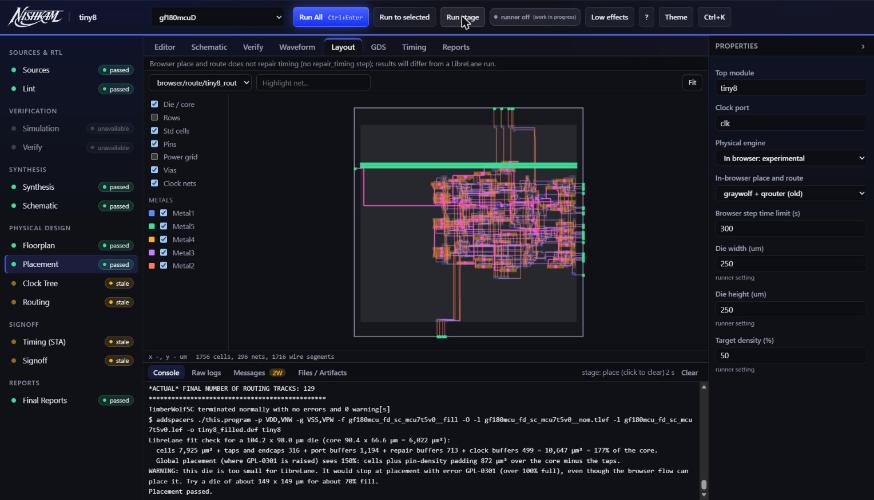

### 8.x Newer OpenROAD build (master 6f3f28c), now the default (#61)

Built the same way as above from OpenROAD master 6f3f28c (2026-10-24, emsdk 3.1.74, patches in `tools/openroad-pnr/openroad-6f3f28c-wasm.patch`, recipe in `web/vendor/openroad-pnr/6f3f28c/SOURCE.md`). Browser clock tree and place and route now both use this one binary (it contains TritonCTS). Run with `node web/studio/engines/pnr-flow.selftest.mjs tiny8` (the old build: `OR_PNR_VER=61932e8 OR_CTS_DIR=<openroad-cts/61932e8>`).

**Native reference built from the same commit.** Docker image `or-native-61:6f3f28c`: OpenROAD source at 6f3f28cc85, `cmake /src -DCMAKE_BUILD_TYPE=Release -DBUILD_GUI=OFF -DCMAKE_PREFIX_PATH=/opt/or-deps $(cat /src/deps-prefixes.sh)`, then `make -j6 openroad` (script `dobuild.sh`, copy in `logs/dobuild.sh`); dependencies under /opt/or-deps; binary `/build/bin/openroad`, version 26Q4-1108-g6f3f28cc85. It has no PDK: the same gf180 LEF, liberty and tech files as the browser are mounted. Run: `docker run --rm --entrypoint bash -v <dir>:/w or-native-61:6f3f28c -c 'cd /w; /build/bin/openroad -exit place.tcl; ...'` with the Tcl written by `web/studio/engines/pnr-native.mjs` (`/w/` paths unchanged). Logs: `logs/or-native-6f3f28c/`. Same synthesized netlist, same Tcl as the browser scripts, die 135.52 x 133.28 um, 50% density, 24 ns clock, one run each. This native run used `openroad -exit` without `-threads 1`, and "wasm" here means the Node run, not a page. Instance counts here include tap cells (407), unlike table A (305). The last column is from earlier runs with a different input and is not the same run as table A, so do not compare it with table A.

| Step (tiny8) | Native 6f3f28c | Wasm 6f3f28c (default) | Result | Earlier: native 61932e8 / wasm 61932e8 |
|---|---|---|---|---|
| Instances after place | 407 | 407 | match | 407 / 407 |
| HPWL after detailed placement (um) | 8044.8 | 8044.8 | match | 8584.3 / 8479.5 |
| Placement DEF cells at the same spot as native | 407 of 407 | 407 of 407 | match | 283 of 407 |
| After CTS: cells at the same spot | 415 of 415 | 415 of 415 | match | n/a |
| Clock buffers / sinks | 6 / 48 | 6 / 48 | match | native CTS not run / 7 buffers (wasm) |
| CTS skew (ns), latency | 0.01 (0.95) | 0.01 (0.94) in the full flow | match (rounding) | n/a |
| Route wire (um) / vias | 9752 / 1858 | 9789 / 1857 | close: wire +0.4%, vias -0.05% | 10461 / 1872 vs 10235 / 1889 |
| TritonRoute violations per iteration | 31 / 11 / 6 / 0 | 33 / 7 / 4 / 0 | final 0 both; path differs | 47-15-5-0 vs 33-8-7-0 |
| Magic DRC / LVS / equivalence / negative control | 0 DRC tiles / match (native Magic 8.3.636 and Netgen on the native route, 2026-11-10, below) | 0 / match / pass / pass | match | |
| Setup / hold worst slack (ns, extracted) | n/a | 11.527 / 0.913 | | 11.563 / 0.901 (old wasm) |

**Native run with `-threads 1`, and native DRC and LVS on the native route (2026-11-10, issue #40).** Image `or-native-61:6f3f28c`, `openroad -threads 1 -exit` for `place.tcl`, `cts.tcl`, `route.tcl` (written by `pnr-native.mjs` from the synthesized netlist of the current Node run, same die, 24 ns). Logs and Tcl: `logs/or-native-6f3f28c/threads1/`. Result: HPWL 8044.8 um, route wire 9752 um, vias 1858, final violations 0. These are the same numbers as the first native run above, so the earlier run without `-threads 1` was not thread-dependent. The native routed DEF was then read by native Magic 8.3.636 (same `run.tcl` as section 5): **DRC 0 tiles** (`logs/magic-native-tiny8-nativeroute.txt`); the extracted SPICE against the netlist in native Netgen: **match, 3148 devices / 1558 nets** (section 2, last row). The native DEF was not byte-compared with the Node DEF (the route differs in 0.4% of wire, as in the table). Native OpenRCX/OpenSTA on that DEF was not run: the Tcl step failed with `RCX-0468 Can't open extraction model file /w/rcx.rules` because the rules file was not mounted (and then crashed in the error path, signal 11, after routing had finished); the routed DEF and all routing numbers are unaffected.

**Native OpenRCX and timing on the native route (2026-11-23, #217, `logs/item3/8x/`).** New run, 24 ns, same synthesized netlist for both sides, `openroad -threads 1` in `or-native-61:6f3f28c` with the rules file now mounted (`rcx.rules` = `web/vendor/gf180mcu/rcx-pdk-7b70722/rules.openrcx.gf180mcuD.nom`, written by `pnr-native.mjs`; the fix for the `RCX-0468` failure above). Then, in the `gf180` container: native `sta` 3.1.0 on each side's own netlist and SPEF with the browser's post-route SDC, native Magic 8.3.636 DRC and extraction, native Netgen 1.5.318 LVS (script `logs/item3/8x/verify_run.sh`, output `run.out`). Reading the raw files:

| tiny8, 24 ns | Native 6f3f28c | Browser (Node, 6f3f28c) | Result |
|---|---|---|---|
| Cells at the same spot after place / after CTS | 407 / 415 | 407 of 407 / 415 of 415 | match |
| Detailed-route wire (um) / vias | 10,133 / 1,885 | 10,125 / 1,883 | close: wire -0.08%, vias -0.1% |
| OpenRCX | 294 nets, 1,458 rsegs, 2,574 ccs (SPEF total cap 1.6139 pF) | SPEF total cap 1.6127 pF | close (different routes) |
| Setup / hold worst slack, native `sta` 3.1.0 on its own route (ns) | 11.6175 / 0.7818 | 11.6006 / 0.7821 | close: 0.017 ns apart |
| Browser's own number (OpenSTA in the page's engine) | | 11.6006 / 0.7821 | equal to native `sta` on the browser route to 4 decimals |
| Magic DRC / LVS on the route | 0 tiles; Netgen match, 3,148 devices, 1,558 nets | 0; browser Netgen match, 3,148 / 1,558 | match |

The setup slack is not a 4-digit match between the two sides: 11.6175 against 11.6006 ns. The cell positions and the netlist are the same, and the browser's slack equals native `sta` run on the browser's own route and SPEF (11.6006, 0.7821). So the 0.017 ns comes from the two routes differing by 8 um of wire, 2 vias and 0.001 pF of extracted capacitance, not from a different timer. The native numbers here (10,133 um, 1,885 vias) differ from the 8.x table above (9,752 um, 1,858 vias), which came from an earlier run; the cause was not traced, so compare within this table only.

CTS golden (LibreLane tiny8 placed DEF, `cts.selftest.mjs`), regenerated with native 6f3f28c using the browser's own CTS Tcl on the same pre-processed DEF: 9 clkbuf_8, 48 sinks, latency 0.67 ns, **skew 0.01 ns** (was 0.00 with 61932e8; the upstream commit changed it, and the native run of the new commit gives 0.01 too). The wasm result has the same COMPONENTS as native line for line, and the NETS have the same words; only DEF annotations (`+ USE SIGNAL`, the NDR name, row lines) differ, which the browser removes for its own router. Selftest golden updated to skew 0.01.

Reading: with the native binary built from the same commit, the Node (WebAssembly) placement and clock tree put every cell at the same spot as native, with HPWL equal to 0.1 um, and routing is within 0.4% in wire length. The difference between native 61932e8 and native 6f3f28c (8584 vs 8044) is the upstream commit change. Why the 61932e8 WebAssembly build moved 41.6% of the cells away from the native 61932e8 build while the 6f3f28c one does not was not found. Router violation counts per iteration differ (cause not found; the native `-threads 1` re-run above gives the same numbers as the first native run, so the native thread count is not it) but both end at 0. This is now held to the same bar as the older build (about 1%, not bit-identical), and met more tightly for placement.
Also not covered: the unresolved `_Unwind_GetIP` symbol (never reached in these runs), Firefox/Safari, designs other than tiny8, the old build is no longer the browser default.

**NOT validated in section 8.**
- Bit-identical results to native OpenROAD (61932e8: they are not, table A; 6f3f28c on tiny8: placement and clock tree are, routing is not).
- For 8.x: designs other than tiny8, adder2, and any run in a page (all 8.x and 8.y numbers are Node). Native extraction and timing on the native route: done for tiny8 at 24 ns (above); the slack differs by 0.017 ns because the routes differ.
- Why LibreLane's wire is 29% longer than ours on the same netlist.
- Magic extraction against OpenRCX; other corners (ss, ff).
- Large or hard designs. Both designs are tiny, at 50% density with a relaxed 24 ns clock (setup slack above 9 ns). Congestion, tight timing and the browser memory limit are not tested on anything bigger.
- gf180 setup details not changed because they would move the numbers of sections 8 and 26 (reviewed in #207): the power grid connects only `VSS` (`power.vssPins`), not the p-well pin `VPW`, so the well is not tied in placement; and `dontUse` is the scan-flop list only and does not apply the `mux2_1` / `oai33_2` exclude list that LibreLane's gf180 setup uses. Both were already in the 18fd9d4 worker. Not measured: how much each changes placement, DRC or timing. Tracked in `docs/ROADMAP.md` (Physical design).
- Firefox and Safari. Power. adder2 timing. A side-by-side native layout picture (there is none for 8, 8.x, 8.y or 8.z; only single-pane Studio screenshots of the 250 um run). The clock tree natively on this exact run. Studio's floorplan DEF against native `initialize_floorplan`.

## 8.y OpenRCX parasitics and PDNSim IR drop (2026-10-25, #65, #68)

**How ours was built.** The 6f3f28c wasm of section 8.x with two more modules switched on (`rcx`, `psm`; patch `tools/openroad-pnr/openroad-6f3f28c-rcx-psm.patch`, recipe in `web/vendor/openroad-pnr/6f3f28c/SOURCE.md`). Studio runs them in the route step of `engines/pnr.worker.js`: `set_extraction_rules_file` (the PDK's own `rules.openrcx.gf180mcuD.nom`, the file LibreLane uses for nom; vendored in `web/vendor/gf180mcu/rcx-pdk-7b70722/`, sha256-checked), `extract_parasitics`, `write_spef`; then `set_pdnsim_net_voltage` (5 V read from the liberty, 0 V for VSS) and `analyze_power_grid` for VDD and VSS. Post-route STA reads that SPEF.

**How native was run.** Docker image `or-native-61:6f3f28c` (section 8.x), `openroad -threads 1 -exit post.tcl` with the same Tcl and the same inputs: the routed tiny8 DEF written by the browser flow (`node web/studio/engines/pnr-flow.selftest.mjs tiny8`, OUT=dir), gf180 LEF/tlef, liberty and rules file. Script and both logs: `docs/validation/logs/or-native-6f3f28c/rcx-psm/` (post.tcl, nat.log, wasm.log).

**History.** Until 2026-10-26 this step used the ORFS typ rules (`gf180mcu_1p5m_1tm_9k_sp_smim_OPTB_typ.rules`, ORFS 5c761de72dd0, sha256 39ca464e...) fetched from jsDelivr: setup WNS 11.6089 ns. The 294-net, IR and power rows below were measured with those rules; the SPEF match and the slack were re-run with the PDK nom rules on 2026-10-26 (#75): 294 nets, every net capacitance identical to native OpenROAD 6f3f28c (sum 1.5696 pF), VDD worst IR drop 2.53e-3 V and power 4.93e-3 W identical, setup WNS 11.6088 ns. Log: `logs/or-native-6f3f28c/rcx-pdk-nom/`.

| tiny8 routed DEF | Native 6f3f28c | Wasm 6f3f28c | Result |
|---|---|---|---|
| Nets in SPEF (*D_NET) | 294 | 294 | match |
| SPEF text, except date and version lines | | | 0 differing lines |
| VDD worst IR drop (ORFS typ rules; the PDK nom re-run gave 2.53e-3 V, also identical to native) | 2.60e-3 V | 2.60e-3 V | match |
| VDD average IR drop | 4.98e-4 V | 4.98e-4 V | match |
| VSS worst / average | 1.05e-3 / 4.69e-4 V | 1.05e-3 / 4.69e-4 V | match |
| Total power used | 4.93e-3 W | 4.93e-3 W | match |

In the Studio flow (a 170 um die, which is not one of the dies in the table above and was not compared with native) the Reports card shows worst 0.593 mV on VDD (0.012% of 5 V). Post-route setup/hold slack on tiny8 moved from 11.527 / 0.913 ns (Magic SPEF, section 8.x) to 11.706 / 0.876 ns (OpenRCX SPEF, ORFS typ rules at the time). The 11.6088 ns above (PDK nom rules) is a different rules file, and the two were not run on the same die in this section; the setup number depends on rules, die and netlist.

**NOT validated.** One design (tiny8), one corner (typical), one rules file (the PDK nom file). The IR numbers use default switching activity, not real activity, and the power grid is our own pdngen script, not LibreLane's. We compared against native OpenROAD, not against Magic, a signoff extractor, or silicon. OpenRCX against Magic extraction was not compared net by net. No IR heat map yet (follow-up).

## 8.z Timing repair after the clock tree (2026-10-25, #70)

**How ours was built.** Same 6f3f28c wasm as section 8.x. In `engines/cts.worker.js` the OpenROAD CTS script now ends, when Properties "Timing repair" is on (default), with: gf180 layer RC from OpenROAD-flow-scripts `platforms/gf180/setRC.tcl` (`set_layer_rc` Metal2 to Metal5; signal wires on Metal2, clock wires on Metal4), `estimate_parasitics -placement`, `repair_timing -setup`, `repair_timing -hold`, `detailed_placement`, `check_placement`. `repair_design` already ran in the place step (after `buffer_ports`). The dont_use list (`drc_exclude.cells`) is applied before, so repair cannot pick the excluded cells; CTS itself still uses clkbuf_8/4/2 only. Global-route repair is NOT done (the browser route step has no SDC and would need a second global route).

**How native was run.** Image `or-native-61:6f3f28c` (section 8.x), `openroad -threads 1 -exit` on the Tcl written by `web/studio/engines/pnr-native.mjs` (`PERIOD=7 REPAIR=1`), same synthesized netlist as the Node run (`PERIOD=7 node web/studio/engines/pnr-flow.selftest.mjs tiny8`, `RAW=1` prints the OpenROAD log). Logs: `logs/or-native-6f3f28c/repair/`. The traditional flow (LibreLane/ORFS) was not run for this step.

tiny8, die 135.52 x 133.28 um, 7 ns clock (input/output delay 20%). A 7 ns clock makes tiny8 fail setup on purpose (24 ns, used elsewhere, has 11 ns slack and nothing to repair).

| tiny8, 7 ns | Repair off | Repair on (wasm) | Native, repair on | Result |
|---|---|---|---|---|
| Setup WNS / TNS after CTS, estimated (ns) | -1.643 / -15.94 (before repair) | 0.017 / 0 | 0.017 / 0 | wasm = native, every printed digit |
| Hold WNS after CTS (ns) | 0.711 | 0.712 | 0.712 | match |
| Repair moves | | 3 buffers inserted, 21 resized up, 1 pin swap, no hold violations | same | match |
| Cells / cell area after CTS | 279 / 8776 um2 | 282 / 8996 um2 (+2.5%) | 282 / 8996 um2 | match |
| Final netlist, wasm vs native | | | | 0 differing lines |
| Post-route setup / hold WNS, OpenRCX (ns) | -1.894 / 0.739 | -0.087 / 0.750 | see the native verification below | repair closes 95% of the setup gap (wasm repair on against repair off); not fully: -0.087 ns still fails 7 ns after routing, because route adds wire delay the estimate did not have |
| TritonRoute violations / Magic DRC / LVS / equivalence | 0 / 0 / match / pass | 0 / 0 / match / pass | route: 0 violations (native wire 10184 um, 1902 vias, wasm 10142 um, 1911 vias) | close: wire -0.4%, vias +0.5% (limit about 1%); native DRC, LVS and equivalence on the native route: see below |

**Native route, OpenRCX, timing, DRC, LVS and equivalence (2026-11-23, #217, `logs/item3/8z/`).** A new 7 ns run with repair on, native `openroad -threads 1` with the rules file mounted, against the browser (Node) run on the same synthesized netlist (identical sha256, `run.out` step 0). Its numbers differ from the earlier table above (this run: native wire 10,234 um, 1,885 vias, browser 10,231 um, 1,897 vias; the table above: 10,184 / 1,902 and 10,142 / 1,911); the cause of the change since the earlier run was not traced, so compare within this paragraph only.

| tiny8, 7 ns, repair on | Native 6f3f28c | Browser (Node) | Result |
|---|---|---|---|
| Repair summary (native log) | 21 resized up, 1 pin swap, log line "Total number of Buffers Inserted: 5", setup after repair +0.091 ns (estimated), hold +0.712 | | the browser's repair counts were not re-read in this run |
| Cells at the same spot after place / after CTS | 407 / 415 | 407 of 407 / 415 of 415 | match |
| Final netlist, native `tiny8_cts.v` against browser `tiny8.final.v` | | | 0 differing lines |
| Detailed-route wire (um) / vias | 10,234 / 1,885 | 10,231 / 1,897 | close: wire -0.03%, vias +0.6% |
| Setup / hold worst slack after route, native `sta` 3.1.0 on its own route and SPEF (ns) | -0.1499 / 0.6500 | -0.1603 / 0.6510 | close: 0.010 ns apart on setup; both still fail 7 ns |
| Browser's own number | | -0.1603 / 0.651 | equal to native `sta` on the browser route to 4 decimals |
| Magic DRC / LVS on the route | 0 tiles; Netgen match, 3,187 devices | 0; browser Netgen match, 3,187 / 1,579 | match |
| Post-PnR equivalence, native Yosys 0.64 on the native netlist | synth netlist: PASS; RTL: PASS; negative control (one gate swapped): FAILS as it should (38 unproven cells) | | pass |

Reading: the native route confirms the browser result. After routing, tiny8 at 7 ns still fails setup by about 0.15 ns on both sides (the estimate after repair was +0.09 ns, so routing adds the difference). The 0.010 ns gap between -0.1499 and -0.1603 is the two routes differing (3 um of wire, 12 vias), as in 8.x. Browser repair off, same run: setup -2.0209 ns. Not done: the browser repair counts for this run; the earlier -0.087 ns number above is from a different run and is not reproduced here.

Default 24 ns run (nothing violates, so repair does nothing): setup/hold 11.709 / 0.882 ns, DRC 0, LVS match, same as before. Run `REPAIR=0 PERIOD=7 node web/studio/engines/pnr-flow.selftest.mjs tiny8` for the "off" column.

**NOT validated.** Studio's "Timing repair" option and `cts.worker.js` inside a page (only Node ran it); native post-route timing and DRC/LVS were run once on tiny8 at 7 ns (above) and not on other designs or clocks; the image `or-native-61:6f3f28c` itself is on the test PC only (its build script is `logs/dobuild.sh`). One design (tiny8), one clock. Repair quality (does it beat LibreLane's repair on the same design): not compared, LibreLane was not run. Repair after global route is absent. A 3 ns clock on tiny8 was tried: repair ran about 1100 iterations, grew area 30%, and still left -6.7 ns WNS, so very tight clocks are not fixed by this step. The ORFS setRC values were used for repair only; placement and CTS still use the average layer RC from the tech LEF. aes (ORFS stress test, #64) is re-run separately and not part of this table.

## 9. Known limits and next checks

Things we know are open. None is claimed as validated.

1. **Cell-position difference in table A (127 of 305 cells).** Not yet traced: which command first diverges (`global_placement` or `detailed_placement`), the cause (for example 32-bit against 64-bit arithmetic or ordering), and the mean and maximum cell move in microns. Next: dump the placement after each command in both builds and compare.
2. **SPEF timing.** Section 4 compares OpenSTA without wire parasitics; sections 14 and 15 add OpenRCX SPEF (identical on 9 corners). Magic's SPEF: done 2026-11-23 (#212), full report text identical, annotated nets counted on both sides, section 4.1. The writer's misnaming of the 32 register-bit nets found there is fixed (#215).
3. **Combinational timing.** Done 2026-11-23 (#212): adder2 with a virtual clock, full report text identical to native `sta`, section 4.1. `set_max_delay` and false paths are still not compared.
4. **LVS negative controls.** Open net: section 2. Swapped net and rail fault (cell VSS pins on VDD): done 2026-11-23 (#212), both fail in native Netgen and the browser report is identical to native, section 2.1. Still open: a real drawn power-to-ground short extracted by Magic, and why one flip-flop with its VSS pin on VDD passes in both.
5. **Side-by-side layout picture** of WebAssembly against native OpenROAD for table A, and a browser run at the 135.52 x 133.28 um die, so the page, Node and native can share one die.
6. **Reproducibility.** `drc-count.mjs` needs a hand edit to compare the two qrouter builds (section 3); it should take the qrouter folder as an argument. The LibreLane runs in sections 7 and 8 are on the test PC only.
7. **RTL grader.** Now covered in section 10. Not covered there: the five CDC problems (rule and bounded checks, `web/cdc.test.mjs`, never claimed as proven) and the Studio flow problem.
8. **Runner.** The statement "runner round trip verified (shreg4 signoff clean 14/14)" has no stored log. The runner is not part of this report.
9. **Missing counts.** Synthesis cell counts for mult8, shreg4, sr8, cnt8, twoclk and pins40 were not recorded, so the benchmark table says so.
10. **Native LVS of the OpenROAD flow.** Done 2026-11-10: native Netgen agrees (3148 devices / 1558 nets, match), section 2.

## 10. RTL practice grader (Yosys miter, k-induction)

**What is claimed.** The grading engine (`web/grader.js`, run in Node; the page banners were checked in Edge on 3 cases only, c01, c24 and c25, see below) says "proven" when a design equals the reference for every input and every cycle after reset, and "first 40 cycles" when it could only check that far. This section tests both statements. It covers the twelve non-CDC RTL problems: the five first ones and seven easy ones added later (and-gate, xor-gate, wire, mux2, counter-3b, seq-101, traffic-light). The first four of the easy ones (and-gate, xor-gate, wire, mux2) are combinational tops with no clock and no reset, so that kind of top is now covered too.

**How ours runs.** `web/grader.js` loads the reference and the user design, builds a miter, and runs `sat -verify -tempinduct -maxsteps 40 -seq 40` starting from undefined state with reset asserted on cycle 1. If that does not succeed, it runs a plain `sat -seq 40` search. A counterexample from either run is a real difference. A pass of the plain search is shown as "first 40 cycles", never "proven". Outputs where the reference is x are not compared. Engine: `@yowasp/yosys` 0.68.1207 (WebAssembly), run in Node.

**How native was run.** The same cases, with the exact same two scripts the grader writes (`prove.ys` first, then `bound.ys` if that fails), run by `/foss/tools/bin/yosys` 0.64 in the `gf180` container (image `hpretl/iic-osic-tools:chipathon26`), one case at a time: `docker exec gf180 bash /foss/designs/grader_val/run.sh` (copy in `logs/grader-cases/run-native.sh`). The native result is "proven" if `prove.ys` exits clean, "first 40 cycles only" if only `bound.ys` does, and "fails" if both stop with an error. Note the versions differ (0.68 against 0.64); the results still agree.

**Cases.** For every problem: the reference against itself, and three or four deliberate mistakes (off-by-one, wrong reset value, missing enable, swapped condition, wrong pattern, wrong shift, and similar). Then four tricky counter cases: two that are equal only if reset is ignored or never used, one that differs only from about cycle 30 (inside the 40 cycle bound), and one that differs only from about cycle 45 (outside it). Cases c26 to c42 are the seven easy problems: each reference against itself (c26 to c32), then two mistakes for each of the problems (c33 to c42; one or two per problem). The case numbers c01 to c25 are unchanged. In the current log of `node web/grader.validation.mjs` the seven new references print first (as c01 to c07), so the log numbers after that are shifted; the table and the case folders use the numbers shown here. Native Yosys results for c26 to c42 are in `logs/grader-cases/native-results-new.txt` (same script, folder renamed). Every case is stored as files in `logs/grader-cases/cNN/` (`ref.v`, `user.v`, `prove.ys`, `bound.ys`).

**Results.** Run `node web/grader.validation.mjs`. Latest log: `logs/grader/grader.validation-2026-11-23.txt`, 140 checks, all as expected (70 proven, 57 fails, 1 "first 40 cycles" case, 12 rejections). The table below is the 42-case native comparison. Older log: `logs/grader.validation.txt` (42 checks; the older `node web/grader.test.mjs` log is `logs/grader.test.txt`). The cycle is counted with reset as cycle 1. The solver returns some counterexample inside the 40 cycles, not the shortest one, so the cycle shown for the late-difference case (40) is where the output first differs in that run, not the earliest possible.

| Case | Problem | Design | Expected | Ours | Native Yosys | Match |
|---|---|---|---|---|---|---|
| c01 | counter-en | reference vs itself | proven | proven | proven | match |
| c02 | rise-edge | reference vs itself | proven | proven | proven | match |
| c03 | seq-1011 | reference vs itself | proven | proven | proven | match |
| c04 | gray-counter | reference vs itself | proven | proven | proven | match |
| c05 | rr-arbiter | reference vs itself | proven | proven | proven | match |
| c06 | counter-en | off-by-one (counts by 2) (first mismatch seen at cycle 3) | fails | fails | fails | match |
| c07 | counter-en | wrong reset value (1) (first mismatch seen at cycle 2) | fails | fails | fails | match |
| c08 | counter-en | missing enable (first mismatch seen at cycle 3) | fails | fails | fails | match |
| c09 | counter-en | swapped condition (en low counts) (first mismatch seen at cycle 3) | fails | fails | fails | match |
| c10 | rise-edge | wrong reset value (p=1) (first mismatch seen at cycle 2) | fails | fails | fails | match |
| c11 | rise-edge | falling edge instead of rising (first mismatch seen at cycle 2) | fails | fails | fails | match |
| c12 | rise-edge | level instead of edge (first mismatch seen at cycle 3) | fails | fails | fails | match |
| c13 | seq-1011 | wrong pattern 1101 (first mismatch seen at cycle 6) | fails | fails | fails | match |
| c14 | seq-1011 | wrong reset value (1111) (first mismatch seen at cycle 5) | fails | fails | fails | match |
| c15 | seq-1011 | window one bit short (3 bits) (first mismatch seen at cycle 4) | fails | fails | fails | match |
| c16 | gray-counter | plain binary output (first mismatch seen at cycle 6) | fails | fails | fails | match |
| c17 | gray-counter | missing enable (first mismatch seen at cycle 3) | fails | fails | fails | match |
| c18 | gray-counter | wrong shift (<<) (first mismatch seen at cycle 3) | fails | fails | fails | match |
| c19 | rr-arbiter | wrong reset pointer (0) (first mismatch seen at cycle 2) | fails | fails | fails | match |
| c20 | rr-arbiter | search starts at last (not last+1) (first mismatch seen at cycle 6) | fails | fails | fails | match |
| c21 | rr-arbiter | pointer never updates (first mismatch seen at cycle 4) | fails | fails | fails | match |
| c22 | counter-en | equal only after reset: no reset input used, q starts undefined (first mismatch seen at cycle 2) | fails | fails | fails | match |
| c23 | counter-en | equal only after reset: reset ignored after first use (age flag) (first mismatch seen at cycle 2) | fails | fails | fails | match |
| c24 | counter-en | differs only from cycle ~30 (inside 40) (first mismatch seen at cycle 40) | fails | fails | fails | match |
| c25 | counter-en | differs only from cycle ~45 (outside 40) | see text | first 40 cycles only | first 40 cycles only | match |
| c26 | and-gate | reference vs itself | proven | proven | proven | match |
| c27 | xor-gate | reference vs itself | proven | proven | proven | match |
| c28 | wire | reference vs itself | proven | proven | proven | match |
| c29 | mux2 | reference vs itself | proven | proven | proven | match |
| c30 | counter-3b | reference vs itself | proven | proven | proven | match |
| c31 | seq-101 | reference vs itself | proven | proven | proven | match |
| c32 | traffic-light | reference vs itself | proven | proven | proven | match |
| c33 | and-gate | OR instead of AND (first mismatch seen at cycle 1) | fails | fails | fails | match |
| c34 | xor-gate | OR instead of XOR (first mismatch seen at cycle 1) | fails | fails | fails | match |
| c35 | wire | inverted (first mismatch seen at cycle 1) | fails | fails | fails | match |
| c36 | mux2 | select swapped (first mismatch seen at cycle 1) | fails | fails | fails | match |
| c37 | counter-3b | counts by 2 (first mismatch seen at cycle 3) | fails | fails | fails | match |
| c38 | counter-3b | wrong reset value (1) (first mismatch seen at cycle 2) | fails | fails | fails | match |
| c39 | seq-101 | wrong pattern 110 (first mismatch seen at cycle 5) | fails | fails | fails | match |
| c40 | seq-101 | output one cycle early (first mismatch seen at cycle 4) | fails | fails | fails | match |
| c41 | traffic-light | red goes to yellow (no wrap to green) (first mismatch seen at cycle 7) | fails | fails | fails | match |
| c42 | traffic-light | reset to red (first mismatch seen at cycle 2) | fails | fails | fails | match |

**Reading the table.**
- All twelve references are proven equal to themselves, in both tools (c01 to c05 and c26 to c32).
- All 29 wrong designs fail with a counterexample, in both tools. The four combinational mistakes (c33 to c36) fail at cycle 1, with no clock and no reset in the design. The two "reset" tricks fail at cycle 2: a design that does not clear its state on reset starts undefined, and the grader treats that as different.
- The case that differs only from about cycle 30 is caught, because it is inside the 40 cycle search.
- **The case that differs only from about cycle 45 is NOT caught.** Induction cannot prove it (the extra counter is hard for induction), the plain search cannot see past cycle 40, so the grader passes it and the banner reads "first 40 cycles" rather than "proven". Native Yosys gives the same answer. This is the stated limit of the bound, not a hidden pass, but a wrong design can pass with that banner.

**What is NOT validated.**
- Native Yosys was compared on twelve problems and 42 cases only (41 expected results plus the cycle 45 case). The 2026-11-23 node run (`logs/grader/grader.validation-2026-11-23.txt`) covers 66 problem names and 128 case folders, with 70 expected proven, 57 expected fails and the cycle 45 case; those were not run natively. Passing the node run shows the method works on them, not on every possible design.
- Designs that differ only after cycle 40 and that induction cannot settle will pass as "first 40 cycles". The size of that blind spot is not measured.
- Induction can fail on states that can never happen. Then the grader falls back to the bounded search, so a correct design can end up with the weaker banner. No such correct design was found among the cases here, but it was not looked for systematically.
- Outputs where the reference is x are skipped (`-ignore_gold_x`). A design that is wrong only where the reference is x passes. Not tested.
- Reset is forced only on cycle 1. Designs that rely on reset later, or on asynchronous reset behaviour, are not tested; the grader turns asynchronous resets into synchronous ones first.
- **Page banners, checked 2026-11-10 (issue #40, review step 6).** Live site https://nishkam.world, Microsoft Edge 157.0.4341.42 (headless, Playwright), practice page, problem "Up-counter with enable"; the user files of cases c01, c24 and c25 pasted into the editor and Submit pressed. Console log: `logs/review/practice-banners-console.txt`; screenshots `img/review/practice-c01.png`, `practice-c24.png`, `practice-c25.png`. c01 (reference): "Correct: matches the reference for every input (proven)", as the table says. c25 (differs after cycle 45): "Passed: no difference in the first 40 cycles (not proven for longer runs)", with the note that a design that goes wrong later could still pass, as claimed. c24 (differs from cycle ~30): the banner reads "Not equal to the reference"; the page then asks "which cycle do you think goes wrong" (guess before reveal) and the counterexample cycle table was not opened in this run, so the cycle number (40) was not seen in a page. Only Edge was used; Chrome, Firefox and Safari were not. The engine in the page and in Node are the same file, and the three banners agree with the Node results.
- Other browsers than Edge were not tried; the page and Node agree on these three cases only.
- The practice page does not run a testbench; it only checks equality with the reference.

## 11. How to repeat

Needs Node, a folder with `@yowasp/yosys` in `node_modules` (run commands from the repo root), Docker, and Git Bash on Windows.

Start the traditional side (the container with the same image; `~/eda/designs` is shared as `/foss/designs`):

```bash
docker pull hpretl/iic-osic-tools:chipathon26
docker run -d --name gf180 -v "$HOME/eda/designs:/foss/designs" hpretl/iic-osic-tools:chipathon26 --wait
export MSYS_NO_PATHCONV=1      # Git Bash on Windows: stops path mangling in docker exec
docker exec gf180 bash -lc "openroad -version; sta -version; netgen -batch quit; yosys -V; pip show librelane | head -2"
```

Browser-side tests, from the repo root:

```bash
node web/studio/engines/cts.selftest.mjs
node web/studio/engines/lvs.selftest.mjs
node web/studio/engines/opensta.selftest.mjs
node web/studio/engines/pd.cases.selftest.mjs
node web/studio/engines/pd.selftest.mjs 8        # 8 = shift-register width (sr8)
node web/studio/engines/selftest.node.mjs
node web/grader.test.mjs
node docs/validation/ctsdiff.mjs
```

Native side by side (each script copies its files to `$HOME/eda/designs/nishkam_validation` and writes logs here):

```bash
bash docs/validation/sta-compare.sh
bash docs/validation/magic-compare.sh
bash docs/validation/netgen-compare.sh
```

OpenROAD place and route (section 8):

```bash
OUT=$PWD/out node web/studio/engines/pnr-flow.selftest.mjs tiny8              # 135.52 x 133.28 um die
OUT=$PWD/out node web/studio/engines/pnr-flow.selftest.mjs tiny8 250 250      # the browser-run die
node web/studio/engines/pnr-flow.selftest.mjs adder2
NETLIST=<file> node web/studio/engines/pnr-flow.selftest.mjs tiny8            # start from another flow's netlist
node docs/validation/pnr-native.mjs $PWD/out tiny8                            # WebAssembly against native
bash docs/validation/pnr-native.sh tiny8
node docs/validation/def-stats.mjs <final.def> ...
node docs/validation/pnr-timing-same-tool.mjs <top> <final.def> <final netlist.v>
```

LibreLane baseline (sections 7 and 8; one job at a time):

```bash
node web/studio/engines/parity/librelane.mjs tiny8 135.52 133.28 50 $HOME/eda/designs/nishkam_jobs/parity_tiny8_x x
docker exec -w /foss/designs/nishkam_jobs/parity_tiny8_x gf180 bash -lc "librelane config.json --run-tag run"
```

Old flow and formal checks: `node web/studio/engines/parity/browser.mjs <design> <outdir>` (set `HEADROOM=0,8970` for tiny8, `0,4400` for adder2 to get the section 7 dies); proofs with `web/studio/engines/parity/equiv.sh` inside the container.

**Note on the log images.** The `img/term-*.png` pictures are log text drawn into an image by `python docs/validation/make-terminal-images.py` from the stored files in `logs/`. They are not screenshots of a terminal; the text is not edited. The `img/pnr-browser-*.png` pictures are real browser screenshots.

## 12. Tiny Tapeout Explorer 3D view (2026-10-25, issue #63)

**Setup.** Studio opens the GDS in the Tiny Tapeout Explorer (`web/vendor/tt-explorer/59a43fb/`, upstream binary, only the layer names edited) inside an iframe. Browser: Chrome/Vivaldi, served from `python -m http.server`. Designs: tiny8 (`web/studio/demo/final/gds`), shreg4, add and m8 (LibreLane `final/gds` from earlier runner jobs). Traditional side: KLayout (container `gf180`, `klayout -b -r`), counting shapes of the top cell recursively per GDS layer.

**What we compared.** The explorer prints per-layer rectangle counts in its own log. Via layers are single rectangles, so they can be compared one to one. Mapping (the explorer's wasm uses sky130 slot names): MCON = Via1 (35/0), VIA1 = Via2 (38/0), VIA2 = Via3 (40/0), VIA3 = Via4 (41/0), MET4 = Metal5 (81/0).

| Design | Via1 35/0 | Via2 38/0 | Via3 40/0 | Via4 41/0 | Metal5 81/0 | Different cell types in the top cell (KLayout / Studio 2D parser; not instance counts) | Result (vias and Metal5 only) |
|---|---|---|---|---|---|---|---|
| tiny8 | 1355 / 1355 | 1104 / 1104 | 127 / 127 | 18 / 18 | 2 / 2 | 41 / 41 | match |
| shreg4 | 93 / 93 | 85 / 85 | 54 / 54 | 18 / 18 | 2 / 2 | 14 (KLayout) | match |
| add | 251 / 251 | 206 / 206 | 33 / 33 | 18 / 18 | 2 / 2 | 19 (KLayout) | match |
| m8 | 1289 / 1289 | 940 / 940 | 109 / 109 | 18 / 18 | 2 / 2 | 52 (KLayout) | match |

(each pair is KLayout / explorer). For tiny8 the Studio 2D parser also gives the same flattened polygon count as KLayout on every drawing layer (the KLayout excess on the `/10` datatypes is text labels, e.g. Metal2 1024 + 21 polygons vs 1024 + 21 labels). Top cell tiny8, shreg4, add, m8 found correctly. Load plus process time in the explorer: 58 to 190 ms.

**Differs.** Metal1 to Metal4, poly and diffusion were not compared (only vias and Metal5). Metal layers are cut into rectangles by the explorer, so counts are higher than polygon counts (tiny8 Metal2: 2138 rects vs 1024 polygons; Metal3 601 vs 451). Not compared further. Colours: since the colour edit (#63) the layer colours in `circuit_viewer.js` are the gf180 PDK colours from `gf180-layers.json`, the same as Studio 2D (Metal1 yellow, Metal2 lime, ...). Heights are the explorer's own display values; the layer order is correct. A "not to scale" note is shown.

**Behaviour fixes in our wrapper.** A file that is not GDSII, or a damaged file, now gives "Could not open the 3D view" (checked with 20 junk bytes and a valid header followed by garbage); upstream otherwise shows its loading text forever.

**Live-site check without `?mock` (2026-11-10, issue #40).** https://nishkam.world/studio.html in Microsoft Edge 157.0.4341.42 (headless, Playwright), access key entered at the gate, Examples > shreg4, Run All. All steps passed in 61 s (post-route setup WS 29.2761 ns, hold WS 0.4803 ns, DRC 0 error tiles, LVS match: 152 devices / 77 nets, "Circuits match uniquely"). GDS tab > "3D (Tiny Tapeout)": the explorer frame loaded (`/vendor/tt-explorer/59a43fb/viewer?...pdk=gf180mcuD`) and drew the layout in 3D (`img/review/studio-shreg4-explorer.png`, console log `logs/review/studio-shreg4-console.txt`). The explorer's per-layer counts were not read, so the earlier KLayout comparison (vias and Metal5 counts) was not repeated for this GDS. KLayout version used for that comparison: 0.30.8 (`klayout -v` in the container). One new finding: in this headless run the Surfer (waveform) frame showed "Sorry, Surfer crashed" when it was opened as part of the page; whether this also happens in a normal window was not checked (headless Edge may lack WebGL), so it is listed here as unverified, not as a bug.

**In-browser flow checked (2026-10-25).** Studio `?mock`, Examples > shreg4, Run All (LVS match), GDS tab, then the Tiny Tapeout Explorer button: the 3D view opened from the in-browser Magic GDS (patched power labels), no error text, new colours visible. No explorer counts were recorded in this page check; not compared against KLayout 3D. The KLayout version and the `-r` script were not recorded.

**NOT validated.** Metal and poly/diffusion geometry against KLayout (only via counts and 2D counts); the 3D picture against a KLayout 3D render; labels and net highlighting; large designs (largest tested: m8, 650 KB); Safari/Firefox; GDS from the in-browser Magic flow on every example.

## 13. Formal tab: SymbiYosys in the browser (2026-10-25, issue #66)

**Setup.** Studio, Properties, "Formal tab (SymbiYosys)" on. SBY 0.64 (Python, unmodified, `web/vendor/sby/0.64/`) runs under Pyodide 0.27.7 in a Web Worker. SBY starts tools as processes; the browser cannot, so `web/studio/engines/formal_shim.py` replaces `subprocess.Popen`: commands SBY would run (`yosys`, `yosys-abc`) are run by JavaScript in the same YoWASP Yosys 0.68.1207 that Lint and Synthesis use (ABC is inside it, run through the `abc -script` pass), then SBY is restarted and replays the results (about 6 restarts per run). `yosys-witness` runs as Python. Engines: `abc pdr` (mode prove), `abc bmc3` (mode bmc) and, since 2026-10-26 (issue #66), `smtbmc` (modes prove, bmc, cover). Not available: `smtbmc` with yices, z3, bitwuzla (no proven WebAssembly build exists for them, see below); SBY refuses mode cover with abc engines.
**smtbmc, how ours differs.** `yosys-smtbmc` (Python, unmodified, `web/vendor/sby/0.64/smtbmc_main.py`, from the same container) runs in the shim like SBY. Its solver is Boolector 3.2.3 (`@yowasp/boolector@3.2.3-6.30`, the YoWASP WebAssembly build). smtbmc talks to the solver through a pipe and a thread, which Pyodide cannot do, so the shim replaces `SmtIo`'s pipe methods at run time (the files stay unmodified): each time smtbmc waits for an answer the run stops, JavaScript runs Boolector on the script written so far, and smtbmc is started again from the beginning (it is deterministic). The solver always runs non-incrementally (`--noincr`). Whatever solver the `.sby` names (or none), the browser uses Boolector and says so in the log. Traces come from smtbmc's own VCD writer, so no `sim` replay is needed for smtbmc tasks.
**Solvers checked:** npm has `@yowasp/boolector` only; `@yowasp/yices2`, `@yowasp/z3`, `@yowasp/bitwuzla` do not exist (404, checked 2026-10-26). The native container has yices but not Boolector.
**Our flow differs from native in these places (Yosys version, the smtbmc solver, `--noincr`, the restarts, and):** the YoWASP Yosys has no `sim` pass, and SBY's other trace route needs yices. So the counterexample VCD is made by replaying ABC's witness (`trace.aiw`) on SBY's own AIGER model (`design_aiger.aig`), in `formal_shim.py`. The `vcd_sim on` option is added to the .sby for this.

**Traditional flow.** Container `gf180` (image `hpretl/iic-osic-tools:chipathon26`, oss-cad-suite), `SBY v0.64-dirty`, `Yosys 0.64`, native ABC (UC Berkeley ABC 1.01, compiled Apr 16 2026) and Yices 2.7.0 (revision 895707f2, built 2026-04-16), recorded 2026-11-10 in `logs/review/tools.txt` and `logs/review/abc-sta.txt`; there is no `boolector`, `bitwuzla` or `btormc` binary in the container. Same files: `sby -f <file>.sby` (script `web/studio/engines/formal.native.sh`). Ours: `node web/studio/engines/formal.selftest.mjs <dir>` then `node web/studio/engines/formal.compare.mjs <dir>` (cases in `formal.cases.mjs`). Also checked in the browser (Studio ?mock, Chrome, local server): the counter (formal) example gives PASS, PASS, FAIL and opens the failing waveform in Surfer (before the cover task was added; the live-site check below shows PASS, PASS, FAIL, REACHED). The 14-row table was run in Node, not in a page. No side-by-side screenshots.

| Case (task) | Ours | Native | Result |
|---|---|---|---|
| counter, prove (abc pdr) | PASS | PASS | match |
| counter, bmc (abc bmc3) | PASS | PASS | match |
| counter, bug (bmc3) | FAIL step 6, 7 cycles | FAIL step 6, 7 cycles | match, all 3 signals identical |
| deep, prove | FAIL step 13, 14 cycles | FAIL step 13, 14 cycles | match, identical |
| deep, bmc | FAIL step 13, 14 cycles | FAIL step 13, 14 cycles | match, identical |
| fifo-ok, prove / bmc | PASS / PASS | PASS / PASS | match |
| fifo-bug, bmc | FAIL step 6, 7 cycles | FAIL step 6, 7 cycles | match, 9 signals identical |
| fifo-bug, prove | FAIL step 6, 7 cycles | FAIL step 6, 7 cycles | status and length match; `count` differs |
| tog, smtbmc prove (base case + induction) | PASS | PASS | match |
| tog, smtbmc bmc depth 12 | PASS | PASS | match |
| deep, smtbmc bmc depth 20 (assert fails) | FAIL step 13, 14 cycles | FAIL step 13, 14 cycles | match, 5 signals identical |
| tog, cover, two reachable points (q==5, q==9) | PASS step 10; traces 7 and 11 cycles | PASS step 10; traces 7 and 11 cycles | match, 5 signals identical in both traces |
| tog, cover, one reachable, one never | FAIL step 6; one trace, 7 cycles | FAIL step 6; one trace, 7 cycles | match (SBY reports FAIL when any cover point is unreached); trace identical |
| counter (formal example), cover q==9, smtbmc | PASS step 10, 11 cycles | PASS step 10, 11 cycles | match, 5 signals identical |

Native runs use yices, ours Boolector, on the same `.sby` files (engine line `smtbmc`). The smtbmc rows are the same status, step and traces; a different solver could choose other free input values in a trace, but none of these traces differ. Cost: Boolector is started once per solver answer (24 to 92 times per task here); a task takes 3 to 16 s in Node on a busy PC, longer for deeper or larger designs. The `tog` design is a 4-bit counter 0 to 9 with `assert (q <= 9)` and `cover` lines; the others (counter, deep, fifo-ok, fifo-bug) are defined in `web/studio/engines/formal.cases.mjs`.

The one difference in the abc rows: PDR may pick another valid counterexample (here the unconstrained start value of `count`); both fail the same assert at the same step. Time: 3 to 8 s per abc task in Node after the downloads (smtbmc tasks: 3 to 16 s, above).

**NOT validated.** `smtbmc` with solvers other than Boolector, `smtbmc` options (`--basecase`, `--induction`, `smtc`, `--keep-going`, `unroll off`, memories with `nomem off`), cover on large designs or deep depths (the restart scheme is quadratic in the depth), `aiger`/`btor` and other engines, mode live, `append`, multi-clock and memories, large designs (largest tested: a 4-entry FIFO), the first-run download size and time on a slow link, Safari/Firefox, the live site's console for smtbmc and cover (checked once on 2026-10-26: https://nishkam.world/studio, counter (formal) example gives PASS, PASS, FAIL, REACHED and the cover task ran Boolector from jsDelivr; console showed no errors, but console capture began after page load). Trace values are checked against native on the cases above only.

**Fixed 2026-10-26 (#66 follow-up):** a Boolector failure (exit code other than 0, 10, 20, or an error line in its output) used to be passed to smtbmc as if it were answers. It now ends the task as ERROR with the solver message, and a Boolector run that adds no new answer stops the run instead of looping. Boolector also exits 1 after a normal check-sat, so exit 1 counts as a failure only when no sat/unsat line came out. Before the fix, SBY itself hung (not PASS) after a failed solver command. Checked in `formal.selftest.mjs` with stubbed solver failures only; a real Boolector failure was not produced.

## 14. Two STA steps: Pre-PnR and Post-route (2026-10-26, issue #71)

**Setup.** Design tiny8 (the `squeeze-tiny8` design), clock 24 ns, input and output delay 4.8 ns (20%), output load 0 pF, clock uncertainty 0.1 ns, gf180mcu 7t5v0, typical corner (tt 25C 5V). Two OpenSTA runs:
- **Pre-PnR STA** (Studio stage after Synthesis): the Yosys netlist, ideal clock, no parasitics.
- **Post-route STA** (stage after Routing): the netlist after the clock tree (OpenROAD TritonCTS), `set_propagated_clock`, and the SPEF written by OpenRCX during Routing.
Each run prints setup and hold (`report_checks -path_delay max` and `min`), `check_setup -verbose`, and `report_check_types -max_slew -max_capacitance -max_fanout -violators`. The Timing tab shows both and a table that compares them. The "difference" column is post minus pre, computed by the page from OpenSTA's numbers.

**Our flow.** OpenSTA defec0b built to WebAssembly (`web/vendor/opensta/defec0b/SOURCE.md`), the same engine as section 4. Netlists and SPEF come from `node web/studio/engines/pnr-flow.selftest.mjs tiny8` (Yosys 0.68.1207, OpenROAD 6f3f28c place, CTS, route, OpenRCX), with `OUT=<dir>` to keep the files. The script text OpenSTA runs is `script()` in `web/studio/engines/opensta.worker.js`.

**Traditional flow.** Container `gf180` (image `hpretl/iic-osic-tools:chipathon26`), native `/foss/tools/openroad/bin/sta`, version 3.1.0. The same Tcl script (generated from `script()`), the same three input files (synthesized netlist, post-CTS netlist, OpenRCX SPEF), the same SDC, and the container's `gf180mcu_fd_sc_mcu7t5v0__tt_025C_5v00.lib`. Command: `sta -no_splash -exit pre.tcl` and `post.tcl`. Both run only the STA step on the same inputs, so this checks the STA engine and our script, not the place-and-route steps (those are sections 8 to 8.z).

| Number | Pre-PnR ours | Pre-PnR native | Post-route ours | Post-route native | Result |
|---|---|---|---|---|---|
| Setup worst slack (ns) | 12.6876 | 12.6876 | 11.6088 | 11.6088 | match |
| Hold worst slack (ns) | 0.6956 | 0.6956 | 0.7818 | 0.7818 | match |
| Setup / hold TNS (ns) | 0 / 0 | 0 / 0 | 0 / 0 | 0 / 0 | match |
| `report_checks` max text (every path, 50 per group) | | | | | identical, line by line |
| `report_checks` min text | | | | | identical, line by line |
| `check_setup -verbose` | no output | no output | no output | no output | match |
| max slew / cap / fanout violators | no output | no output | no output | no output | match |
| Worst setup path | instr[9] to _411_ | same | instr[9] to _412_ | same | match |
| `report_power` table | | | | | identical (the browser file also keeps its `@@POWER` marker line, cosmetic) |

What the clock tree and wires cost on tiny8: setup slack drops by 1.0788 ns (12.6876 to 11.6088) and hold slack rises by 0.0862 ns (0.6956 to 0.7818). Hold goes up because the clock tree delays the capture clock. These are one design and one corner.

**Differences found.** The two reports are identical once surrounding blank lines are trimmed and the browser's `@@POWER` marker line is ignored. Nothing differs in the numbers. The power totals are not copied into the table, and the stored report files are not named in this section.

**Side by side** (the same tiny8 flow as section 15: browser Timing tab, then native `sta` output for the same corner; later screenshots were taken with Multi-corner on, the nom_tt corner is the one compared here):

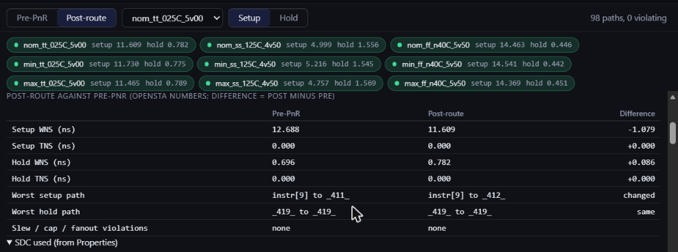
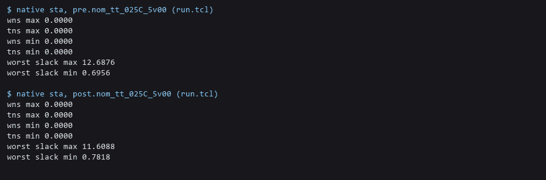

**NOT validated.** Designs other than tiny8; other corners (this section compares tt 25C 5V only; the nine-corner run is section 15); any case where `check_setup` or the max slew / capacitance / fanout lists are not empty (the lists were empty on tiny8, so only the "empty" output is compared); the Magic extractor path of Post-route STA (the Magic SPEF is checked in section 4.1, not re-run here); the runner (LibreLane) mapping of its own `stapostpnr` reports into the same Timing tab; SDC with false paths or multicycle paths (not offered in Properties); Safari/Firefox.

## 15. Multi-corner STA (2026-10-26, issue #72)

**Setup.** Same design and constraints as section 14 (tiny8, 24 ns, input and output delay 4.8 ns, load 0 pF, uncertainty 0.1 ns). Properties > Multi-corner (off by default) runs OpenSTA once per corner of the standard flow instead of once.

**The corners are copied, not chosen.** Source: the container's `$PDK_ROOT/gf180mcuD/libs.tech/librelane/config.tcl` (open_pdks 7b70722) and LibreLane's `config/pdk_compat.py` (quoted in issue #72). `LIB_SYNTH` tt_025C_5v00, `LIB_SLOWEST` ss_125C_4v50, `LIB_FASTEST` ff_n40C_5v50; `RCX_RULES`, `RCX_RULES_MIN`, `RCX_RULES_MAX` become `RCX_RULESETS nom_* min_* max_*`; `STA_CORNERS` = nom, min, max times tt, ss, ff (9 names); `DEFAULT_CORNER` = nom_tt_025C_5v00. Studio uses the same names (`STA_CORNERS` in `web/studio/engines/opensta.worker.js`). The 7t5v0 cell-library config itself sets no corner list.

**Our flow.** OpenSTA defec0b in WebAssembly (section 4), one OpenSTA process per corner as LibreLane does (`define_corners`, `read_liberty -corner`, `read_spef -corner`, `report_checks -corner`). Full libraries ss 125C 4.50 V and ff -40C 5.50 V are vendored gzipped next to the tt one (`web/vendor/gf180mcu/lib-ss4v5-full`, `lib-ff5v5-full`, about 2.8 MB each, downloaded only with Multi-corner on). Pre-PnR has no wires, so nom, min and max are the same there and only the three nom corners run (LibreLane also skips identical corners). Post-route runs all nine. During Routing, OpenRCX is run three times with the PDK's own rule files (`web/vendor/gf180mcu/rcx-pdk-7b70722/`, sha256 checked) and writes `tiny8.spef` (nom), `tiny8_min.spef`, `tiny8_max.spef`; each corner reads the SPEF of its prefix. If a routing was made without Multi-corner, or the Magic extractor is chosen, only one SPEF exists; then every corner uses it and the Timing tab and log say so.

**Traditional flow.** Container `gf180`, native `/foss/tools/openroad/bin/sta` 3.1.0 and `or-native-61:6f3f28c` OpenROAD. Script `docs/validation/sta-mc-compare.sh <dir>` (with `OUT=<dir> node web/studio/engines/pnr-flow.selftest.mjs tiny8` first): for each corner the same Tcl, the same netlists and SPEFs, the container's own `.lib` files (sha256 equal to ours), `sta -no_init -exit run.tcl`, then a full text diff. Logs: `logs/sta-mc/`.

| Corner | Pre setup / hold WNS (ns) | Post setup / hold WNS (ns) | Native text |
|---|---|---|---|
| nom_tt_025C_5v00 | 12.6876 / 0.6956 | 11.6088 / 0.7818 | identical |
| nom_ss_125C_4v50 | 6.9110 / 1.3937 | 4.9992 / 1.5556 | identical |
| nom_ff_n40C_5v50 | 15.1870 / 0.3927 | 14.4627 / 0.4461 | identical |
| min_tt / min_ss / min_ff | (same as nom, no wires) | 11.7299 / 0.7754; 5.2162 / 1.5447; 14.5408 / 0.4419 | identical |
| max_tt / max_ss / max_ff | (same as nom, no wires) | 11.4653 / 0.7894; 4.7566 / 1.5685; 14.3691 / 0.4511 | identical |
| Worst setup | | max_ss_125C_4v50, 4.7566 | |
| Worst hold | | min_ff_n40C_5v50, 0.4419 (pre-PnR: nom_ff_n40C_5v50, 0.3927) | |
| TNS (all corners) | 0 | 0 | identical |

All 12 runs (3 pre, 9 post) match native line by line (5598 lines pre, 7677 post). OpenRCX with the PDK min and max rules: native OpenROAD 6f3f28c on the same routed DEF gives the same 294 nets with identical net capacitances (nom / min / max sum 1.5696 / 1.4037 / 1.7693 pF); STA on the native SPEFs gives the same slacks, checked at min_tt and max_ss only; the other seven post-route corners were not run on native SPEFs. Native image: `hpretl/iic-osic-tools:chipathon26` plus `or-native-61:6f3f28c`. The SPEF files differ only in the numbering of the name map.

**Side by side.** Studio Timing tab (all corners table, Studio run with the tiny8 knobs of this section: 24 ns, 4.8 ns delays, 0 pF, die 135.52 x 133.28 um) and native `sta` worst-slack lines of six corners:

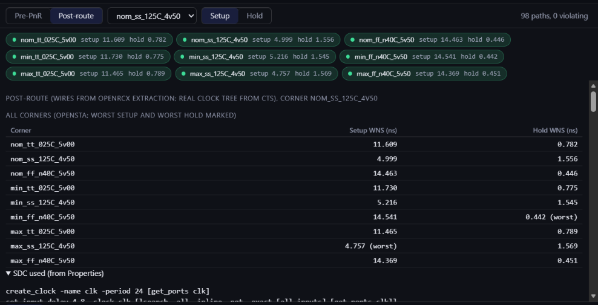
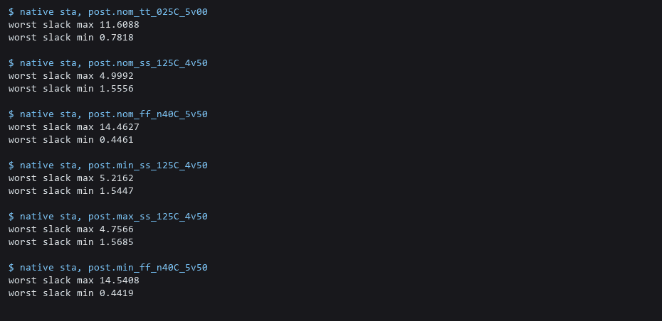

**Note on the nominal corner.** Single-corner and Multi-corner both use the PDK's `rules.openrcx.gf180mcuD.nom` for nom, so the single-corner run gives 11.6088 ns, the same as nom_tt. History: until 2026-10-26 single-corner used the ORFS typ rules, 11.6089 ns (#75).

**NOT validated.** Designs other than tiny8; the Pre-PnR min and max corners are not run (identical to nom without wires, as in LibreLane); OpenSTA's output was not compared with a full LibreLane run (its `stapostpnr` step also uses the real repaired netlist, the flow's own SDC and its own CTS); the other four 7t5v0 liberty corners (e.g. ss_n40C, ff_125C) and the 9-track library; timing repair per corner (the browser does not repair at all corners); the Magic-extractor fallback; the memory use on larger designs (each corner is one OpenSTA process in turn, so memory stays at one corner, but time grows nine-fold post-route); Safari/Firefox.

## 16. Cell delay lookup in the Timing tab (2026-10-26, issue #36)

**What it is.** A panel under the Timing tab (`web/studio/viewers/celldelay.js`). You pick a gf180 cell, an arc (pin to pin, with the liberty `when` condition if there is one), the output edge, an input slew and an output load. You guess the delay, then press Reveal: the widget shows the real NLDM tables from the liberty, marks the four surrounding points, and gives the delay and the output slew. Clicking an output-pin row of a path opens it filled in (checked by script only, not by clicking in the Timing tab; see Not validated) with that row's slew (from the input pin row) and load (Cap column). Nothing is estimated: the numbers come from the vendored full liberty (`web/vendor/gf180mcu/lib-{tt5v0,ss4v5,ff5v5}-full`, the Corner list of the panel) and the interpolation is the same one OpenSTA uses (find the segment `x[i] <= v < x[i+1]`, clamped to the first or last segment, then bilinear; outside the table this continues the end segment linearly).

**Our flow.** The browser parses the liberty and interpolates. "Run OpenSTA on this point" (single-input combinational cells) runs the browser OpenSTA (section 4, defec0b) on a one-cell netlist with `set_input_transition`, `set_load` and `set_false_path -<other edge>_to`, and shows OpenSTA's delay and slew next to ours. In a path, OpenSTA's number is the row of the report.

**Traditional flow.** Container `gf180`, native `/foss/tools/bin/sta` 3.1.0 (a different path from the `/foss/tools/openroad/bin/sta` of sections 14 and 15; checked 2026-11-10: `/foss/tools/bin/sta` is a symlink to `/foss/tools/openroad/bin/sta` (sha256 `ee433c20...`), both report 3.1.0, so it is the same binary (`logs/review/abc-sta.txt`, `logs/review/tools.txt`); defec0bda3, the same commit as our WebAssembly build), the container's own `gf180mcu_fd_sc_mcu7t5v0__tt_025C_5v00.lib` (`cmp` identical to ours). Per point: `read_liberty`, a netlist with one cell, `set_load L`, `set_input_transition S`, `set_false_path -<other>_to`, `report_checks -path_delay max -fields {slew cap input_pins} -digits 4`. Script and raw output: `docs/validation/logs/celldelay/all.sh`, `native-sta.out`. The test `node web/studio/viewers/celldelay.test.mjs` compares the widget's lookup with these numbers (`web/studio/viewers/celldelay.sta.json`).

| Check | Points | Result |
|---|---|---|
| Native OpenSTA vs widget: inv_1, inv_4, buf_2, clkbuf_4, rise and fall, 8 slew/load points each, 16 of the 64 outside the table (slew 6 ns, load 0.5 pF, slew 0.01 ns, load 0.0004 pF) | 64 delay + 64 output slew | match (rule used here: equal after rounding to the 4 printed digits, i.e. within 0.00005 ns); extrapolated points match as well |
| Browser OpenSTA (the button) vs widget: inv_1 rise at 0.5 ns / 0.09 pF, buf_2 fall at 1.3 ns / 0.15 pF | 2 x (delay, slew) | identical to 4 digits (1.0123 / 1.5371 and 0.9489 / 0.7671) |
| Studio Pre-PnR path row, flip-flop dffrnq_1 CLK to Q rising, slew 0, load 0.0667 | delay, slew | widget 1.4454 / 1.1608, report 1.4454 / 1.1609: close (one unit in the last printed digit; the load in the report is rounded to 4 digits) |
| Studio Post-route path row, buf_1 I to Z rising, slew 0.0001, load 0.0308 (tiny8) | delay, slew | differs: widget 0.4343 / 0.5638, report 0.4330 / 0.5443 |

**Why the post-route row differs (explained, not hidden).** After routing OpenSTA reads the wire parasitics (SPEF). It then calculates with the wire's resistance and an effective load that is lower than the total capacitance printed in the Cap column, so its delay and slew come out lower than a table lookup at the total load. The widget looks up the table at the printed total load and says so when the two differ by more than the 4-digit rounding. Without wires (Pre-PnR, or the one-cell run) the two agree. We did not reproduce the effective-capacitance calculation in the widget.

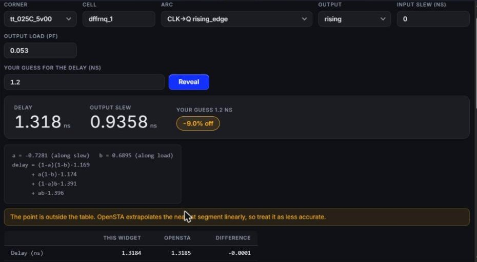

**NOT validated.** CCS and ECSM current-source models (only the NLDM tables, as in the default OpenSTA delay calculation of this flow). The effective-capacitance and wire-delay calculation after routing (see above). Setup, hold and other constraint tables (only cell delay and output slew). Cells with several `when` arcs on the same pins were only checked through the arc-matching in the path view, not against separate native runs per condition. 1-D or template-indexed tables are skipped. The ss and ff corner files use the same code but were not compared point by point. The panel was checked in Chromium at desktop width only. The screenshot is the widget mounted on its own, not inside the Timing tab (the Timing tab pre-fill was checked by script with the same data).

## 17. Verilator simulation in the browser (2026-10-26, issue #77)

**Design and setup.** tiny8 (`web/studio/engines/vsim-fixtures/tiny8.v`) with two testbenches: a C++ one (`tb.cpp`, 2000 cycles, writes `w.vcd` with `VerilatedVcdC`) and a SystemVerilog one (`tb.sv`, `$dumpfile`/`$dumpvars`, 1000 clock cycles, `$finish`). The check: the VCD our browser flow writes must be byte for byte the VCD native Verilator writes for the same sources.

**Our flow, built this way.** Studio, Properties, Simulation engine, "Verilator (C++ compiled in your browser)" (`web/studio/engines/verilator-sim.worker.js`). Steps, all in one Web Worker:
1. `verilator-wasm@1.0.0` (Verilator 5.051 devel, commit e6cee9d54) writes the C++: `--cc --exe --trace -O1` for a C++ testbench; `--cc --exe --main --timing --trace -O1 --top-module <tb top>` for a SystemVerilog one.
2. `@yowasp/clang@22.0.0-git20542-10` (LLVM built to WebAssembly) compiles one file that `#include`s every generated `.cpp`: `clang++ -std=c++20 -O1 -fno-exceptions <the -DVM_* flags from Verilator's own makefile> -Iinclude ... unity.cpp libverilated.a -o sim.wasm`.
3. `libverilated.a` is prebuilt once, from the Verilator `include/` at the same commit (`web/vendor/verilator-sim/5.051-e6cee9d/SOURCE.md`).
4. The result runs as a WASI program on the WASI shim and in-memory filesystem of `verilator-wasm`; the VCD is read from that filesystem and shown in the Waveform tab.

**Traditional flow.** Container `gf180` (`hpretl/iic-osic-tools:chipathon26`), native Verilator 5.046 (2026-02-28): `verilator --cc --exe --build --trace -O1 tb.cpp tiny8.v` for the C++ testbench, `verilator --binary --timing --trace -O1 --top-module tb tiny8.v tb.sv` for the SV one, then the generated executable.

**Version note.** The browser Verilator is 5.051 devel (the commit `verilator-wasm` is built from); the container has 5.046. The two writers differ by a few months of upstream changes, and the VCDs still came out identical for these designs. The compiler headers must match the Verilator that writes the C++, so we vendor the headers from the `verilator-wasm` commit, not from the container.

| Check | Result |
|---|---|
| C++ testbench VCD, browser flow vs native 5.046 | identical (112,654 bytes, SHA-256 equal) |
| SV testbench (`--main --timing`) VCD, browser flow vs native 5.046 | identical (105,285 bytes, SHA-256 equal) |
| Console text of the SV run (`done pc=67 out=6`) | same as native |
| Native build time, `-j4`, `--trace` (container), C++ and SV testbenches not told apart | 7.5 to 7.9 s |
| Native run time and peak memory | not recorded |
| Browser build, warm (compiler cached), tiny8 | 10 to 15 s for C++ compile + link; run 0.01 to 0.03 s |
| Browser, first run (compiler downloaded from jsDelivr, fast link) | 20.5 s in total |
| Peak memory (Node, one compile) | 540 to 590 MB for the compiler, 52 MB to run the result |
| Compiler download | about 25 MB sent (br), 105 MB unpacked; cached in the browser (Cache API) after the first run |

Per-file compiling costs about 6 s per C++ file (starting the compiler and reading the Verilator headers dominate), which is why we compile one combined file: 10 to 15 s instead of about 55 s. `-O0`, `-O1` and `-O2` were within one second of each other here.

Repeat: `cd <scratch> && npm i @yowasp/clang@22.0.0-git20542-10 verilator-wasm@1.0.0 && node <repo>/web/studio/engines/verilator-sim.selftest.mjs` (checks the two hashes in `vsim-fixtures/native-vcd.json`). The scripts that built `libverilated.a` are in `tools/vsim-spike/`.

**Side by side.** Browser: Studio with shreg4, the Verilator engine, the console showing "C++ compiled and linked in 12.9 s", the testbench's `PASS q=0110` and the Waveform tab. There is no native screenshot: the native comparison is a byte-for-byte file match, which has nothing to look at. The picture shows shreg4, whose VCD was not compared with native; tiny8, the only compared design, was run in Node only, with no page screenshot.

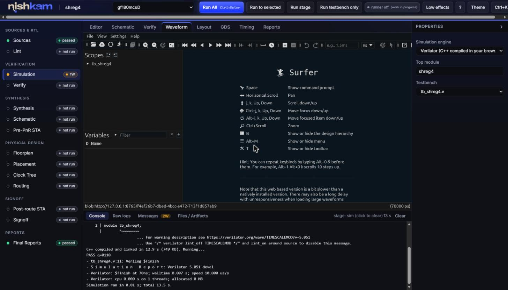

**NOT validated.**
- Designs and testbenches other than tiny8 (shreg4 ran in the browser and printed `PASS`, but its VCD was not compared with a native one).
- UVM, DPI, `$readmemh`/file input, `--coverage`, multi-threaded models (`--threads`) and FST output: not built or not enabled; the model runs on one thread.
- Large designs: memory and compile time were measured only on tiny8-size designs. A big design may exceed the browser's memory or take minutes to compile.
- Exceptions: the compiler's C++ library has none, so everything is built with `-fno-exceptions`.
- Safari and Firefox (Studio was checked in Chromium only); the numbers above come from one PC.
- The timings of the first browser run depend on the network to jsDelivr.

## 18. Analog: ngspice in the browser (issue #86)

**Design and setup.** Five small decks on gf180mcuD, typical corner, 27 C, in `docs/validation/analog/decks/`: NMOS Id-Vg (`nfet_03v3`, W=1u L=0.28u), PMOS Id-Vg (`pfet_03v3`, same size), 1:1 NMOS current mirror (W=2u L=1u, 10 uA), a 5-transistor OTA (open-loop AC, 20 uA tail, 1 pF load) and an inverter transient (W=1u/2u, 10 fF load, 3.3 V). The check: the same deck, the same model files, must give the same numbers in the browser build and in native ngspice.

**Our flow, built this way.** ngspice-46 from the official release tarball (sha256 `a0d1699a...`), no source patches, built with Emscripten 3.1.74 (`web/vendor/ngspice/46/SOURCE.md`, `build.sh`). Configure: `--without-x --with-readline=no --disable-openmp --disable-xspice --disable-cider`, `-O2`. KLU is compiled in (ngspice 43 and later enable it by default; the page log prints "Compiled with KLU Direct Linear Solver"), but these decks ran on SPARSE 1.3, the same as native. No threads. The models are the container's own files from open_pdks 7b70722 (`web/vendor/gf180mcu/models-7b70722/`: `design.ngspice`, `sm141064.ngspice`, `sm141064_mim.ngspice`). The container's sha256 values were taken on 2026-11-10 (`inventory.txt`, section sha256) and the three vendored files give the same values: `design.ngspice` `091cb530...6692`, `sm141064.ngspice` `677822db...3c46`, `sm141064_mim.ngspice` `b7918b5a...9767` (full values in `inventory.txt`). So the model files are byte-identical. Only `design.ngspice` and `sm141064.ngspice` are used by the decks; `sm141064_mim.ngspice` is vendored for later and is NOT validated (no deck has a MIM cap). The browser needs `/proc/meminfo` in its virtual disk and a `~/.spiceinit` with `set ngbehavior=hsa` (the gf180 models need it; the container sets this and three more: `ng_nomodcheck`, `num_threads=4`, `enable_noisy_r`, which the browser run does not set). Run by `node docs/validation/analog/run-browser.mjs` (Node, same `.wasm` and `.js` the page loads); logs are in `docs/validation/analog/browser/`.

**Traditional flow.** Container `gf180` (`hpretl/iic-osic-tools:chipathon26`), `ngspice-46` (compiled with KLU, built 2026-04-16), open_pdks 7b70722, models in `/foss/pdks/gf180mcuD/libs.tech/ngspice/`, the first native runs applied no `.spiceinit` at all ("No compatibility mode selected"); the re-run with `ngbehavior=hsa`, `ng_nomodcheck`, `num_threads=4`, `enable_noisy_r` is described under "Explained 2026-11-10" below. Each deck ran with `ngspice -b -o <deck>.log <deck>.cir` via `docs/validation/analog/run-native.sh`; results are in `docs/validation/analog/native/`. Both logs say "Using SPARSE 1.3 as Direct Linear Solver" (both binaries have KLU compiled in, but ngspice uses SPARSE unless a deck sets `.options klu`, and these decks do not), so the solver is the same.

| Quantity | Native ngspice-46 | Browser build ngspice-46 (run in Node) | Result |
|---|---|---|---|
| NMOS Id (Vgs=Vds=1.65 V) | -1.49706e-04 A | -1.49706e-04 A | match |
| NMOS Vth / Vdsat / gm | 0.6249512 V / 0.6546577 V / 196.3739 uS | same, all digits printed | match |
| PMOS Id (Vsg=Vsd=1.65 V) | 5.125095e-05 A | 5.125095e-05 A | match |
| PMOS Vth / Vdsat / gm | 0.7006352 V / 0.8159598 V / 85.84982 uS | same | match |
| Mirror Iout at Vo=1.65 V (Iref 10 uA) | 10.1683 uA (ratio 1.0168) | 10.1683 uA | match |
| Mirror M1 / M2 Vth | 0.6846909 / 0.6846896 V | same | match |
| OTA output DC | 2.361618 V | 2.361618 V | match |
| OTA gain at 1 Hz | 47.9036 dB | 47.9036 dB | match |
| OTA unity-gain frequency | 20.6745 MHz | 20.6745 MHz | match |
| OTA phase margin | 84.30338 deg | 84.30338 deg | match |
| OTA M1..M5 Vth, Vdsat, Vds, Vgs | see `native/ota5t_ac.log` | all 20 values equal | match |
| Inverter tpHL | 60.5040 ps | 60.5040 ps | match |
| Inverter tpLH | 66.7168 ps | 66.7168 ps | match |

**Tolerance.** We call a number a match when it agrees to the digits ngspice prints (ngspice prints 5 to 7 significant digits, so about 1e-5 relative or better) and the target was 0.5%. Every printed result number is identical (the browser log has one extra warning line, below). For the raw files we call a vector a match if its difference is within 1e-6 of its largest value; this limit was chosen after seeing the data (worst 2.7e-7), not before. We also compared the full ASCII raw files (every point of every plotted vector) against the native raw files, first as max difference divided by the largest value in the file; this was corrected, see the next line:

Correction: the first version of this table divided every difference by the largest value in the whole file, which is the 3.3 V sweep axis, so the current columns looked far better than they are. The table below is per vector (each vector divided by its own largest native value), made by `run-browser.mjs`:

| Deck | Points (native / browser) | Max difference / largest value, per vector (all within 1e-6: match) |
|---|---|---|
| nmos_idvg (2-D sweep) | 662 / 662 | v(g) 0, i(vd) 5.2e-11 |
| pmos_idvg (2-D sweep) | 662 / 662 | v(g) 0, i(vd) 2.0e-12 |
| mirror (DC sweep) | 331 / 331 | i(vo) 2.7e-7, v(ref) 7.9e-8 |
| ota5t_ac (AC, 1 Hz to 1 GHz) | 181 / 181 | frequency 0, v(out) 0 (complex values: real and imaginary parts combined) |
| inv_tran (transient, 60 ns) | 6026 / 6026 | time 0, v(in) 0, v(out) 0 (even the time steps are the same) |

**Bias coverage.** The Id-Vg decks write the whole sweep, not one point: Vgs 0 to 3.3 V in 10 mV steps at Vds = 0.1 V (linear region) and Vds = 3.3 V (saturation), 331 points each. Vth is 0.625 V (NMOS), so the sweep runs from deep subthreshold, through threshold, to strong inversion; the max difference above is over all 662 points. The mirror sweeps Vo from 0 to 3.3 V (triode to saturation of M2). The OTA is checked at one DC point plus the AC curve. gds is not probed or compared in any deck (only gm, Vth, Vdsat and the currents/voltages in the raw files), so output conductance is not validated on its own.

**Negative control (can the comparison fail?).** Run `PERTURB=nmos_idvg:W=1u:W=1.001u node docs/validation/analog/run-browser.mjs`. This changes the NMOS width in the browser run only (0.1 percent) and compares against the unchanged native raw file with the same method. Result: Id at the bias point becomes -1.49850e-04 A (native -1.49706e-04 A) and the i(vd) difference is 9.6e-4, about seven orders of magnitude above the 5.2e-11 of the unperturbed run. The other decks stay at their normal values. So a 0.1 percent change is clearly visible and a real mismatch would be caught.

The transient took the same 6026 time points, so the step-size control behaves the same. The small non-zero difference on the first three (up to 2.7e-7) is larger than double-precision rounding would give; the cause is not known (a different compiler and maths library, or a solver step that stopped one iteration apart, are guesses and were not tested). The Id-Vg decks also contain a separate `op` at Vgs=Vds=1.65 V, which is where the 1.65 V rows of the first table come from. Run times: 63 to 197 ms per deck are warm runs in Node with the same `.wasm` (module already loaded, one PC). They are not browser timings. In a real browser (Edge, Lab page, starter `ota5t` deck, `http://localhost:8040/lab.html?mock`) the page console reports `Simulation passed in 216 ms`; this was one run and the time to fetch the 4.9 MB `.wasm` first was not timed separately.

One note: the browser log shows the line `Warning: m=xx on .subckt line will override multiplier m hierarchy!` (from the gf180 model wrapper). The native logs do not contain it. **Explained 2026-11-10:** the earlier native runs did not apply the container's `~/.spiceinit` at all (their logs say "No compatibility mode selected"; the browser logs say "Compatibility modes selected: hs a", because `run-browser.mjs` writes `ngbehavior=hsa` into its own `.spiceinit`), so the two sides ran in different compatibility modes, and the warning is printed only in `hsa` mode. Re-running all five decks natively with a `.spiceinit` in the working directory (`ngbehavior=hsa`, `ng_nomodcheck`, `num_threads=4`, `enable_noisy_r`; logs in `analog/native-hsa/`) prints the warning in all five (count 1 each) and every printed result number is identical to both the earlier native logs and the browser logs. So the modes differ, the numbers do not. The earlier statement in this section that the native runs used that `.spiceinit` was wrong and is corrected here. (The `grep -c` check on the original native run gave 0; with `hsa` it gives 1.)

**KLU on both sides (2026-11-10).** `.options klu` added before `.control` in `mirror` and `ota5t_ac`; native ngspice-46 and the browser build both print "Using KLU as Direct Linear Solver", and every printed result number is identical between the two, and identical to the SPARSE runs (`analog/klu/`). The raw files of the native KLU run were not compared point by point (the browser KLU raw file against the native SPARSE raw gave the same 2.7e-7 on `mirror` as before). KLU on larger circuits is still not tested.

**Tool versions (2026-11-10).** Container image digest `hpretl/iic-osic-tools@sha256:b3a754709b6d71bf11ce9357c07d2d63b6a4562c2a36b20c1dde33dd0079a9b4`; `ngspice-46` "Compiled with KLU Direct Linear Solver"; gcc 13.3.0 (Ubuntu 13.3.0-6ubuntu2~24.04.1) (`logs/review/tools.txt`). Native compiler flags of the ngspice build were not recorded.

**Lab page check (pipeline only, not a native comparison).** On 2026-11-10 the Lab page (deck builder, raw-file reader, plots) was run in a browser. For the `ota5t.spice` starter (W=10u L=1u, so a different deck from the validation `ota5t_ac`): gain_dc 47.976 dB and ugf 20.741 MHz, the same from the hand-written deck and from the drawn schematic. A 3-analysis deck gave gain_dc 47.976, ugf 2.0741e7, vmax 2.36119, vo 2.36119 and 4 plot canvases. These show the page reads and plots ngspice output; they are not compared with native. Screenshot of the Plots tab for the starter deck: `docs/validation/img/lab-plots-starter.png`.

**Side by side.** (A gap against our own rule, not a pass.) No native-versus-browser screenshots: the comparison is a number and file match (tables above).

**NOT validated.**
- Corners other than typical (ss, ff, fs, sf), temperatures other than 27 C, and the 5 V / 6 V devices.
- Mismatch, Monte Carlo and the `statistical` models; noise analysis (`.noise`); `.tf`, `.pz`; temperature sweeps.
- Circuits bigger than these five decks (the five decks used SPARSE; KLU was run on two small decks only, see "KLU on both sides"; KLU on large netlists is not compared); memory and run time limits.
- Other model blocks: diodes, BJTs, resistors, MIM and MOS caps (the decks do not use them). `sm141064_mim.ngspice` is vendored but never used by a deck.
- XSPICE code models and CIDER are compiled out of the browser build (`--disable-xspice --disable-cider`); the native binary has code models. Any deck needing them will not run in the browser.
- Memory: the browser build gets a fake `/proc/meminfo` and has a wasm32 memory ceiling (4 GB at most). Behaviour near that limit is untested.
- gds and other small-signal conductances (see bias coverage).
- `sm141064_mim.ngspice`: same files as the container, but no simulation uses it.
- Every browser. All native-against-WebAssembly comparisons here were run in Node. The Edge run of the Lab page used a different deck and was not compared with native, so no browser is validated against native ngspice in this section; the Lab page in Edge is compared in section 18B (Chrome, Firefox and Safari are not).
- No side-by-side screenshots; native compiler flags and full-length sha256 values are not in this section; the image digest is recorded above.
- The browser does not run the native binary's multi-thread path, and the multi-thread path is not exercised; KLU was exercised on two small decks only.
- A good analog design: these decks only check the simulator.

## 18B. Analog: more decks, corners and the Lab page (issue #192)

**Design and setup.** Eight plain gf180mcuD decks in `docs/validation/analog-decks/` (`*.cir`; only `nfet_03v3`, `pfet_03v3`, ideal R/C/L and sources): the 5-transistor OTA at typical, ss and ff (`ota5t_tt/ss/ff`; same transistor sizes, 20 uA bias and 1 pF load as section 18, written inline, but using the Lab starter `web/analog/ota5t.spice` biasing: 1.65 V input common-mode with balanced +/-0.5 V AC drive instead of section 18's 1.5 V single-ended 1 V AC drive, which raises DC gain by 0.072 dB and UGF by 66.5 kHz compared to section 18's `ota5t_ac`), a two-stage Miller op-amp (`miller`: AC gain, unity-gain frequency, phase; DC feedback through a 1 GH inductor so the output sits at its real bias point), a 5-stage ring oscillator (`ring5`: period, `.tran`), a StrongARM latch comparator (`strongarm`: decision time, `.tran`), a beta-multiplier current reference (`bmr`: `.dc temp -40 125 5`, read at -40 / 27 / 125 C) and an NMOS source follower (`follower`: `.dc` transfer plus `.ac` supply-to-output PSRR, two analyses in one deck). A bandgap with bipolar devices and an LDO were not built (see NOT validated). The check: the same deck text and the same model files must give the same numbers in the browser build and in native ngspice. Each plain deck is turned into the exact text the Lab page runs (the auto control block of `web/analog/control.js`: `op`, the device probes, the analyses, `.meas`, `write`) by `make-page-decks.mjs` into `page/`. The probes were `vth vdsat gm gds vgs vds id` per transistor when this section was measured; `cgg`, `w` and `l` were added later for the Devices table (issue #187) and add no analysis. Native, Node and the page all ran that same text.

**Our flow, built this way.** Same as section 18: ngspice-46 built with Emscripten 3.1.74 (`web/vendor/ngspice/46/SOURCE.md`), models from open_pdks 7b70722 (`web/vendor/gf180mcu/models-7b70722/`, byte-identical to the container's, section 18), `.spiceinit` with `ngbehavior=hsa`, `ng_nomodcheck`, `num_threads=1`, `enable_noisy_r` as `web/analog/ngspice.worker.js` writes it. Two ways to run it: (1) `node docs/validation/analog-decks/run-browser.mjs` (Node, same `.wasm`/`.js`, 3 runs per deck, writes `browser/*.log`, `browser/summary.json`, `browser/run.txt`); (2) the real Lab page, `http://127.0.0.1:8177/lab.html?mock` served by `python -m http.server` from `web/`, driven in Microsoft Edge (Playwright, `channel: msedge`, script kept outside the repo): the plain deck is pasted into the editor, Run All, and the numbers are read from the Reports tab (`browser/page-edge.json`). All 8 decks ran in the page.

**Traditional flow.** `ngspice-46` from the image `hpretl/iic-osic-tools:chipathon26` (digest as in section 18; compiled with KLU, SPARSE used), open_pdks 7b70722 models at `/foss/pdks/gf180mcuD/libs.tech/ngspice/`. `docs/validation/analog-decks/run-native.sh` runs `ngspice -b -o log deck.cir` on each `page/*.cir` (3 times each, wall time recorded) with a `.spiceinit` in the working directory (`ngbehavior=hsa`, `ng_nomodcheck`, `num_threads=4`, `enable_noisy_r`; the log says "Compatibility modes selected: hs a"). Logs and raw files are in `native/`. On 2026-11-21 the container `gf180` would not start (host port 8080 was busy), so a throw-away container of the same image was used (`docker run --rm`, no ports); the tool and the model files are the same. Both sides print "Using SPARSE 1.3 as Direct Linear Solver" for every deck.

**Numbers (browser build in Node vs native; the Lab page column is what the Reports tab showed, about 5 significant digits).**

| Deck | Measurement | Native ngspice-46 | Browser (Node) | Browser (Lab page, Edge) | Relative difference | Result |
|---|---|---|---|---|---|---|
| ota5t_tt | DC gain / UGF / phase at UGF | 47.976 dB / 20.741 MHz / -1.67011 rad (PM 84.31 deg) | identical, all digits | 47.976 / 20741000 / -1.6701 | 0 | match |
| ota5t_ss | DC gain / UGF / phase | 48.0524 dB / 19.9491 MHz / -1.66939 rad | identical | 48.052 / 19949000 / -1.6694 | 0 | match |
| ota5t_ff | DC gain / UGF / phase | 47.7555 dB / 21.5290 MHz / -1.67074 rad | identical | 47.755 / 21529000 / -1.6707 | 0 | match |
| miller | DC gain / UGF / phase at UGF | 93.7968 dB / 21.7633 MHz / -2.49629 rad (PM 36.97 deg) | identical | 93.797 / 21763000 / -2.4963 | 0 | match |
| ring5 | period / max / min of v(n1) | 412.202 ps (2.426 GHz) / 3.40667 V / -0.0916378 V | identical | 4.122e-10 / 3.4067 / -0.091638 | 0 | match |
| strongarm | decision time (clk 50 % to outn 50 %) / outn, outp at 6 ns | 276.729 ps / 1.52483e-8 V / 3.3 V | identical | 2.7673e-10 / 1.5248e-8 / 3.3 | 0 | match |
| bmr | v(g1) at -40 / 27 / 125 C | 0.908136 / 0.908611 / 0.931564 V | identical | 0.90814 / 0.90861 / 0.93156 | 0 | match |
| bmr | v(s2) = I x 10k at -40 / 27 / 125 C | 82.8853 / 108.879 / 154.000 mV | identical | 0.082885 / 0.10888 / 0.154 | 0 | match |
| follower | Vout at Vin = 2.2 V / 3.0 V | 1.18846 / 1.85011 V | identical | 1.1885 / 1.8501 | 0 | match |
| follower | PSRR at 1 Hz / 1 MHz / 100 MHz | -47.2144 / -47.2178 / -56.6626 dB | identical | -47.214 / -47.218 / -56.663 | 0 | match |

Every printed `.meas` number is identical to all printed digits (relative difference 0 in the log text). The page shows fewer digits (its own formatting) and agrees with native at those digits. The device probe values that the page deck prints (7 per transistor, so `gm` and `gds` are compared too) are also identical: 21 to 77 values per deck, max relative difference 0 for all 8 decks (`browser/run.txt`).

**Raw files, every point.** `op.raw` and `out.raw` (binary) compared vector by vector against native, max difference divided by that vector's own largest value (complex values: real and imaginary parts combined; same method as section 18):

| Deck | Analysis, points | Vectors | Worst relative difference | Result |
|---|---|---|---|---|
| ota5t_tt / ss / ff | AC, 181 | 24 each | 0 (bit-identical) | match |
| miller | AC, 181 | 26 | 0 | match |
| follower | DC 47 + AC 91 | 25 | 0 | match |
| bmr | DC temperature sweep, 34 | 17 | 6.1e-15 (supply current) | match |
| ring5 | transient, 4008 | 18 | 2.0e-13 (i(vdd)); time steps equal | match |
| strongarm | transient, 3044 | 30 | 1.4e-13 (i(vp)); time steps equal | match |

Both transients take the same number of time steps on each side, and the StrongARM latch (exponential gain on a 5 mV input) still ends on the same value to 1e-13, so the solver path is the same. This is tighter than section 18's 2.7e-7 on the `mirror` DC sweep; the cause of that earlier difference is still unknown and it did not show up here. The Vectors column totals `op.raw` (1 point) plus `out.raw` sweep vectors, including scalar `.meas` variables that `web/analog/control.js` currently writes into `out.raw` because `.meas` runs before `write`.

**Negative control.** `run-browser.mjs` checks every printed `.meas` value, every device operating-point probe, and every raw-file vector against a stated relative tolerance of `1e-6` (NaN-safe, and checking that every expected `.meas` is present and finite) and exits non-zero if any check fails. Running `PERTURB="ota5t_tt:^XM[12] :W={wn}:W=10.1u" node run-browser.mjs` changes only the OTA input-pair widths (`XM1` and `XM2`, leaving the tail mirror `XM5`/`XM6` unchanged) by 1 % in the browser run only. Result: exit code 1 (45 checks failed); `gain_dc` 47.9871 vs native 47.976 dB (relative 2.31e-4), `ugf` 20.8052 vs 20.741 MHz (3.10e-3), `ph_ugf` -1.67049 vs -1.67011 rad (2.28e-4), device probes up to 3.82e-3, raw AC vector difference up to 8.21e-3 (`out:AC Analysis:i(vcn)`). So the comparison fails with a non-zero exit code on a 1 % input-pair change, far above the 0 to 2.0e-13 seen on the unperturbed decks.

**Run times (one PC, Windows 11, shared load; median of 3 unless noted).** Node/WASM with a warm module (not a browser time): OTA decks 101 to 109 ms, miller 115, follower 123, bmr 114, ring5 829, strongarm 568. Native ngspice in the container (`docker run` process start not counted, but the ngspice process start is): 97 to 272 ms for the AC/DC decks (OTA 100 to 115, miller 97, follower 139, bmr 272), ring5 581, strongarm 834. Lab page in Edge (one run each, a fresh WASM instance per run, models cached; the first deck also fetched the 4.9 MB `.wasm`): 218 to 284 ms for the AC/DC decks, ring5 634, strongarm 564. So the WASM build is about 0.4 to 1.4 times the native time on these small decks, and the page takes about 0.8 to 2.7 times the Node time (module start-up and parsing; times vary with machine load). None of these decks is big enough to say anything about large circuits.

**Page screenshots** (Reports tab after Run All, Edge): `img/analog-lab-ota5t_tt.png`, `img/analog-lab-miller.png`, `img/analog-lab-ring5.png`, `img/analog-lab-strongarm.png`. These are not side by side with native (native has no page); the numbers are in the tables above.

**Page issues met while doing this.** (1) The Reports footer always says "gf180mcuD typical corner", also for the ss and ff decks (known; the PVT selector is #184). (2) `ph_ugf` is printed in radians with no unit, so a hand-made phase margin 180 + ph_ugf is wrong; native ngspice prints the same radians, but the page deck never sets `units=degrees`: new issue #195. (3) `.step` / `.step temp` is not supported (known, #185), so the temperature sweep used `.dc temp`. (4) On the localhost run the console shows CORS errors for the `/flags` call and Cloudflare insights, because the page is served from 127.0.0.1; they are not Lab simulation errors. No wrong number was found in the page.

**NOT validated.**
- Source/drain diffusion parasitics (the Lab's ad/as/pd/ps are in section 18C): none of the 8 decks set `ad`, `as`, `pd`, `ps`, `nrd` or `nrs` (the model defaults leave them at 0), so BSIM4 junction capacitance, diode leakage and diffusion resistance are zero; in `ring5`, only stage 1 (`n1`) has an explicit 5 fF load.
- A bandgap with bipolar devices (no `pnp` deck; the beta-multiplier is MOS only) and an LDO with an error amplifier and pass device (the source follower is the only supply-rejection deck). BJT and resistor model blocks are still not exercised.
- Corners fs and sf, 5 V / 6 V devices, and temperatures other than the three read from the bmr sweep (the OTA corners ran at 27 C only).
- Mismatch / Monte Carlo, `.noise`, `.pz`, `.tf`. (`.step` is in section 18C.)
- Circuits larger than about 80 devices; KLU (only SPARSE was run); native multi-thread paths (native had 4 threads set but these decks are too small to use them; the browser is single-thread).
- The numbers agree, which does not mean the decks are good circuits: the Miller op-amp has no zero-nulling resistor (PM 37 deg) and the beta-multiplier current moves 86 % over -40 to 125 C. They only test the simulator.
- Browsers: the page runs were Microsoft Edge only, on one machine. Chrome, Firefox and Safari were not run. The Node runs use the same WASM file but are not a browser.
- The Lab page's plots, schematic editor and Devices table were not compared with native here; only the Reports numbers were read.
- The Devices table's later figures (Vov, ro, Id/(W/L), fT; issue #187) are arithmetic on ngspice's own `vgs`, `vth`, `id`, `gds`, `gm`, `cgg`, `w` and `l` probes. Only the probes `vth vdsat gm gds vgs vds id` were compared above; `cgg`, `w` and `l` were added later (issue #187) and were not compared with native, so `fT` and `Id/(W/L)` are not checked either, but the derived numbers were not read back from the page and compared with a hand calculation; `fT = gm / (2*pi*Cgg)` is the small-signal definition using ngspice's `cgg`, not a measured transition frequency.
- Run times are small single-machine samples; no large-circuit memory or time limit was tested.
- Native compiler flags were not recorded (see section 18).

## 18C. Analog Lab: .step sweeps, schematic parts, junction parasitics, starter circuits (issues #185, #186, #187, #191)

**Design and setup.** Four Lab features added after section 18B, each checked by running the same deck text in the browser ngspice-46 (WebAssembly, same build and models as section 18B) and in native ngspice-46 (same image, models and `.spiceinit` as section 18B; the container was `gf180v`, same image). Decks: (1) `.step` (#185): an RC low-pass stepped over R = 1k/2k/4k, and a diode stepped over `.step temp -40 27 125`; the Lab turns `.step` into an ngspice `foreach` loop with `alterparam` / `option temp`, `reset`, then the analysis, and appends the plots per step. (2) Schematic parts (#186): a diode clipper, an NPN common-emitter stage (the gf180 `bjt_typical` model line is added to the deck) and a voltage-controlled voltage source (E) amplifier, each built in the schematic editor in Edge; the generated deck was also run native. (3) Junction parasitics (#191): the Lab now writes `ad`/`as` = W x 0.44 um and `pd`/`ps` = 2 x (W + 0.44 um) on schematic-built FETs. `docs/validation/analog-decks/diffusion-check.mjs` writes `diffusion/{ring5,ota5t_tt}_{plain,diff}.cir` (the page deck from section 18B, plain and with those four parameters on every FET) and runs them in the browser build. (4) Starter circuits (#187): five schematics in the Examples menu (`web/analog/examples.js`).

**Numbers (native ngspice-46 vs browser build; same deck text).**

| Feature | Measurement | Native | Browser | Result |
|---|---|---|---|---|
| `.step` R (#185) | RC bandwidth at R = 1k / 2k / 4k | 159156 / 79578 / 39789 Hz (1/R, as expected) | identical | match |
| `.step temp` (#185) | diode i(v1) at 0.6 V, -40 / 27 / 125 C | -1.92565e-7 / -1.18720e-4 / -3.55153e-2 A | identical | match |
| Diode clipper (#186) | v(out) / i at the `.dc` point | 0.237018 V / -2.76298 mA | identical | match |
| BJT common emitter (#186) | Ic / collector voltage at base 0.78 V and 0.82 V | -156.517 uA / 3.22214 V and 3.00232 V | identical | match |
| E source amplifier (#186) | vout / i(e1) | 1.00000 V / -1.000 mA | identical | match |
| Junction parasitics, `ring5` (#191) | period without / with ad,as,pd,ps | 412.2 ps / 493.9 ps (frequency -16.5 %) | same to 6 digits on both decks | match |
| Junction parasitics, `ota5t_tt` (#191) | UGF without / with | 20.741 / 20.424 MHz (-1.5 %) | same to 6 digits on both decks | match |

The first five rows come from the issue comments (#185, #186); only the parasitics script is kept in the repository, so those rows cannot be re-run from this folder. The `.step` and parts circuits also ran in the Lab page in Edge with the same numbers (screenshots in `docs/img/lab-step/` and `docs/img/lab-parts/`; not side by side with native, native has no page).

**Starter circuits are examples, not validation claims.** Their `.meas` values (for example the Miller example: DC gain 63.6 dB, unity-gain frequency 12.8 MHz) come from the Lab's own ngspice. `web/analog/examples.test.mjs` checks that each parses, builds, runs with exit 0 and gives values in the expected range. They were not compared with a traditional flow, and the Lab does not claim they are good designs.

**Found while checking.** The gf180 diode clipper gives v(out) = 0.0769 V with a `.dc` step of 0.1 V and 0.237 V with a step of 0.5 V, in native and in the browser alike (solver path, not a port difference).

**NOT validated.**
- `.step`: only one `.step` line is supported; the op point and Devices table show base values, not stepped ones. Only the two decks above were compared.
- Parts: no pnp, no F/G/H sources, no BJT in a feedback bias circuit. Printed values only were compared, not raw files.
- Parasitics: the formula (0.44 um from the gf180mcuD KLayout DRC rules CO.7 + CO.1 + CO.4) was not checked against a layout extraction; the check shows only that native and browser agree for the same parameters. Hand decks (section 18B) still have no diffusion.
- Starter circuits: not compared with native, not graded.
- Chrome, Firefox, Safari; large circuits.

## 19. Parasitic extraction: Magic vs KLayout-PEX (tiny8, gf180mcuD)

**Claimed:** nothing is validated here. This is a cross-check of two extractors on the same layout. Neither is treated as the reference, and neither result proves the other is right. Issue #114.

**Design and setup:** tiny8 final GDS from the RTL-to-GDS flow run (`20261112-060506-1d07aa`, gf180mcuD). The schematic for kpex is the LVS netlist of the same run (`final/spice/tiny8.spice`). 4063 transistors in both outputs.

**How our flow does it:** the in-browser Studio extraction is Magic (the browser build is upstream commit bed8d4f, `web/vendor/magic/*/SOURCE.md`). It was not run in this comparison. The Magic side here is the container's Magic 8.3.636 with `ext2spice` flat, cthresh 0 and rthresh 0.

**How the other tool was installed and run:** container `gf180` from `hpretl/iic-osic-tools:chipathon26`. KLayout-PEX 0.9.0 (`kpex extract --2.5D --mode CC`) on KLayout 0.30.8 (kpex warns that 0.30.13 is recommended). Wall time 23.3 min. Magic 8.3.636 in 19 s. `kpex --magic` failed (no `magicrc`), so it is not compared. Scripts and outputs are in the private kpex folder (`scripts/run_all.sh`, `scripts/compare.py`, `RESULTS.md`).

| Quantity | KLayout-PEX 2.5D | Magic 8.3.636 | Verdict |
|---|---|---|---|
| Caps, total (fF) | 3942.8 | 5055.5 | differs (-22%): 797.9 fF of the gap is one VDD-to-VSS cap in Magic (837 fF) that touches no signal net |
| Signal-to-ground caps (fF) | 1718.8 | 1979.8 | differs (-13%): Magic has more caps on internal diffusion nodes; reason not checked |
| Coupling caps, each once (fF) | 2185.1 | 2238.9 | close (-2.4%) |
| Total without VDD-VSS cap (fF) | 3903.9 | 4218.7 | differs (-7.5%) |
| Nets matched by name | 34 (ports) | 34 | match (clk, rst_n, instr, out, pc) |
| Nets matched by structure | 1912 of 2090 (91.5%) | | close: unique colour match, sanity-checked by terminal counts, not LVS |
| Top 10 nets (Magic total C), per-net diff | | | close to differs: from -5.1% to +10.3%, kpex higher on 9 of 10 |

**Not validated:** which tool is right (both are unchecked against measurement or a golden reference); the browser Magic build (bed8d4f) is not the container's 8.3.636, and the two were not compared on this layout (section 5 compares them on the old-flow layouts); kpex `--magic` (not run); cap values per device or per geometry; net-to-net correspondence from the LVS database (matched by structure only); the physical origin of the 837 fF VDD-to-VSS cap; the statement that kpex `$I` nets are cell-internal (inferred from the netlist). No screenshots yet.

## 20. OpenCDC clock-domain-crossing check in Studio (early, issue #113)

**Claimed:** nothing is validated as a sign-off check. The browser build of OpenCDC gives the same output as the native build on our 13 CDC cases. Its findings agree with our CDC grader on 8 of 13 cases. The stage is early and optional.

**Design and test set.** The cases are CDC designs from our CDC grader (`web/cdc-problems.js`: `cdc-sync2`, `cdc-async-fifo`, `cdc-pulse-sync`). Issue #113 names these groups: the two-flop synchronizer (7 cases), the FIFO reference and the FIFO "gray-late" case, the pulse synchronizer reference and a pulse one-flop case. The other 2 cases are not named in the sources. OpenCDC cannot give an input port a clock domain, so for the two-flop synchronizer the input is driven through a flop on `clk_a` in a wrapper. Only errors and warnings are counted; "info" (verified safe) is not.

**How our browser build was made.** Upstream OpenCDC at commit 4101730f63ccd687354ad6316566c9e77b5f1f80 (https://github.com/Ayoubbelguellaoui/CDC, Apache-2.0). Built to WebAssembly by `web/vendor/opencdc/4101730/build.sh`, run in Docker:
```
docker run --rm -v <parent of checkout>:/work -w /work emscripten/emsdk:3.1.74 bash build.sh
```
Details, from `web/vendor/opencdc/4101730/SOURCE.md`:
- cmake 4.x from pip (the image has 3.22; OpenCDC needs 3.28).
- Flags include `-DSLANG_USE_MIMALLOC=OFF`, `-sMODULARIZE -sEXPORT_ES6`, `-sALLOW_MEMORY_GROWTH`, `-fexceptions`.
- Patches: `opencdc-wasm.patch` (one narrowing cast in `crossing.cpp`, two includes in `socket_compat.h`), plus two `sed` edits to the fetched slang in `build.sh`.
- Output: `wasm/src/opencdc.{js,wasm}`, 5.2 MB (issue #113).

The Studio stage is "CDC check (early)" in Properties. It is optional and off by default (`web/studio/stages.js`, `web/studio/app.js`).

**How native was built and run.** Upstream 4101730 built unchanged; `ctest` passed 576 of 576 (issue #113, 2026-11-12). The 13-case runs, `RESULTS.md`, the build and run scripts and the logs are archived in `logs/opencdc/` (copied 2026-11-23 from `~/eda/designs/opencdc`; source and WebAssembly trees left out, they are large). Build commands: `logs/opencdc/scripts/build.sh` (cmake Release, `BUILD_TESTING=ON`, make -j8, ctest; logs `cmake.log`, `build.log`, `ctest.log`, `build.status`). Run commands: `logs/opencdc/scripts/run.sh` (inside the `gf180` container). The native compiler version is not recorded here.

**Numbers.**

| Quantity | Native OpenCDC 4101730 | Browser build (WebAssembly) | Verdict |
|---|---|---|---|
| Findings on the 13 cases (rule, severity, source, destination) | native output | same output | match on all 13 cases |
| Agreement with our CDC grader on RTL, the 13 cases | 8 of 13 | same as native (output matches) | differs on 5 (below) |
| Agreement before the input-port fix (phase 1, issue #113) | 5 of 13 | not recorded | historical, replaced by 8 of 13 |
| Browser build size | not applicable | 5.2 MB | not applicable |

The 5 cases that differ from our grader (issue #113, 2026-11-12; the numbered 13-case table is not in the repo, so this list and the case numbers in the Decision paragraph below are not reconciled by number): the two-flop synchronizer "bypass" and "inverted-output" cases (the issue notes these are not CDC problems), the FIFO Gray-pointer cases (OpenCDC still flags CDC001 and CDC002 on the wide Gray-pointer synchronizer), and the pulse one-flop case (not flagged).

**What is NOT validated.**
- Grader integration: our CDC grader does not use OpenCDC, and the grading path does not use it.
- The 5 differences are recorded, not fixed. No constraint removes the Gray-pointer finding, and the issue gives no further reason.
- The input-port workaround (a flop on `clk_a` in a wrapper) is not checked against a real input constraint, so results depend on the wrapper.
- No in-browser click-through yet. The Chrome check failed (issue #113). A live check only showed `opencdc.js` and `opencdc.wasm` served with status 200 and correct types.
- The repo selftest (`node web/studio/engines/opencdc.selftest.mjs`) runs 2 cases only (a clean synchronizer and a one-flop crossing). The 13-case comparison script is archived as `logs/opencdc/scripts/ours.mjs` (our side), with `table.py` for the table; it is not part of the repo test run.
- Other designs, other browsers, timing, and screenshots: not checked.

**Decision (issue #113).** OpenCDC is a Studio lint aid and is never used for grading. Reviewed by a second AI model (Gemini Argon), case by case against our grader: case 6 (port-level crossing), our grader is right; case 7 (bit-skew safety), the two tools apply different rules, so they are not comparable; cases 8, 9 and 13 (multi-bit Gray pointers, first-flop tap next to a 2-flop branch), OpenCDC is wrong. OpenCDC is better only for harness-free linting of open designs and for rules we do not have (for example unsynchronized resets).

**CDC grader holes found by the same review (2026-11-17, `web/cdc.test.mjs`).** The reviewer claimed four designs that should fail but pass. Each was built as a test and run against the grader before any change.

| # | Cheating design | Before | Fix | Now |
|---|---|---|---|---|
| 1 | extra `clk_a` flop feeds a kept `clk_b` chain, `q = d` | passes: confirmed | an output may not be driven straight from an input pin | fails (structure) |
| 1b | same, but `q = da` | fails already (timing check, "q did not follow"): claim false | none needed | fails |
| 2 | first synchronizer flop feeds two `clk_b` flops that reconverge | passes: confirmed | the first flop must feed exactly one place | fails (structure) |
| 3 | binary pointers as scalar flops `wb0..wb2`, one synchronizer per bit | passes: confirmed (bus grouping went by net name) | crossings are grouped as one bus per direction, not per name | fails (bus rule, one bit at a time) |
| 4 | flop built from `wdata ^ wbin[0]` crosses with one flop into read-side logic | passes: confirmed | only flops built purely from data ports skip the structure check | fails (structure) |

All 13 earlier cases keep their results. Still open: a flop built purely from `wdata` and used in read-side logic is still exempt (data-path flops are the registered read data case) and only the 16-step timing check covers it. Grouping by direction would wrongly flag two unrelated signals that cross the same way and change together; no current problem has that.

## 21. No-arithmetic rule for the adder problems (issue #127)

**Claimed:** a design for one of the four adder problems that uses an arithmetic operator (such as `+`) is rejected before the equivalence check. The rule checks structure only. The learner must build the carry network.

**Which problems.** The four problems with `noArith: true` in `web/problems.js`: `adder-manchester`, `adder-brent-kung`, `adder-kogge-stone`, `adder-han-carlson`. The rule and the cases ship in commit 9551747 (issue #127), which is on `main`.

**What the check does.** `noArithScript(top)` in `web/grader.js` runs this Yosys script on the user's file:
```
read_verilog -sv user.v
hierarchy -check -top <top>
proc; flatten; opt_clean
select -assert-none t:$add t:$sub t:$alu t:$macc t:$neg t:$mul t:$lt t:$le t:$gt t:$ge t:$div t:$mod t:$divfloor t:$modfloor t:$pow
```
If the `select` assertion fails, the grader stops with the message "Build the carry network yourself; '+' is not allowed here." A compile error or an empty module does not count as this rejection; the normal run reports it. When the rule fails, the equivalence check is skipped.

The cell list is the 15 types in the script, including `$div`, `$mod`, `$divfloor`, `$modfloor` and `$pow`. The shipped validation cases (table below, in `web/grader.validation.mjs`) test `+`, `-` alone (`a - ~b - ~cin`) and `/` alone (`a / b`). No case uses `%`, `**` or the floor variants, so those types are listed in the code but not exercised by a case.

**How it was tested.** `web/grader.validation.mjs` (cases below), with `@yowasp/yosys` 0.68.1207 in Node. Native Yosys was not run for this check. The run used a scratch copy of the files at 9551747 (before the five types above were added to the list); the `-` and `/` rows were re-run on the 15-type script on 2026-11-16, Node 26.7.0. The log of the 2026-11-23 run is `logs/grader/grader.validation-2026-11-23.txt` (Node 26.7.0, `node web/grader.validation.mjs`, no argument; the output folder is the default one). Command: `node web/grader.validation.mjs [outdir]`. The table below was generated from that log.

**Results.** The 2026-11-23 run printed 140 checks, all as expected: 12 "uses `+`, `-` or `/`" rejections and 128 case folders, covering 66 problem names (the 4 adder problems below and 62 others). The 24 adder checks are below (12 rejections, 12 case folders: reference, rule-off reference and one mutant per adder). The other 116 checks are the grader cases of section 10 and the other problems.

| Problem | Case | Design | Expected | Ours |
|---|---|---|---|---|
| adder-manchester | (none, printed) | uses '+': rejected by the structural check | rejected | rejected (message above) |
| adder-manchester | (none, printed) | '-' only (a - ~b - ~cin): rejected | rejected | rejected (message above) |
| adder-manchester | (none, printed) | '/' only (a / b): rejected | rejected | rejected (message above) |
| adder-manchester | c121 | reference equals a+b+cin (structural rule off) | proven | proven |
| adder-manchester | c122 | chain stage 2 passes a instead of the carry | fails | fails (first mismatch at cycle 4) |
| adder-manchester | c26 | reference vs itself | proven | proven |
| adder-brent-kung | (none, printed) | uses '+': rejected by the structural check | rejected | rejected (message above) |
| adder-brent-kung | (none, printed) | '-' only (a - ~b - ~cin): rejected | rejected | rejected (message above) |
| adder-brent-kung | (none, printed) | '/' only (a / b): rejected | rejected | rejected (message above) |
| adder-brent-kung | c123 | reference equals a+b+cin (structural rule off) | proven | proven |
| adder-brent-kung | c124 | one prefix cell missing (level 5, bit 4) | fails | fails (first mismatch at cycle 7) |
| adder-brent-kung | c27 | reference vs itself | proven | proven |
| adder-kogge-stone | (none, printed) | uses '+': rejected by the structural check | rejected | rejected (message above) |
| adder-kogge-stone | (none, printed) | '-' only (a - ~b - ~cin): rejected | rejected | rejected (message above) |
| adder-kogge-stone | (none, printed) | '/' only (a / b): rejected | rejected | rejected (message above) |
| adder-kogge-stone | c125 | reference equals a+b+cin (structural rule off) | proven | proven |
| adder-kogge-stone | c126 | one prefix cell missing (level 3, bit 7) | fails | fails (first mismatch at cycle 4) |
| adder-kogge-stone | c28 | reference vs itself | proven | proven |
| adder-han-carlson | (none, printed) | uses '+': rejected by the structural check | rejected | rejected (message above) |
| adder-han-carlson | (none, printed) | '-' only (a - ~b - ~cin): rejected | rejected | rejected (message above) |
| adder-han-carlson | (none, printed) | '/' only (a / b): rejected | rejected | rejected (message above) |
| adder-han-carlson | c127 | reference equals a+b+cin (structural rule off) | proven | proven |
| adder-han-carlson | c128 | one prefix cell missing (level 3, bit 5) | fails | fails (first mismatch at cycle 6) |
| adder-han-carlson | c29 | reference vs itself | proven | proven |

The "rule off" rows check that the function matches, with the structural rule switched off for that case. The "(none, printed)" rows are the rule checks; the log prints them without a case number.

**What is NOT validated.**
- Network depth and cell count are not checked. A lookup table, or a different prefix network that avoids `+`, passes if its function is right.
- Only the function (proven by k-induction for the reference cases) and the absence of the 15 listed cell types are checked. Other cell types are not checked.
- The check runs in the browser. It is not a security control.
- Native Yosys was not run for this check. The page itself was not clicked through for this rule.
- Only the four adder problems and the cases above were tested.

## 22. Python tests in Studio: cocotb-compatible subset (early, issue #67) - NOT YET VALIDATED

Studio can run `test_*.py` files with a small cocotb-compatible subset: our own scheduler in Pyodide (`web/vendor/pyodide/314.0.8/`) drives Icarus (`web/vendor/icarus/a275a9a/`) through a generated Verilog harness. It is not cocotb. No claim is made that it behaves like real cocotb. Supported so far: `cocotb.test`, `Timer`, `RisingEdge`, `FallingEdge`, `ClockCycles`, `Clock` (via `start_soon`), `dut.x.value` read and write, `assert`. Writes take effect at once (real cocotb applies them in a later phase). Values with x or z read as `None`.

Not validated: no side-by-side run against real cocotb with Icarus in the gf180 container has been done yet. That comparison (same tests, same pass/fail and failure messages, screenshots, numbers table) will be added here before any validation claim is made. Only the built-in selftest (`node web/studio/engines/cocotb.selftest.mjs`: one passing, one failing test) has run.

## 23. Gate-level simulation in Studio (early, issue #188)

**Claimed:** for three small designs and one seeded-broken netlist, the browser gives the same simulation values as native Icarus on the same netlist, signal by signal and time step by time step. Nothing about timing is claimed.

**What is checked.** The Studio stage "Gate-level simulation (early)" runs the learner's testbench twice in Icarus: once on the RTL and once on the netlist from Synthesis with the gf180 cell models (zero delay), then compares the two waveforms. Here the same netlist and the same testbench are also run by native Icarus with the PDK's own models, and the four waveforms are compared value by value (`docs/validation/gls-compare.mjs`).

**Designs and testbenches** (all in `gls-compare.mjs`, so the numbers can be repeated):
| Design | What it is | Cells after Synthesis | Testbench |
|---|---|---|---|
| shreg4 | 4-bit shift register, async reset | 4 | reset, 32 data bits, a second reset pulse, 8 more bits |
| counter | 4-bit counter, sync reset | 13 | reset, count, reset again, count |
| counter-bug | the counter netlist with its first `xor2` changed to `xnor2` by hand | 13 | same testbench (negative control) |
| tiny8 | the `squeeze-tiny8` CPU, 48 flip-flops | 236 | a 7-instruction loop fed from a small ROM by `pc`, reset in the middle |

**How our browser flow was run.** The same WebAssembly files the page loads, run in Node: Yosys `@yowasp/yosys` 0.68.1207 for Synthesis, Icarus Verilog "14.0 (devel)" (`web/vendor/icarus/a275a9a/`, from verisim a275a9a, the exact Icarus commit is not recorded in `SOURCE.md`), and the stripped gf180 models `web/vendor/gf180mcu/sim-7b70722/gf180mcu_fd_sc_mcu7t5v0.sim.v` (from open_pdks 7b70722; `SOURCE.md` there says what was removed). The stage code is `web/studio/engines/gls-core.js` (`glsRun`). Command, from a folder with `@yowasp/yosys@0.68.1207` in `node_modules`:
```
node docs/validation/gls-compare.mjs build <outdir>
```
**How the traditional flow was run.** Image `hpretl/iic-osic-tools:chipathon26`, Icarus Verilog 14.0 (devel) (s20251012-145-g9b0d46b4-dirty), the PDK's own models `gf180mcuD/libs.ref/gf180mcu_fd_sc_mcu7t5v0/verilog/gf180mcu_fd_sc_mcu7t5v0.v` and `primitives.v` (full files, not stripped), same netlist and testbench files copied from the browser run. The container `gf180` would not start on 2026-11-21 (port 8080 was in use on the PC), so a second container `gf180v` was created from the same image with the same mount and no ports; the tool versions are the same.
```
iverilog -g2012 -DFUNCTIONAL -o gate.vvp tb.v netlist.v primitives.v gf180mcu_fd_sc_mcu7t5v0.v && vvp -n gate.vvp
```
`-DFUNCTIONAL` removes the timing blocks of the PDK models (it is the zero-delay setting, the same as our stripped file) and no power pins are defined. Script: `docs/validation/gls-compare.sh`. Then `node docs/validation/gls-compare.mjs compare <outdir>` reads the VCD files with our own parser (`parseVcd` and `diffVcd`) and lists every signal that is in both files.

**Numbers.**

| Design | Run | Signals compared (top level only) | Value changes in the browser file | Signals that differ | Signals in only one file |
|---|---|---|---|---|---|
| shreg4 | RTL | 11 (11) | 379 | 0 | 0 |
| shreg4 | gates | 65 (10) | 1811 | 0 | 0 |
| counter | RTL | 6 (6) | 208 | 0 | 0 |
| counter | gates | 137 (15) | 2496 | 0 | 0 |
| counter-bug | RTL | 6 (6) | 208 | 0 | 0 |
| counter-bug | gates | 137 (15) | 2970 | 0 | 0 |
| tiny8 | RTL | 22 (22) | 654 | 0 | 0 |
| tiny8 | gates | 2960 (198) | 31229 | 0 | 0 |

Verdict: **match** on all 8 pairs of files. "Signals compared" counts the testbench and design signals and also the signals inside every cell model; all of them agree at every time step. The negative control: the page code reports the seeded fault in the counter (`q` is `1001` where the RTL has `0001` from time 15), and native Icarus gives exactly the same wrong values (0 differences between the two gate runs).

What the Studio page itself shows for these runs (RTL against gates, in the browser): counter 0 of 6 signals differ; shreg4 2 of 10 (`dout`) and tiny8 6 of 10 (`instr`, `pc`, `out`) differ at time 0 only. At time 0 the RTL signals are still unknown (x) and the gates already show 0, most likely because the testbench starts with the reset low and there is no falling edge to trigger the reset in the RTL. Native Icarus shows the same x at time 0 in the RTL file, so this is the simulator's rule and not a browser difference; the page's hint text for this case says the signal is unknown until reset.

**In a page.** Studio in Edge (Playwright, `msedge`, the page served from the repo's `web/`, `?mock`), example design `counter`, stage "Gate-level simulation (early)" ticked, Run: the stage passed, "RTL and gates match on all 8 shared signals", RTL run 55 ms, gate run 358 ms, no console errors. Screenshot:

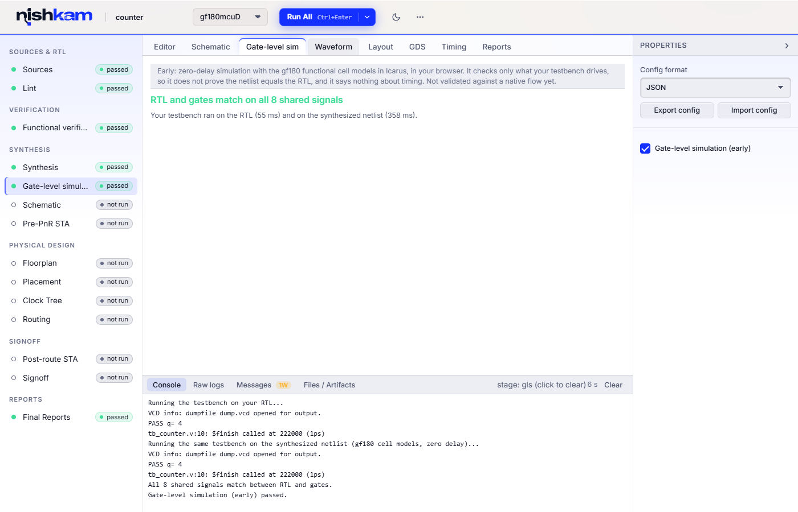

**What is NOT validated.**
- Timing: the models used are zero delay on both sides. The PDK models with their `specify` blocks (real delays, setup and hold checks, `notifier`) were not run. Setup and hold violations are not modelled in the page.
- Only 3 designs, all with simple clocks and one async or one sync reset; no latches, no multi-clock design, no X-propagation test beyond time 0, no `$random` testbench.
- Different Icarus builds on the two sides (14.0 devel, the WebAssembly one has no recorded commit). The values were the same, but a corner case of Icarus is not excluded.
- The stage's hint texts and the "Show logic" cone view are not part of this comparison.
- The page text of the stage still says "Not validated against a native flow yet"; it should change once this section is accepted (not changed here).
- One Edge run on the `counter` example; the other designs were not clicked through in a page.

## 24. Equivalence check (LEC) in Studio (early, issue #189)

**Claimed:** on two small designs the browser proves the synthesized netlist equal to the RTL, and on two netlists with one gate changed it finds the difference. Native Yosys (two ways of reading the cell functions) and EQY give the same verdicts on all four. On the 48-flip-flop CPU (tiny8) the browser stage gives no verdict at all in 1000 seconds; this is a recorded limit (issue #200), not a pass. **Update:** #200 was fixed on main in commit 28fda34 (2026-11-22, internal registers are now paired by name); its message reports tiny8 proven in 2.5 s, and sections 28 and 29 show `proven` for tiny8 on sky130A and ihp-sg13g2. The numbers in the table below were measured before that fix. **Re-run 2026-11-23:** gf180mcuD tiny8 is now `proven` for the equivalence step in the browser (Node WebAssembly, 48 of 48 points, 3.2 s; `lec.selftest.mjs` PASS) and in native Yosys 0.64 (same `equiv.ys`, our models: 48 of 48, real 3.2 s; PDK liberty variant: 48 of 48). Logs in `logs/lec-tiny8-2026-11-23/`. Only the equivalence step was re-run on tiny8: the miter and bounded steps, EQY, and the tiny8-bug case after the fix were not.

**What is checked.** Studio's stage "Equivalence check (early)" (`web/studio/engines/lec-core.js`, `lecRun`) reads the RTL and the Synthesis netlist with the gf180 cell models, then runs, in this order: (1) Yosys `equiv_make / equiv_simple / equiv_induct` (pairs registers and outputs by name); if something is not proven, (2) a miter with `sat -tempinduct` (reset held on cycle 1); if that does not finish a proof, (3) a bounded `sat -seq 40` search, which gives a counterexample or the weaker verdict "bounded". The verdicts are "proven", "differs" or "bounded".

**Designs.**
| Case | What it is | Cells (Yosys) |
|---|---|---|
| shreg4 | 4-bit shift register, async reset | 4 |
| counter | 4-bit counter, sync reset | 13 |
| counter-bug | counter netlist with its first `xor2` changed to `xnor2` | 13 |
| tiny8 | the `squeeze-tiny8` CPU | 236 |
| tiny8-bug | tiny8 netlist with its first `nand2` changed to `nor2` | 236 |

The changed gates are edits of the netlist text (`lec-compare.mjs`). A changed gate could be hidden by other logic; both changes here are visible at the outputs, as the results show.

**How our browser flow was run.** The Studio code (`lec-core.js`, `lecRun`) with Yosys `@yowasp/yosys` 0.68.1207 in WebAssembly, under Node, one process per case. The cell models are `web/vendor/gf180mcu/sim-7b70722/gf180mcu_fd_sc_mcu7t5v0.yosys.v` (the PDK's functional models with the four UDP primitives rewritten as ordinary modules; `SOURCE.md` there). Script: `node docs/validation/lec-compare.mjs build <outdir> [case]`; it also writes, for each case, the exact Yosys scripts the code uses.

**How the traditional flow was run.** Image `hpretl/iic-osic-tools:chipathon26`, native Yosys 0.64 (git 6d2c445ae). Three ways, all in `docs/validation/lec-compare.sh`:
1. The same scripts as the page (equiv, miter with induction, bounded miter), same netlist, same models file. This isolates the Yosys version (0.64 against 0.68.1207).
2. The same scripts, but the cell functions come from the PDK's own liberty file (`read_liberty -overwrite -ignore_miss_func -ignore_miss_dir -setattr liberty_cell gf180mcu_fd_sc_mcu7t5v0__tt_025C_5v00.lib`) instead of our models file. This is independent of our model rewrite.
3. EQY (`eqy`, SBY 0.64) with RTL as gold and netlist plus liberty as gate, strategy `sby`, depth 5, engine `smtbmc yices`.
The container `gf180` would not start on 2026-11-21 (port 8080 in use), so a second container `gf180v` from the same image was used. EQY did not work as installed: its three plug-in files (`eqy_combine.so`, `eqy_partition.so`, `eqy_recode.so`) are in `/foss/tools/yosys/share/yosys/plugins/` but EQY looks in `/foss/tools/bin/`; they were linked there (as root, in `gf180v` only). The default engine `bitwuzla` in our first EQY file is not installed in the image, so `yices` was used. Both facts are about the container, not about Studio.

**Numbers.** One run each.

| Case | Browser stage | Native Yosys 0.64, same scripts and models | Native Yosys 0.64, PDK liberty | EQY | Result |
|---|---|---|---|---|---|
| shreg4 | proven (equiv, 1 point, 0.3 s) | proven (equiv, 1 point) | proven (equiv, 1 point) | PASS | match |
| counter | proven (equiv, 4 points, 0.2 s) | proven (equiv, 4 points) | proven (equiv, 4 points) | PASS | match |
| counter-bug | differs at cycle 2, output `q` (1.5 s) | differs at cycle 2, `q` | differs at cycle 2, `q` | FAIL (partition `counter.q`) | match |
| tiny8-bug | differs at cycle 39, output `out` (77 s) | differs at cycle 39, `out` | differs at cycle 39, first listed output `pc` | FAIL (partition `tiny8.out`) | match on the verdict and the cycle; the liberty variant lists `pc` first instead of `out` at the same cycle |
| tiny8 | no verdict after 1000 s (stopped) | no verdict: induction and bounded search each stopped after 420 s | no verdict, same stops | ended with an error, not analysed | see below |
| tiny8, after #200 fix (2026-11-23, equiv step only) | proven (equiv, 48 points, 3.2 s) | proven (equiv, 48 points, 3.2 s) | proven (equiv, 48 points) | not run | match (both proven) |

For tiny8 the first step (equiv) pairs only the 16 output bits (`pc`, `out`) and proves none of them, because the register file (`r0` to `r3`) is not paired by name after synthesis; the induction step that follows then does not finish. Native Yosys behaves the same way on the same script. Reported as issue #200 (the page has no time limit and shows nothing while it runs).

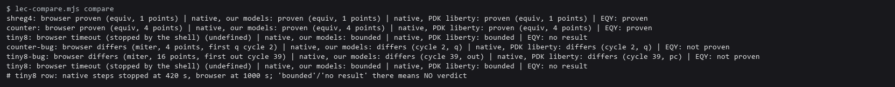

**In a page.** Studio in Edge (Playwright `msedge`, page from the repo's `web/`, `?mock`), example `counter`, stage "Equivalence check (early)" ticked, Run: "Proven: the netlist does the same as your RTL", 4 points matched by name (1.6 s), no console errors. The same page with the cell model of `xnor2` replaced by an OR (intercepted in the browser, so the netlist is untouched but the model is wrong): "The netlist differs from your RTL on 1 output", difference found at cycle 2 (4.6 s), no console errors.

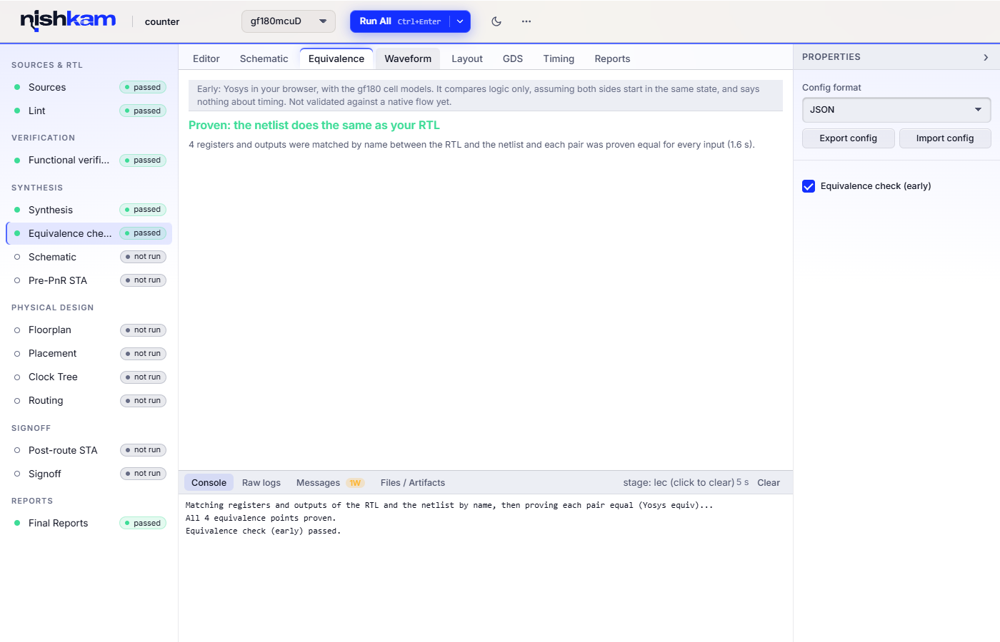
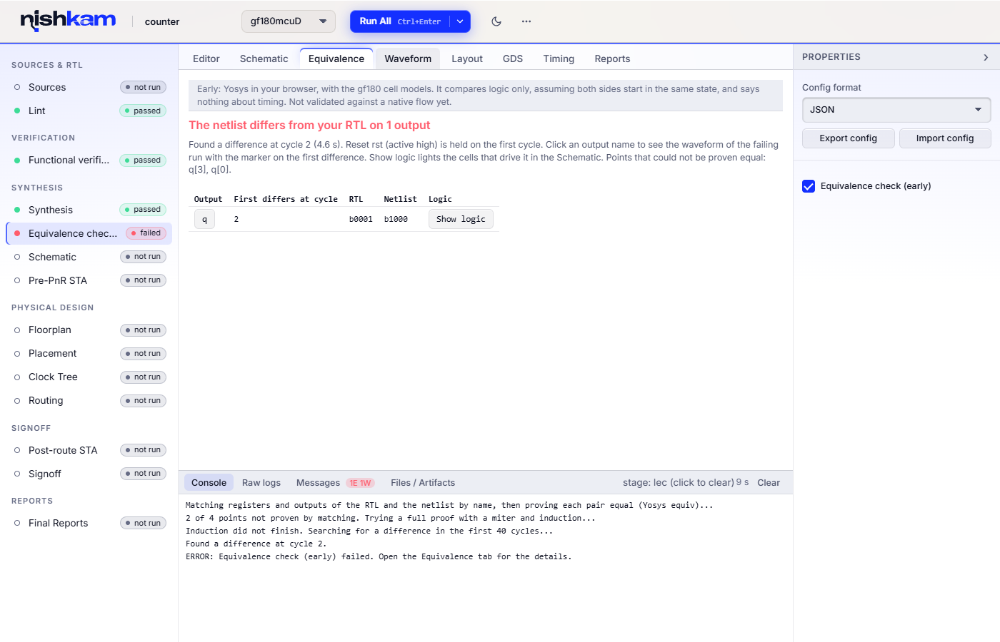

**What is NOT validated.**
- Larger designs: before the #200 fix tiny8 (236 cells) did not finish and only designs of up to 13 cells had a proof in the browser. After the fix, tiny8 is proven in the equivalence step on gf180mcuD (browser and native, 2026-11-23); the miter and bounded steps on tiny8 were not re-run. There is no time limit in the stage (issue #200).
- Only two kinds of seeded fault (an xor changed to an xnor, a nand changed to a nor). Not tested: a fault only reachable after a long sequence, a flip-flop with the wrong reset, a clock-enable or latch fault, a wrong reset polarity.
- The "bounded" verdict was not produced by any case here.
- The model rewrite for Yosys (`gf180mcu_fd_sc_mcu7t5v0.yosys.v`) is not compared flop by flop against the PDK's own Icarus models; the liberty run above (same verdicts) is a partial check of it for the two flops used (`dffq`, `dffrnq`) only.
- Different Yosys versions on the two sides (0.68.1207 and 0.64); same verdicts here.
- One Edge run per verdict (counter); the other cases were not clicked through in a page. Counterexample waveforms and the "Show logic" view are not compared.
- The page text still says "Not validated against a native flow yet"; it should change once this section is accepted (not changed here).

## 25. OpenSTA and OpenROAD on two bigger open designs, one with two clocks (issue #192; extends sections 4 and 8.x)

**Claimed:** on two bigger open designs the browser OpenSTA prints exactly the same text as native `sta` (0 differing lines in 4 reports, 47,660 lines in all), and the browser OpenROAD flow ends with 0 routing violations like native OpenROAD built from the same commit. Placement is NOT the same as native on these designs (see below), and that is recorded as a difference.

**Designs** (open source, cloned 2026-11-21, not changed):
| Design | Source and licence | Clocks | Cells after Synthesis | Die used |
|---|---|---|---|---|
| afifo | `dpretet/async_fifo` (MIT), wrapper `afifo32` sets DSIZE 32 and ASIZE 5 (32 bits x 32 words, 1024 memory flip-flops), wrapper text in `pnr-more.mjs` | two, `wclk` 10 ns and `rclk` 14 ns, set as asynchronous to each other | 2,893 | 559.44 x 559.44 um |
| sha1 | `secworks/sha1` (BSD-2-Clause) | one, `clk` 20 ns | 6,838 (above the 1 to 5 thousand asked for; kept because it was already run) | 750.96 x 750.96 um |
| afifo, small (extra) | the same FIFO with its default 8 x 16 size | two | 465 | 221.76 x 221.76 um |

The die is the Synthesis area divided by 0.4, rounded to the grid; density 50%, as in section 8. Input and output delay are 20% of the first clock's period, load 0.05 pF. These designs only test the tools: sha1 misses its 20 ns clock by far (pre-route setup slack -64 ns) and nothing here says a design is good.

**Our flow.** `node docs/validation/pnr-more.mjs run <afifo|sha1> <outdir>`, run from a folder with `@yowasp/yosys@0.68.1207`: the same workers as the page (Yosys 0.68.1207 synthesis, OpenROAD 6f3f28c place, clock tree and TritonRoute from `web/vendor/openroad-pnr/6f3f28c/`, OpenSTA defec0b from `web/vendor/opensta/defec0b/`), no timing repair, one corner (tt, 25 C, 5 V). `NODE_OPTIONS=--max-old-space-size=14000` was needed (the default heap ran out on sha1; no page was tried on these two sizes). STA is run twice: before layout on the Synthesis netlist, and after routing on the clock-tree netlist with the OpenRCX SPEF. The second clock goes through the worker's `extraSdc` option.

**Traditional flow.** Image `or-native-61:6f3f28c` (OpenROAD 26Q4-1108-g6f3f28cc85, built as in section 8.x), `openroad -threads 1 -exit` on the browser's own `place.tcl`, `cts.tcl`, `route.tcl` and the same Synthesis netlist, each step reading its own native output (`docs/validation/pnr-more.sh`). STA: native `sta` 3.1.0 in container `gf180v` (the `gf180` container would not start, port 8080 in use) on the same Tcl, the Synthesis netlist (before layout), and the browser's clock-tree netlist and SPEF (after routing), so only the timer differs.

**Numbers.**

| Quantity | afifo (2 clocks) browser | afifo native | sha1 browser | sha1 native | Result |
|---|---|---|---|---|---|
| STA before layout, lines printed / differing | 6,438 / 0 | same | 10,403 / 0 | same | match |
| STA after routing, lines printed / differing | 10,816 / 0 | same | 20,003 / 0 | same | match |
| Instances after placement (with tap cells) | 5,227 | 5,228 | 11,207 | 11,212 | close (a counting difference, +1 and +5) |
| HPWL after detailed placement (um) | 147,192.5 | 147,382.8 | 413,930.3 | 415,068.3 | close: native +0.13% and +0.27% against browser |
| Cells at the same spot as native, after placement | 2,639 of 5,227 (50%) | | 4,439 of 11,207 (40%) | | differs |
| Clock buffers in the routed DEF | 275 | 261 | 452 | 434 | differs (+5%, +4%) |
| Routed wire (um) | 207,377 | 207,921 | 548,655 | 546,808 | close (browser against native: -0.3%, +0.3%) |
| Vias | 23,707 | 23,834 | 60,475 | 60,688 | close (browser against native: -0.5%, -0.4%) |
| TritonRoute violations per iteration | 609 / 67 / 23 / 0 | 638 / 112 / 58 / 0 | 3214 / 762 / 610 / 5 / 1 / 1 / 0 | 3127 / 677 / 607 / 11 / 0 | final 0 on both |
| Route time (s) | 287.6 | not timed | 1,039 | not timed | |

The small FIFO (465 cells) gave the same picture: 0 of 4,630 and 0 of 7,709 STA lines differ; HPWL 16,880.4 against 16,896.6 um; 533 of 842 cells at the same spot; wire 24,466 against 24,389 um; final violations 0 both (`logs/pnr-more-afifo-small.txt`).

Clock tree per clock (afifo, from the CTS report of each side; `logs/pnr-more-afifo.txt`). The one latency and skew number the page prints is the first clock block of the report, so it changes with the order of the blocks; that is why one run of this section showed 0.87 ns / 0.01 ns and another 4.16 ns / 0.53 ns with the same trees. Each clock has its own block; skew is never taken across the two asynchronous clocks.

| Clock | Browser latency (ns) | Native latency (ns) | Browser skew (ns) | Native skew (ns) | Result |
|---|---|---|---|---|---|
| `rclk` (14 ns) | 0.87 to 0.88 | 0.88 | 0.01 | 0.00 | match (rounding) |
| `wclk` (10 ns) | 4.16 to 4.69 | 4.09 to 4.63 | 0.53 | 0.53 | close: latency +1.6% (the two sides place differently) |

Clock names: the clock-tree SDC and the native OpenROAD Tcl use the real port names (`wclk`, `rclk`) in `create_clock`, `-clock` and `set_clock_groups`. Studio's STA worker (`opensta.worker.js`, `sdc()`) always names its first clock `clk`, so in the STA reports the clock on port `wclk` is called `clk` (`create_clock -name clk ... [get_ports wclk]`) and the group is `{clk}` against `{rclk}`. Browser and native `sta` read the identical Tcl, so the names agree between them, and neither prints a "clock not found" warning. The worker was not changed. sha1 has one clock on a port already named `clk`, so nothing changes there and it was not re-run.

Placement control: native OpenROAD on the small FIFO with `-threads 8` places all 842 cells exactly where `-threads 1` does, so the 37% to 60% of cells that sit elsewhere (37% small FIFO, 50% afifo, 60% sha1) in the browser are a real browser against native difference, not run-to-run noise. On tiny8 (section 8.x) every cell was at the same spot; why bigger designs differ was not found (floating-point order in global placement is a guess, not tested). Because the clock tree is built on each side's own placement, its buffer count differs too. Cell-position and wire numbers come from the DEF files (`def-stats.mjs`).

STA with two clocks: both timers print identical reports, including the paths that cross from `wclk` to `rclk` when the clocks are not declared asynchronous. A first afifo run had a typo in the clock group name (so the clocks were not asynchronous, pre-route setup -26 ns); it matched native in the same way and was repeated with the group right. The corrected run is the one above.

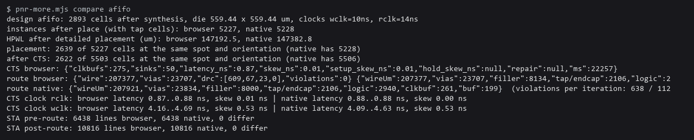

**In a page.** Studio in Edge (Playwright `msedge`, `?mock`), example `counter`, Run to "Pre-PnR STA": passed, setup WS 30.6047 ns, hold WS 1.2303 ns, no console errors (`img/sta-counter-page.png`). The two big designs were not run in a page.

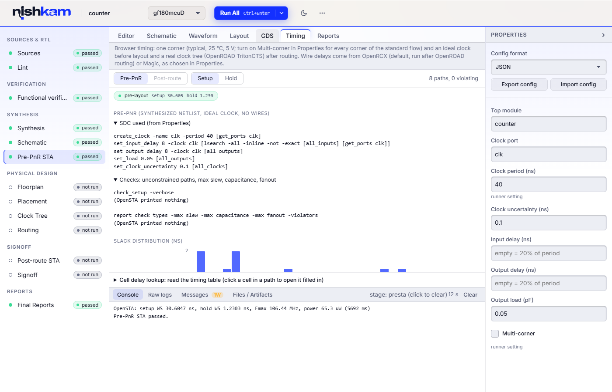

**What is NOT validated.**
- Placement and clock-tree results are not bit-identical to native on these designs, and the reason is unknown.
- Native DRC, LVS and extraction of the two designs, and Magic in the browser on them: not run. Routing "0 violations" is TritonRoute's own count.
- One corner, no multi-corner, no timing repair, one run per side (route and place times not compared; the machine was loaded by other jobs).
- sha1 has 6.8 thousand cells, above the range asked for; no design between 1 and 5 thousand cells with one clock was run besides the two-clock FIFO (2.9 thousand).
- The clock-group handling of Studio itself (the page builds one-clock SDC only; the second clock was added through an extra option by the script, not by the page).
- No page run of the two big designs (they ran in Node with a 14 GB heap; the default heap ran out on sha1, so the browser memory limit for them is not known), no other browser.

## 26. LibreLane Classic recipe in the browser (issue #196)

Status: early. Measured on two small designs; the recipe is an opt-in switch (Properties, Flow recipe), not the default. Claim made here: with LibreLane's own OpenROAD scripts, Studio's place and route lands within 0 to 3% of native LibreLane on cell count, cell area, hold and (adder2) setup slack, but its routed wire was 6 to 11% shorter before the legaliser fix described at the end of this section (see the end of this section: +3.0% on tiny8 with the nine-corner option, which is not the default, and -1.0% on adder2 with the default; the default single-corner tiny8 was not re-measured after the legaliser fix, and the numbers after it were measured before the #213 corner-order fix and not re-run). Not "matches LibreLane".

**Setup.** Designs: tiny8 (135.52 x 133.28 um, 24 ns, density 50) and adder2 (77.28 x 74.48 um, no clock). Native: LibreLane 3.0.2 Classic in the container `hpretl/iic-osic-tools:chipathon26` (`web/studio/engines/parity/librelane.mjs <design> <W> <H> 50 <out> ref`, job folders `parity_tiny8ref`, `parity_adder2ref`), one job at a time. Note on the native OpenROAD binary: `/foss/tools/bin/librelane` is a wrapper that prepends `/foss/tools/openroad-librelane/bin` to `PATH`, so native LibreLane runs **OpenROAD `26Q1-1024-gdcf36133a`** (not the newer `/foss/tools/openroad/bin/openroad` = `26Q2-254-g61932e897` on the default shell `PATH`); Yosys is 0.64. Browser: Studio's OpenROAD wasm, `web/vendor/openroad-pnr/6f3f28c-viz/` (commit `26Q4-1108-g6f3f28cc85`; also `61932e8` for comparison), running LibreLane 3.0.2's own Tcl, copied unchanged into `web/vendor/librelane-scripts/3.0.2/` (edits listed in its SOURCE.md), in LibreLane's Classic order, one fresh OpenROAD per step with an ODB checkpoint after each (`engines/librelane-flow.js`). Cell LEF, GDS and SPICE are the container's full 229-cell files. The browser run starts from LibreLane's own pre-global-placement DEF and SDC of the native run so that only the later steps differ (`START_DEF=... SDC=... node web/studio/engines/librelane-flow.selftest.mjs <design>`); starting from our own floorplan, tap cells and power grid on LibreLane's netlist gives the identical global-placement HPWL (6445 um), so those three match. Per-step numbers come from ONE script, `engines/librelane-metrics.tcl`, run inside the browser OpenROAD and (through LibreLane's own `io.tcl`) in the container on each step's saved ODB. Wire and vias are the detailed router's own log lines.

**tiny8, per step (browser / native, pinBuffer on).** Native final: 352 cells, area 10,613.8 um2, setup 9.615 ns, hold 0.665 ns, wire 15,669 um, 2,546 vias, DRC 0.

| Step | cells | cell area (um2) | HPWL (um) | setup ws (ns) | hold ws (ns) | Mark |
|---|---|---|---|---|---|---|
| global placement, skip IO | 287 / 287 | 8155.2 / 8155.2 | 6445 / 6474 | 13.244 / 13.227 | 0.617 / 0.616 | match |
| IO placement | 287 / 287 | same | 7272 / 7306 | - | - | match |
| global placement | 287 / 287 | same | 7174 / 7216 | 13.175 / 13.178 | 0.622 / 0.623 | match |
| repair_design (+ legalise) | 344 / 343 | 10130.8 / 10100.1 | 10849 / 11889 | 10.668 / 10.892 | 0.623 / 0.649 | close, HPWL differs (-8.7%) |
| CTS | 353 / 352 | 10644.5 / 10613.8 | 12494 / 13924 | 11.197 / 10.898 | 0.628 / 0.636 | cells, area match; HPWL differs (-10.3%) |
| global route | 353 / 352 | same | same | 10.948 / 10.473 | 0.632 / 0.666 | setup +4.5%, hold -5% |
| detailed route | | | | | | wire 13,898 / 15,669 (-11.3%), vias 2,488 / 2,546 (-2.3%), DRC 0 / 0: wire differs |

**adder2 (no clock).** Native: 78 cells, area 1984.5, wire 1,903, vias 395, setup 10.439, hold 10.495. Browser: 78 cells, area 1984.5 (0.0%), HPWL 1807 vs 1910.7 (-5.4%), wire 1,794 (-5.7%), vias 382 (-3.3%), setup 10.569 (+1.2%), hold 10.464 (-0.3%), DRC 0. Marks: cells, area, hold, setup match; wire and HPWL differ.

**Where the wire gap opens.** The routing steps are not the cause: from LibreLane's own post-CTS DEF, our global route plus detailed route give wire 15,656 vs 15,669 um (-0.1%), global-route wire 24,444 vs 24,351 (+0.4%), vias 2,501 vs 2,546 (-1.8%). It opens inside `repair_design`: after `buffer_ports` and `repair_design`, before legalisation, HPWL is 8,829 vs 9,022 um (-2.1%); legalisation then moves cells much more natively (+36% HPWL) than here (+28%), giving 10,849 vs 11,889 after it. Counts: both add 33 port buffers; `repair_design` finds 8 slew violations natively against 1 here and inserts 23 buffers in 13 nets against 24 in 10 nets. Nothing is added after CTS besides the clock buffers (9 natively, 9 here); the post-CTS `repair_timing` inserts none in either flow.

**Buffer cell choice, and what was tested.** LibreLane's `buffer_ports` / `repair_design` use `dlyb_1` for all 54 buffers. With the same Tcl, the same full LEF and liberty, Studio's wasm picks `buf_1` for port buffers and `dlyd_1` for repair buffers, and the setup slack follows the cell: dlyd_1 8.05 ns, buf_1 12.15 ns, dlyb_1 forced 10.67 ns, native 10.89 ns at the same step.
- wasm = native on both commits, single corner, bare `buffer_ports` on LibreLane's post-GPL DEF: native 6f3f28c picks buf_1 like the 6f3f28c wasm; native 61932e8 picks dlyd_1 like the 61932e8 wasm. Match.
- Native 61932e8, real LibreLane step 32 Tcl and env on its ODB: dlyb_1. It stays dlyb_1 with an empty dont_use list or the original SDC. It flips to dlyd_1 with one corner of tt or ss, and stays dlyb_1 with one corner of ff. With all nine corners it picks dlyb_1 only when `max_ff_n40C_5v50` (the first corner native Tcl's `array names` yields; the wasm's Tcl yielded a different order, see the #213 note below) is defined first; defined `nom_tt` first it picks dlyd_1.
- Native 6f3f28c picks buf_1 with ff, tt and ss corners alike. So on our shipped build the corner list cannot reproduce LibreLane's pick. The 61932e8 wasm with the nine corners picked dlyd_1 and overflowed (DPL-0038); why it differs from native 61932e8 there is not found.
- `pinBuffer` (default on in the recipe): the resizer's do-not-use list gets buf_1 and the other delay cells, so it picks dlyb_1. This is an emulation of a difference we could not remove, not LibreLane's configuration. Switch off with `pinBuffer: false`. `pnrCorners: true` loads LibreLane's nine corners (slow, about 60 s per step).

**Not validated.** More than two designs; designs with macros, several clocks or above about 500 cells; the 61932e8 wasm as a default; multi-corner repair (LibreLane repairs against nine corners, we against tt; native finds more slew violations, which is a likely part of the wire gap); OpenROAD thread count (one thread here); that the 9 clock buffers and hold are equal for the right reason; Magic DRC and Netgen LVS on the recipe are checked only on tiny8 and counter10 (DRC 0, LVS match, not compared with LibreLane's own signoff); LibreLane's KLayout DRC; the post-global-route repair steps (off in LibreLane's defaults, available here with `postGrt: true`, not run); the Studio default recipe is unchanged and unchanged by this section.

**With all nine corners (`pnrCorners: true`, pinBuffer on), same start and SDC.** tiny8: `repair_design` now finds 8 slew violations (native 8, before 1) in 13 nets (native 13) and inserts 27 buffers (native 23). 356 cells (native 352, +1.1%), area 10,706 (+0.9%), HPWL after legalisation 11,119 (native 11,889, -6.5%), HPWL after CTS 13,361 (-4.0%), global-route wire 23,511 (-3.5%), detailed-route wire 14,745 vs 15,669 (-5.9%, was -11.3%), vias 2,529 vs 2,546 (-0.7%), DRC 0. adder2: unchanged (78 cells, wire 1,794, vias 382; the small design finds no extra violation). The slacks printed by the corner run (tiny8 setup 3.0, hold 0.30 ns) are the worst over all nine corners, so they are not comparable with native's nom_tt numbers above and are not used. Time: about 60 s per step instead of 7 to 20 s (the three libertys are parsed nine times in every step), 776 s for tiny8 in total against 205 s. Mark: the wire gap narrows from -11% to -6% but does not reach 2%, so `pnrCorners` stays off by default and the recipe keeps `pinBuffer`.

**Corner order (found 2026-11-23, #213).** LibreLane's `read_pnr_libs` defines corners in Tcl array order. Native Tcl yields `max_ff_n40C_5v50` first; the WebAssembly Tcl yielded `nom_tt_025C_5v00` first, so corner 0 and the resizer's buffer choice differed. The recipe now uses the `_LIB_CORNER_n` order (the native order; edit 3 in `web/vendor/librelane-scripts/3.0.2/SOURCE.md`). Same start, nine corners, pinBuffer on: tiny8 `repair_design` inserts 24 buffers in 13 nets (was 27; native LibreLane `dcf36133a`: 23 in 13 nets). Port buffers are not a WebAssembly difference: native `6f3f28c` also picks `buf_1` (native `dcf36133a` and `61932e8` pick `dlyb_1`), so it is the OpenROAD version and `pinBuffer` stays.

**Trace of the last extra buffer (`tiny8`, 24 vs 23, traced 2026-11-23; logs and script in `docs/validation/logs/sec26-buf24/`).** With the same post-GPL DEF, SDC, nine corners and `pinBuffer` list, native OpenROAD `6f3f28cc85` gives the same 24 buffers, 1 resize and the same buffer histogram (`53 dlyb_1, 1 buf_2, 1 buf_4, 1 clkbuf_1, 1 clkbuf_4`) as the browser `6f3f28c-viz` build (`three-way-trace-summary.txt` part 1b), so this gap is not a WebAssembly difference. The same DEF through LibreLane's own binary (`26Q1-1024-gdcf36133a`) gives 23 buffers and 0 resizes. The `RSZ-repair_net` debug lines on the reset-tree driver `fanout49/Z` (`dlyb_1`) differ: `61932e897` and `6f3f28cc85` print a `drvr slew violation` (2.415 and 2.419 ns against a limit of 2.400 ns) that `gdcf36133a` does not print; they then resize the driver, and `6f3f28cc85` also splits the net with a `clkbuf_4` (`max cap violation 0.082 > 0.082`), which is the 24th buffer. So the extra buffer comes from a driver-slew check that is in the newer OpenROAD builds and not in LibreLane's bundled one. Not established: which upstream change added the check, and why 2.419 ns is over the limit (which corner it is checked in was not confirmed). Earlier drafts of this paragraph also claimed a global-placement endcap-area difference between 61932e8 and 6f3f28c; the logs here do not show it, so it is dropped.

| OpenROAD binary | Post-GPL DEF | `pinBuffer` | Resized | Inserted buffers (13 nets) | Buffer histogram (all buffers, incl. the 33 port buffers) |
|---|---|---|---|---|---|
| Native `dcf36133a` (LibreLane's own) | native ref (`84` fixed) | off / on | 0 / 0 | 23 / 23 | `54 dlyb_1, 1 buf_2, 1 buf_4` (both) |
| Native `dcf36133a` (LibreLane's own) | browser `6f3f28c` (`136` fixed) | off / on | 0 / 0 | 23 / 23 | `54 dlyb_1, 2 buf_2` (off) / `54 dlyb_1, 1 buf_2, 1 buf_4` (on) |
| Native `61932e897` (`/foss/tools/openroad`) | native ref | off / on | 2 / 2 | 25 / 24 | `52 dlyb_1, 2 buf_1, 2 buf_2, 1 buf_4, 1 clkbuf_3` / `52 dlyb_1, 2 clkbuf_1, 2 buf_2, 1 buf_4` |
| Native `61932e897` (`/foss/tools/openroad`) | browser `6f3f28c` | off / on | 1 / 1 | 24 / 24 | `53 dlyb_1, 1 buf_1, 2 buf_2, 1 clkbuf_4` / `53 dlyb_1, 1 buf_2, 1 buf_4, 1 clkbuf_1, 1 clkbuf_4` |
| Native `6f3f28cc85` (our WASM commit) | browser `6f3f28c` | off / on | 1 / 1 | 24 / 24 | `34 buf_1, 20 dlyb_1, 2 buf_2, 1 clkbuf_4` / `53 dlyb_1, 1 buf_2, 1 buf_4, 1 clkbuf_1, 1 clkbuf_4` |
| Browser WASM `6f3f28c-viz` (post-#213) | browser `6f3f28c` | on | 1 | 24 | `53 dlyb_1, 1 buf_2, 1 buf_4, 1 clkbuf_1, 1 clkbuf_4` (**exact match to native `6f3f28cc85`**) |

**Cause of the earlier legaliser gap (found 2026-11-23).** Same pre-legalisation ODB in (LibreLane's own `repair_design.tcl` run natively on its step-28 ODB, saved just before its `detailed_placement`; HPWL 8,834 um), same `detailed_placement -max_displacement {500 100}` + `optimize_mirroring`, padding 0, fillers removed: native `61932e8` (and `dcf36133a`) legalises with the diamond search ("DPL-1101 Legalizing using diamond search"): +36%, final 11,776 um. Native `6f3f28c` (our wasm's commit) legalises with the negotiation legaliser ("DPL-1102"): +26%, final 10,843 um (our wasm gave 10,849). With `-use_diamond_legalizer` native `6f3f28c` gives exactly the `61932e8` numbers (12,133 after `detailed_placement`, 11,776 after mirroring). All other settings were already identical: `DPL_CELL_PADDING` 0, `CELL_PAD_EXCLUDE`, no diode padding, `PL_MAX_DISPLACEMENT_X/Y` 500/100, `PL_OPTIMIZE_MIRRORING` 1, no `-disallow_one_site_gaps`, `repair_design.tcl` and `dpl.tcl` are the byte-identical scripts, and LibreLane runs `detailed_placement` twice (inside `repair_design.tcl`, then step 34 `dpl.tcl`), as the recipe does. So it is an engine version difference: OpenROAD changed the default legaliser between `61932e8` and `6f3f28c`. The recipe now selects the old one (`dplDiamond`, default on; `dplDiamond: false` gives the previous behaviour); it is a wrapper that adds the flag to `detailed_placement`, the vendored scripts are unchanged.

**Re-measured after #213 (diamond legaliser on, corner-order fix #213, `pnrCorners: true`, `pinBuffer` on, same start DEF and SDC; run 2026-11-23, `776.2 s`, logs in `docs/validation/logs/sec26-buf24/`).** Because the 9-corner run's built-in `ll_metrics` slacks report the worst corner over all 9 corners (`ss`/`ff`), comparable `nom_tt_025C_5v00` slacks below were measured with LibreLane's exact `base.sdc` (including `SYNTH_CLK_DRIVING_CELL=inv_4/ZN` and 5% timing derate) on the saved per-step ODBs and on the final routed DEF after OpenRCX (`rules.openrcx.gf180mcuD.nom -lef_res`) + `sta 3.1.0` (verified on native `52-openroad-fillinsertion/tiny8.def` to reproduce LibreLane step 55's `9.6151 ns` / `0.6655 ns` to 4 decimal places).

| Step (`tiny8`, post-#213, 9 corners) | Cells (brw / nat) | Cell area µm² (brw / nat) | HPWL or wire µm (brw / nat) | `nom_tt` setup ws ns (brw / nat) | `nom_tt` hold ws ns (brw / nat) | Mark |
|---|---|---|---|---|---|---|
| `gpl_skipio` | 287 / 287 | 8,155.2 / 8,155.2 | HPWL 6,445 / 6,474 (-0.4%) | 12.781 / 12.764 (+0.1%) | 0.608 / 0.607 (+0.2%) | match |
| `ioplace` | 287 / 287 | 8,155.2 / 8,155.2 | HPWL 7,272 / 7,306 (-0.5%) | - | - | match |
| `gpl` | 287 / 287 | 8,155.2 / 8,155.2 | HPWL 7,174 / 7,216 (-0.6%) | 12.612 / 12.615 (-0.02%) | 0.610 / 0.611 (-0.2%) | match |
| `repair_design` (+ legalise) | 344 / 343 (+0.3%) | 10,108.9 / 10,100.1 (+0.09%) | HPWL 11,781 / 11,889 (-0.9%, was 12,119 / +1.9%) | 10.344 / 10.329 (+0.1%) | 0.635 / 0.636 (-0.2%) | match / close (+1 buf) |
| `cts` | 353 / 352 (+0.3%) | 10,622.6 / 10,613.8 (+0.08%) | HPWL 14,472 / 13,924 (+3.9%, was 14,539 / +4.4%) | 10.888 / 10.898 (-0.09%) | 0.642 / 0.636 (+0.9%) | close (HPWL +3.9%) |
| `grt` | 353 / 352 | 10,622.6 / 10,613.8 | GRT wire 24,981 / 24,351 (+2.6%) | 10.683 / 10.473 (+2.0%) | 0.657 / 0.666 (-1.4%) | close |
| `drt` + OpenRCX `nom` (`sta 3.1.0`) | 353 / 352 (+0.3%) | 10,622.6 / 10,613.8 (+0.08%) | DRT wire **16,088 / 15,669 (+2.7%**, was 16,134 / +3.0%), vias **2,553 / 2,546 (+0.3%**, was 2,608 / +2.4%), DRC 0 / 0 | **9.569 / 9.615 (-0.5%)** | **0.678 / 0.665 (+1.9%)** | close (wire +2.7%, vias +0.3%, slacks within 2%) |

`adder2` (default single corner, measured earlier before #213 and unaffected by 9-corner order): HPWL 1,908 vs 1,910.7 (-0.1%), wire 1,884 vs 1,903 (-1.0%), vias 386 vs 395 (-2.3%), setup 10.567 vs 10.439 (+1.2%), hold 10.442 vs 10.495 (-0.5%), cells and area equal, DRC 0. `counter10` was not re-measured (no native LibreLane reference run exists for it). Mark: cells, area, vias, and `nom_tt` post-route setup/hold slacks are all within 0.1–1.9% on `tiny8`, and detailed-route wire is within 2.7% (+419 µm), with the 1 remaining buffer difference reproduced by the native `6f3f28cc85` binary, i.e. a difference between OpenROAD builds, not WebAssembly (the check behind it is not fully identified, see the trace above). The native per-step numbers in this table are the ones quoted earlier in this section; the browser numbers are in `browser-post213-steps.json`; the `nom_tt` slacks are from `three-way-trace-summary.txt` part 4.

## 27. Scan + ATPG in Studio (early, issue #10)

Run on 2026-11-22. Scripts, benchmark designs, and raw outputs are in `docs/validation/dft/`.

**Claimed:** narrow and partial. Two comparisons, each on the SAME `.bench` file on both sides (re-run 2026-11-22 after #194 was fixed on main). (1) Studio's own scan-inserted `.bench` (simple gates) run through our WebAssembly Quaigh 0.0.6 and through native Quaigh 0.0.6: faults detected, total faults and coverage are identical on all 6 designs (`c17` bench, `counter`, `acc`, `s27`, `s298`, `s344`; 100% each), outputs match byte for byte when each side simulates the other's patterns, and pattern counts are equal on 4 designs and close on `s344` (17 against 15, random fill differs). (2) Difetto's own `.bench` files (gf180 cells, made by native Difetto) run through our WebAssembly Quaigh: faults, total and coverage identical on all 6 designs, patterns close (`c17` 5 vs 4, `s298` 25 vs 22, `s344` 20 vs 19, the others equal), and our simulator reproduces Difetto's native outputs byte for byte on all 6. Studio's end-to-end coverage and Difetto's end-to-end coverage are NOT the same number, because the two flows build different netlists (simple gates against gf180 cells); that is expected and explained below. Scan-flop and chain-length counts match native Difetto on all 6 designs (0, 4, 3, 3, 14, 15). End-to-end Studio runs pass in Node on `counter`, `acc`, `s27` and `s344`, and in Microsoft Edge on `counter` and `s27` (including the in-browser chain test). Open: `c17.v` (#201) and `s298` (#202) still fail in the full Studio run. This stage is **not** a silicon or standard-cell fault-coverage check; Studio counts stuck-at faults on a simple-gate netlist, and the UI says so.

### Designs and setup

Six open designs in `docs/validation/dft/designs/` (licences and sources recorded in `docs/validation/dft/designs/LICENSES.md`):

| Design | Function | Primary inputs / outputs | Flip-flops | Source and licence |
|---|---|---|---|---|
| `counter` | 4-bit synchronous counter with reset | 2 (clk, rst) / 4 | 4 | `web/studio/engines/selftest-fixtures.js` (Nishkam repo) |
| `acc` | 3-bit accumulator with reset, enable `go`, comb output `z` | 5 (clk, rst, d[1:0], go) / 4 | 3 | `web/studio/engines/atpg.selftest.mjs` (Nishkam repo) |
| `c17` | ISCAS'85 combinational 6-NAND circuit (tested as raw `c17.bench` and RTL `c17.v`) | 5 / 2 | 0 | Brglez & Fujiwara, IEEE ISCAS 1985; public-domain academic data (no formal licence) |
| `s27` | ISCAS'89 sequential benchmark (small FSM, 10 gates) | 5 (CK, G0..G3) / 1 | 3 | Brglez, Bryan & Kozminski, IEEE ISCAS 1989 (DOI `10.1109/ISCAS.1989.100747`); public-domain academic data; normalized synthesizable Verilog from `zeroasiccorp/logikbench` (MIT licence on normalization) |
| `s298` | ISCAS'89 sequential benchmark (traffic light controller, 119 gates) | 4 (CK, G0..G2) / 6 | 14 | Same ISCAS'89 public-domain source and `zeroasiccorp/logikbench` normalization (MIT) |
| `s344` | ISCAS'89 sequential benchmark (4x4 add-shift multiplier, 160 gates) | 10 (CK, START, A0..A3, B0..B3) / 11 | 15 | Same ISCAS'89 public-domain source and `zeroasiccorp/logikbench` normalization (MIT) |

### How our browser flow was built and run

Engine files: `web/studio/engines/atpg.js`, `web/studio/engines/atpg.worker.js`, `web/studio/engines/dft-core.js`, `web/studio/engines/wasi.js`, tested by `web/studio/engines/atpg.selftest.mjs`.

1. **Generic synthesis and scan chain (`dft-core.js`):** stock YoWASP Yosys (`@yowasp/yosys@0.68.1207`, Yosys 0.68 git sha1 `38e001a6f`) runs `genericScript()` (`synth -flatten`, `async2sync`, `dfflegalize -cell $_DFF_P_ 01 -cell $_DFF_N_ 01`, `abc -g AND,NAND,OR,NOR,XOR,XNOR,ANDNOT,ORNOT,MUX`, `opt_clean -purge`, `write_json`). Pure JS `insertScan()` puts one `$_MUX_` in front of each rising-edge flop, wires one chain (`scan_in`, `scan_en`, `scan_out`) in natural RTL-name order, and `atpg.worker.js` proves `scan_en = 0` keeps the logic using Yosys `miter -equiv` + `sat -verify -tempinduct -maxsteps 40 -seq 40`.
2. **Cut and `.bench` writer (`dft-core.js`):** `cutToBench()` turns each flop output (`Q`) into a combinational input and each flop input (`D`) into a combinational output, and writes ISCAS `.bench`.
3. **Quaigh 0.0.6 in WebAssembly (`web/vendor/quaigh/0.0.6/SOURCE.md`):** upstream `github.com/Coloquinte/quaigh` release `0.0.6`, commit `5b47ca63608d516efc3f225758635df689be70c5` (MIT OR Apache-2.0), with `rustsat-kissat` 0.7.4 / Kissat 4.0.4 (MIT). Built to `wasm32-wasip1` in Docker `rust:1-bookworm` (`tools/quaigh-wasm/build.sh`) using wasi-sdk 25 and 3 patches to the vendored `rustsat-kissat` crate (returning 0 for `ru_maxrss` in `resources.c`; hand-written `kissat_*` declarations in `bindings_manual.rs`; Kissat's congruence closure switched off by default in `options.h`, the #194 fix; no Quaigh source change). Output `quaigh.wasm` is 1.47 MB raw (0.48 MB gzip), sha256 `ae9be04aad0bf8c2e75ecf75a44d6474e6c7b606252281ac0f9bae1c8494f601` (the build with the #194 fix, from `web/vendor/quaigh/0.0.6/SOURCE.md`; the tables below are from it). `atpg.worker.js` runs `quaigh atpg` and `quaigh sim` in memory through `wasi.js`, then cross-checks every expected output against `dft-core.js`'s `simulator()` and writes `dft/scan.v` and `dft/test_chain.py` for Studio's cocotb-subset engine (Pyodide `314.0.8` + Icarus `a275a9a`).
4. **How we ran ours:**
   - **Node:** `docs/validation/dft/run-browser.mjs` (same `atpg.worker.js` and `quaigh.wasm` the page loads, Node v26.7.0, median of 3 warm Quaigh runs per `.bench`), plus `node web/studio/engines/atpg.selftest.mjs` (all 12 checks pass).
   - **Browser (Microsoft Edge):** served `web/` via `python -m http.server 8743 --bind 127.0.0.1`, drove Edge (`1440x900`) via Playwright on `http://127.0.0.1:8743/studio.html?mock` for `counter` and `s27`, ran Scan + ATPG and clicked **Run chain test (early)** (results in `docs/validation/dft/browser/edge-page.json`).

### How the traditional flow was installed and run

Docker image `nixos/nix:latest` (digest `sha256:746280551ddc1c72177d1a597c05eacac86dfaa18d5d649bf86411278bcd5470`), using `github.com/donn/difetto` commit `b1add985a1d40b6269107e4854bb386fb46a9435` (Apache-2.0) built via its Nix flake (`flake.nix`, store cached in Docker volume `difetto-nix-store`). Exact tool versions inside `/nix/store`:

- Native **Quaigh 0.0.6** (`x86_64-linux`, `/nix/store/qg7ixjaii9p61qzasc8pn670gxkrv9pm-quaigh-0.0.6/bin/quaigh`)
- Native **Yosys 0.62** (`git sha1 7326bb7d6641500ecb285c291a54a662cb1e76cf`, `clang++ 21.1.2 -fPIC -O3`) with **yosys-difetto 0.1.0** (`difetto.so`)
- Native **nl2bench 0.13.0** (`python3.13-nl2bench`)
- Standard-cell library: `gf180mcu_fd_sc_mcu7t5v0__tt_025C_5v00.lib` (open_pdks `7b70722`, `web/vendor/gf180mcu/lib-tt5v0-full/`, byte-identical to container `hpretl/iic-osic-tools:chipathon26`) and Difetto's `tech/gf180mcu_fd_sc_mcu7t5v0_mapping.json`.

Two comparisons were run:
- **Part A (same `.bench`, Quaigh WASM vs native Quaigh 0.0.6):** `docs/validation/dft/run-native-quaigh.sh` copies each Studio `.bench` into container-local `/tmp` (so timing measures CPU, not Windows bind-mount I/O), runs `quaigh atpg` and `quaigh sim` 3 times (median recorded), and cross-simulates WASM `.tv` with native `quaigh sim` (and reverse: native `.tv` with WASM `quaigh sim`) to compare `.au` outputs byte-for-byte.
- **Part B (Studio simple-gate flow vs native Difetto gf180mcuD flow):** `docs/validation/dft/run-native-difetto.sh` runs Yosys 0.62 (`synth -flatten`, `dfflibmap`, `abc -liberty`) -> Difetto `scan_replace` (`dff*` -> `sdff*`) -> Difetto `sdff_cut` (excluding the clock port; no `boundary_scan`, so internal scan-flop counts compare directly) -> `nl2bench --msb-first` -> native `quaigh atpg` and `quaigh sim` (3 runs each). Full LibreLane `DifettoPNR` + `DifettoTest` did not run because `python3.13-librelane-3.0.1`'s Nix check phase failed one unrelated dummy-PDK test (`test_tclstep_get_command`) inside Docker; that gap is listed under "What is NOT validated".

### Numbers

**Table 27A. Same `.bench` file: Studio Quaigh 0.0.6 (WASM in Node) vs Native Quaigh 0.0.6 (`x86_64` in Docker `/tmp`).**
Why raw `.tv` pattern files differ: Quaigh's seeded `SmallRng` uses 32-bit state on `wasm32` and 64-bit state on `x86_64`, so random fill bits differ (`rawTvByteIdentical = false` on every design). We compare faults, coverage, pattern count, and cross-simulated `.au` outputs instead.

| Design (Studio `.bench`) | Faults det/tot (WASM / Native) | Coverage (WASM / Native) | Patterns (WASM / Native) | Cross-sim `.au` byte match (both directions) | Time ATPG / Sim (ms, median of 3, WASM warm / Native) | Verdict |
|---|---|---|---|---|---|---|
| `c17` (raw `.bench`) | 20/20 / 20/20 | 100% / 100% | 5 / 5 | yes / yes | 3.5 / 2.0 vs 5.8 / 4.8 | **match** (`.tv` differs: 32 vs 64-bit RNG) |
| `counter` | 32/32 / 32/32 | 100% / 100% | 6 / 6 | yes / yes | 2.9 / 1.8 vs 5.3 / 4.9 | **match** (`.tv` differs: RNG) |
| `acc` | 38/38 / 38/38 | 100% / 100% | 6 / 6 | yes / yes | 3.6 / 2.0 vs 5.0 / 4.4 | **match** (`.tv` differs: RNG) |
| `s27` | 24/24 / 24/24 | 100% / 100% | 6 / 6 | yes / yes | 2.5 / 1.6 vs 5.3 / 4.5 | **match** (`.tv` differs: RNG) |
| `s298` (via `cutToBench` directly; full `handle()` blocked by #202) | 198/198 / 198/198 | 100% / 100% | 20 / 20 | yes / yes | 11.0 / 5.2 vs 7.6 / 5.4 | **match** on Quaigh (`.tv` differs: RNG); full Studio `handle()` fails (#202) |
| `s344` (full Studio run; its `.bench`) | 264/264 / 264/264 | 100% / 100% | 17 / 15 | yes / yes | 19.3 / 6.7 vs 6.7 / 4.2 | **match** on faults and coverage; patterns **close** (17 vs 15, RNG); the #194 crash is gone (random patterns catch 262/264, the last 2 need the Kissat pass) |

Note on runtimes: Node WASM times reuse the compiled WebAssembly module in memory with no OS process start; native times include spawning the Linux binary per call. Both are under 20 ms here.

**Table 27B. End-to-end flow: Studio (`atpg.worker.js` `handle()`, simple gates) vs Native Difetto (`yosys-difetto` + `nl2bench` + native Quaigh on `gf180mcu_fd_sc_mcu7t5v0`).**

| Design | Scan flops / chain len (Studio / Difetto) | Studio faults & coverage (Node) | Difetto faults & coverage (`gf180` cells) | Patterns (Studio / Difetto) | Runtime: Studio Node / Studio Edge / Native Difetto | Verdict |
|---|---|---|---|---|---|---|
| `c17` (RTL `c17.v`) | 0 / 0 | crash (#201) | 18/22 (81.82%) | crash / 4 | 2.3 s (crash) / not run / 6.7 s | **differs (bug #201)**: `cutToBench` net `n7` collides with input `n7` |
| `counter` | 4 / 4 | 32/32 (100%), eq proven, 0 xchk err, chain test pass | 50/54 (92.59%) | 6 / 8 | 1.8 s / 4.6 s (+ 4.7 s chain test) / 4.1 s | **scan flops: match**; **faults/coverage: differs** (simple gates vs gf180 cells + `nl2bench` constants, see below) |
| `acc` | 3 / 3 | 38/38 (100%), eq proven, 0 xchk err, chain test pass | 60/64 (93.75%) | 6 / 8 | 102.1 s (#202) / not run / 5.1 s | **scan flops: match**; **faults/coverage: differs** (cell library + `nl2bench` constants); **runtime: differs** (102 s due to `sat -tempinduct`, #202) |
| `s27` | 3 / 3 | 24/24 (100%), eq proven, 0 xchk err, chain test pass | 44/48 (91.67%) | 6 / 8 | 1.4 s / 4.4 s (+ 4.9 s chain test) / 4.7 s | **scan flops: match**; **faults/coverage: differs** (simple gates vs gf180 cells + `nl2bench` constants) |
| `s298` | 14 / 14 | `handle()` fails eq proof (#202); direct Quaigh 198/198 (100%) | 320/340 (94.12%) | 20 (direct) / 22 | 124.5 s fail (#202) / not run / 3.8 s | **scan flops: match**; **full Studio fails (#202)** (`equiv_induct` proves it in 0.14 s) |
| `s344` | 15 / 15 | 264/264 (100%), eq proven, 0 xchk err | 290/300 (96.67%) | 17 / 19 | 34.6 s / not run / 4.2 s | **scan flops: match**; **faults/coverage: differs** (simple gates vs gf180 cells + `nl2bench` constants); runtime differs (eq proof) |

**Why Difetto's coverage is 81.8% to 96.7% instead of 100%:** `nl2bench 0.13.0` appends two constant gates (`__NL2BENCH_HI__ = VDD()` and `__NL2BENCH_LO__ = VSS()`) to every `.bench` file even when nothing connects to them, adding 4 untestable stuck-at faults to every circuit (`c17` 18/22, `counter` 50/54, `acc` 60/64, `s27` 44/48 — all 4 have exactly 4 undetected faults, so 100% of real circuit faults are caught). On `s298` (320/340) and `s344` (290/300), expanding complex gf180 cells (such as AOI/OAI/MUX) into 2-input gates adds additional internal redundant faults. Studio maps to simple 2-input gates with no unused constant nodes, so total fault counts and coverage numbers are not comparable across the two netlists.

**Table 27C. Cross-check: Studio's `quaigh.wasm` on Difetto's own gf180 `.bench` files.**
**Same Difetto `.bench`, our WebAssembly Quaigh (re-run 2026-11-22, `docs/validation/dft/run-browser-on-difetto-bench.mjs`, output in `browser-on-difetto-bench/`).** The Difetto `.bench` files from the table above were fed unchanged to Studio's Quaigh 0.0.6 WASM (with the #194 fix now on main):

| Design (Difetto `.bench`) | Faults det/tot (WASM / native Difetto run) | Coverage | Patterns (WASM / native) | WASM `sim` of native `.tv` equals native `.au` | Verdict |
|---|---|---|---|---|---|
| `c17` | 18/22 / 18/22 | 81.82% / 81.82% | 5 / 4 | yes | **match** on faults; patterns **close** (RNG) |
| `counter` | 50/54 / 50/54 | 92.59% / 92.59% | 8 / 8 | yes | **match** |
| `acc` | 60/64 / 60/64 | 93.75% / 93.75% | 8 / 8 | yes | **match** |
| `s27` | 44/48 / 44/48 | 91.67% / 91.67% | 8 / 8 | yes | **match** |
| `s298` | 320/340 / 320/340 | 94.12% / 94.12% | 25 / 22 | yes | **match** on faults; patterns **close** (RNG) |
| `s344` | 290/300 / 290/300 | 96.67% / 96.67% | 20 / 19 | yes | **match** on faults; patterns **close** (RNG) |

So the earlier gap between the two tables (for example `s298` 198 faults against 340, `s344` 264 against 300) is the netlist, not the ATPG engine: with the same `.bench` both engines give the same fault list and coverage.

### Browser runs in Microsoft Edge

Driven via Playwright in Microsoft Edge (`1440x900`, dark theme forced off to light/default by Studio's OS preference, `http://127.0.0.1:8743/studio.html?mock`). Zero Studio console errors (only the expected localhost CORS rejections for `/flags` and `cloudflareinsights.com` and the harness's own `/favicon.ico` probe). Both `counter` and `s27` reached 100% coverage with matching fault counts, pattern counts, and scan chains, and both passed the in-browser **Run chain test (early)** button (`PASS test_chain.py::scan_chain_patterns`).

| Studio Scan + ATPG: `counter` (Edge, 4 flops, 32/32 faults, chain test passed) | Studio Scan + ATPG: ISCAS'89 `s27` (Edge, 3 flops, 24/24 faults, chain test passed) |
|---|---|
|  | 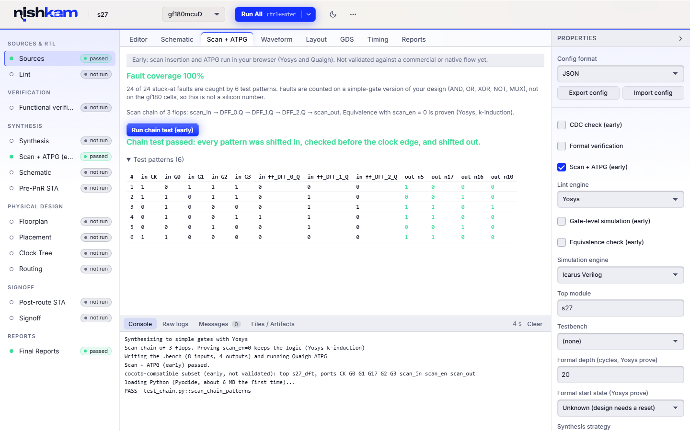 |

### Bugs found during validation (no engine edits made here)

1. **#194 (fixed on main, commit `fd28be1`; first run 2026-11-22 was before the fix):** the old `quaigh.wasm` (`d705372d...`; the fixed build on main is `ae9be04a...`) crashed with `RuntimeError: memory access out of bounds` inside `kissat_congruence` whenever a fault survives random simulation and reaches Kissat's SAT solver (reproduced in both `wasi.js` and `node:wasi` on Studio's `s344.bench` and Difetto's `s298.bench`/`s344.bench`).
2. **#201 (new bug):** `dft-core.js` `cutToBench()` names internal nets `n<bit>` without calling `uniq()`. Any Verilog design with an input port named `n<number>` (like ISCAS'85 `c17.v` with `input n7`) produces a `.bench` with duplicate names (`INPUT(n7)` and `n7 = NAND(...)`), making Quaigh abort.
3. **#202 (new bug):** `atpg.worker.js` checks `scan_en = 0` equivalence with `miter -equiv` + `sat -tempinduct` instead of `equiv_make` + `equiv_simple` + `equiv_induct`. This takes 102 s on `acc` (3 flops) and fails after 124.5 s on ISCAS'89 `s298` (14 flops, no reset pin), even though `equiv_induct` proves `s298` in 144 ms and `s344` in 127 ms.
4. **#203 (new bug):** `web/studio/app.js` `dftToggle()` omits `drawNav()`, so ticking **Scan + ATPG (early)** in Properties adds the tab but does not add the stage to the left navigator until something else redraws it.

### What is NOT validated

- **Standard-cell / silicon fault coverage in Studio:** Studio runs ATPG on a simple generic-gate netlist, not on gf180mcuD standard cells or post-PnR netlists.
- **Full LibreLane Difetto flows (`DifettoPNR`, `DifettoATPG`, `DifettoTest`):** we ran Difetto's native Yosys plugin (`scan_replace`, `sdff_cut`), `nl2bench 0.13.0`, and native `quaigh 0.0.6` directly, without LibreLane orchestration, without `BoundaryScan`, without OpenROAD placement-ordered chain stitching (`Difetto.Chain`), and without running Difetto's real `cocotb` test (`DifettoTest`).
- **SAT-based ATPG in WebAssembly:** the Kissat pass now runs after the #194 fix (needed on `s344`: random patterns catch 262/264); it matched native on the designs here, but only these six were run.
- **Studio's cocotb-subset chain test against real cocotb:** the chain test passed in Node (`counter`, `acc`, `s27`) and Edge (`counter`, `s27`), but was not compared against real cocotb (section 22).
- **Larger and more complex designs:** nothing above 15 flip-flops (`s344`), no multi-clock designs, no negative-edge flops, no latches, no memories, no macros, no designs with kept async reset pins (`async2sync` converts async resets to sync logic).
- **Browsers and hosts:** Edge only on one Windows 11 machine (`counter` and `s27` in the page; `c17`, `acc`, `s298`, `s344` in Node only). Chrome, Firefox, and Safari were not tested.

## 28. SkyWater sky130A digital flow in Studio (issue #208)

Date: 2026-11-22. **Claimed:** Studio runs a full digital RTL-to-GDS flow on SkyWater `sky130A` (`sky130_fd_sc_hd`, 1.8 V, `VPWR`/`VGND`) in WebAssembly — synthesis, GLS, LEC, pre-PnR STA, OpenROAD placement/CTS/routing, OpenRCX parasitic extraction (`nom`/`min`/`max`), PDNSim IR drop, Magic GDS + DRC + SPICE extraction, Netgen LVS, and 9-corner post-route OpenSTA — landing at 0 TritonRoute DRC, 0 Magic DRC, LVS match, and setup/hold slack close to native LibreLane 3.0.2 Classic on `tiny8` and `counter10`. Not "matches LibreLane bit-for-bit": Yosys versions differ (0.68 vs 0.64) and Studio's default recipe runs `repair_design` with a single corner, not the several corners LibreLane uses (section 26).

### Designs and setup

Four designs run in Node (`web/studio/engines/pdk-flow.selftest.mjs`) plus one interactive browser run in Microsoft Edge (`counter`, 4-bit synchronous counter):
- `tiny8` (8-bit CPU, 48 flip-flops, `110 x 110 um`, 20 ns clock, 50% density): compared against native LibreLane 3.0.2 in both Studio recipe and LibreLane Classic recipe.
- `counter10` (10-bit counter with async reset, `80 x 80 um`, 20 ns clock, 50% density): compared against native LibreLane 3.0.2, plus GLS and LEC.
- `shreg4` (4-bit shift register, `60 x 60 um`, 20 ns clock): browser flow with GLS, LEC, 9-corner STA, DRC, LVS.
- `adder2` (8-bit combinational adder + XOR, no clock, `65 x 65 um`): verifies the clockless path.

### Browser tools and PDK assets

- Engines: `@yowasp/yosys@0.68.1207`, Icarus `a275a9a`, OpenROAD `6f3f28c-viz` (`openroad.wasm.gz`), OpenSTA `defec0b` (3.1.0), Magic `bed8d4f`, Netgen `3cb047b` (1.5.324), KLayout `kwasm` 0.3.1.
- PDK assets (`web/vendor/sky130A/7b70722/`, Apache-2.0): copied from `open_pdks` commit `7b70722e33c03fcb5dabcf4d479fb0822d9251c9` inside `hpretl/iic-osic-tools:chipathon26`. Every file is under 5 MiB (largest: `sky130_fd_sc_hd.gds` at 4.00 MiB, well below Cloudflare Pages' 25 MiB limit). Full NLDM liberties (`tt_025C_1v80`, `ss_100C_1v60`, `ff_n40C_1v95`) ship gzipped; calibre OpenRCX rules (`nom`/`min`/`max`) are SHA-256 pinned in `web/studio/pdk.js`.
- Browser command: `node web/studio/engines/pdk-flow.selftest.mjs sky130A <design>` (and with `RECIPE=librelane MC=0` for the LibreLane Classic recipe).

### Native LibreLane 3.0.2 reference

Container `gf180v`, image `hpretl/iic-osic-tools:chipathon26` (`sha256:b3a754709b6d71bf11ce9357c07d2d63b6a4562c2a36b20c1dde33dd0079a9b4`): LibreLane `v3.0.2` Classic, OpenROAD `26Q1-1024-gdcf36133a` (as run by LibreLane; the container's default `openroad` is `26Q2-254-g61932e897`), Yosys `0.64 (6d2c445ae)`, Magic `8.3.636`, KLayout `0.30.8`, Netgen `1.5.318`.
Command (one job at a time, `unset PDK STD_CELL_LIBRARY` so container defaults do not leak):
```sh
unset PDK STD_CELL_LIBRARY
librelane --pdk sky130A --scl sky130_fd_sc_hd config.json --run-tag run
```
with `FP_SIZING: "absolute"`, `DIE_AREA: [0, 0, W, H]`, `CLOCK_PERIOD: 20`, `PL_TARGET_DENSITY_PCT: 50`, `CTS_ROOT_BUFFER: "sky130_fd_sc_hd__clkbuf_16"`, `CTS_CLK_BUFFERS: ["sky130_fd_sc_hd__clkbuf_8", "sky130_fd_sc_hd__clkbuf_4", "sky130_fd_sc_hd__clkbuf_2"]`.

### Side-by-side GDS and browser screenshots

| Browser Studio GDS (`tiny8`, 110 × 110 µm, rendered in KLayout with `sky130A.lyp`) | Native LibreLane 3.0.2 GDS (`tiny8`, 110 × 110 µm, same `sky130A.lyp`) |
|---|---|
| 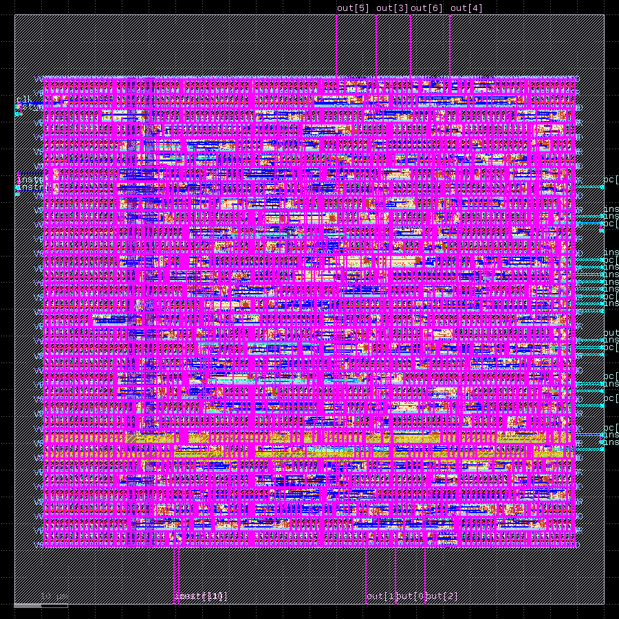 | 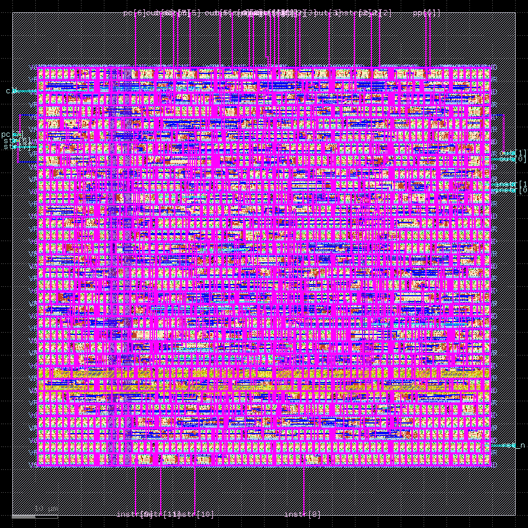 |

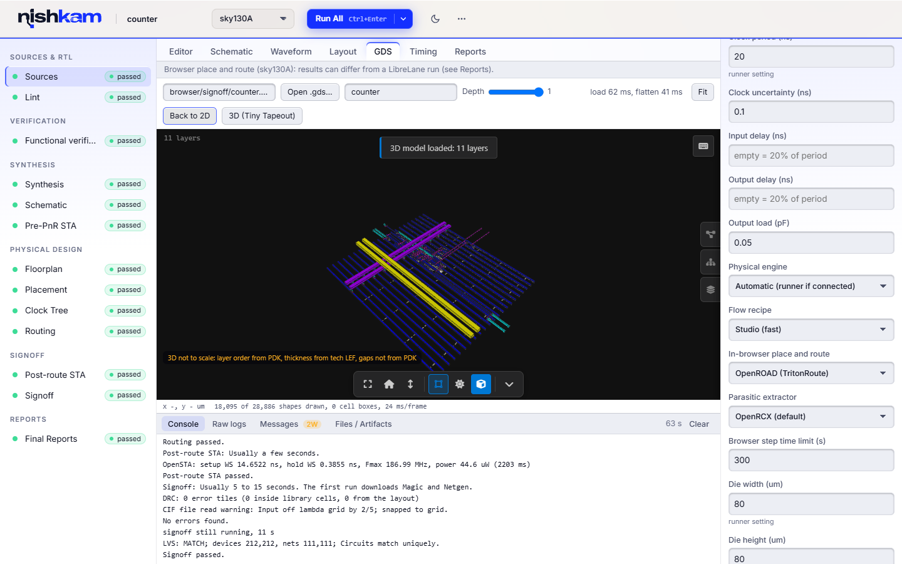

This picture is the 4-bit `counter` run (13 stages). The later `counter10` Edge run shown further down (18 stage chips passed) is a different run; no numbers were recorded for it, and why 13 and 18 differ was not recorded.

**Native KLayout DRC on the browser GDS (re-run 2026-11-23, #208).** `sky130A_mr.drc` (KLayout 0.30.8 in `gf180v`) reports **0 violations** on the browser (Studio recipe) GDS of `counter10` and, after the RC change below, `tiny8` (the earlier `tiny8` layout had 3, see Table 28A; the count depends on the layout). Not run on `shreg4`, `adder2`. Log and report: `logs/klayout-drc-207-208.txt`, `logs/klayout-drc-sky130A-counter10.lyrdb`. Browser `counter10` GDS drawn in KLayout (default layer colours; no native side-by-side picture was made for `counter10`):

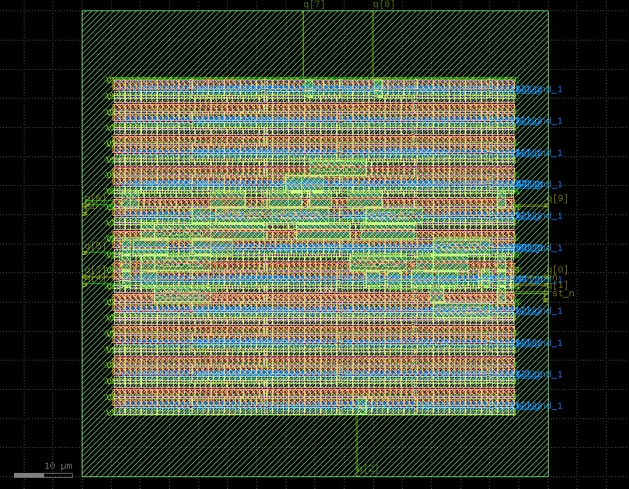

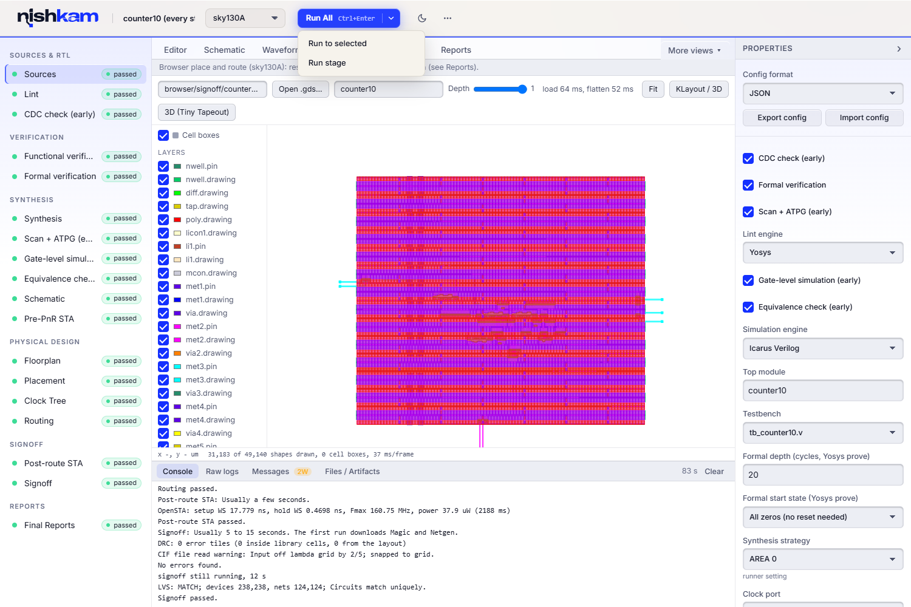

**Wire RC and `li1` (review of #208, fixed).** Before 2026-11-23 the browser flow set the wire RC before placement and CTS to the average of every routing layer in the tech LEF, which included `li1` (about 100 times the resistance of `met1`-`met5`; it is not a routing layer in the flow). Native LibreLane 3.0.2 uses `DATA_WIRE_RC_LAYER met2` / `CLOCK_WIRE_RC_LAYER met5` from `/foss/pdks/sky130A/libs.tech/librelane/config.tcl` (lines 144-145, read as `SIGNAL_WIRE_RC_LAYERS` / `CLOCK_WIRE_RC_LAYERS`). Studio now sets exactly that in every step (`earlyRc` in `web/studio/pdk.js`; before, it did so only in timing repair). The Studio-recipe numbers in Tables 28A/28B were re-run after the change (Node); the native numbers are unchanged. Effect on `tiny8`: wire 7,181 to 7,027 µm, vias 2,017 to 1,980, setup 12.386 to 12.100 ns, worst-corner setup 8.247 to 7.791 ns (native 8.765), power 448 to 388 µW; `counter10`, `shreg4`, `adder2` essentially unchanged.

### Numbers (`sky130A`)

**Table 28A. `tiny8` (`110 x 110 um`, 20 ns, 50% density): Browser Studio vs Browser LibreLane Classic vs Native LibreLane 3.0.2.**

| Metric | Browser (Studio recipe) | Browser (LibreLane Classic recipe) | Native LibreLane 3.0.2 | Verdict & reason |
|---|---|---|---|---|
| Yosys synth cells / area | 222 / 3,093.0 µm² | 222 / 3,093.0 µm² | 471 final stdcells (incl. port/repair bufs + taps/decaps) / 4,460.5 µm² | **differs** (native synth count not recorded, so this compares post-synth with post-PnR cells; the browser Classic recipe adds 34 `repair_design` buffers and 8 clock cells, giving 264 logic cells / 3,415.8 µm²; Yosys 0.68 vs 0.64 may also differ) |
| Routed wirelength | 7,027 µm | 6,922 µm | 8,581 µm | **differs** (-18.1% / -19.3%; fewer cells from Yosys 0.68 and single-corner `repair_design`, same effect as Section 26) |
| Vias | 1,980 | 1,972 | 2,421 | **differs** (-18.2% / -18.5%; tracks cell and net count) |
| TritonRoute DRC | 0 | 0 | 0 | **both 0** (each flow on its own layout) |
| Magic DRC (`drc(full)`) | 0 (0 in cells, 0 layout) | 0 (0 in cells, 0 layout) | 0 | **both 0** (each flow on its own layout) |
| Native KLayout DRC (`sky130A_mr.drc`) on GDS | 0 (earlier run, before the RC change: 3 = `1× nsdm.1`, `2× psdm.1`) | not run | 0 (on KLayout streamout) | **match on this run, layout dependent** (browser streams GDS from Magic, not KLayout; the earlier layout left 3 implant-edge flags under `sky130A_mr.drc`, this one none; `counter10` also 0) |
| Netgen LVS | Match (`3274/3274` dev, `1712/1712` nets) | Match (`3238/3238` dev, `1694/1694` nets) | 0 errors | **both clean** (browser transistor-level Netgen; LibreLane's own LVS is a different, cell-level check, so not the same comparison) |
| LEC (Yosys equiv vs RTL) | proven | proven | n/a | **pass** |
| Post-route setup WNS (`nom_tt_025C_1v80`) | 12.100 ns | 11.843 ns | 12.265 ns | **close** (-1.3% Studio / -3.4% Classic) |
| Post-route hold WNS (`nom_tt_025C_1v80`) | 0.394 ns | 0.394 ns | 0.357 ns | **close** (+0.037 ns) |
| Worst setup corner (`max_ss_100C_1v60`) | 7.791 ns | not run (`MC=0`) | 8.765 ns | **differs** (-0.97 ns; different synthesized netlist and single-corner repair) |
| Fastest setup corner (`min_ff_n40C_1v95`) | 13.627 ns | not run (`MC=0`) | 13.636 ns | **close** (-0.01 ns) |
| PDNSim worst IR drop (`VPWR`, 1.8 V) | 0.299 mV (0.017%) | 0.520 mV (0.029%) | not extracted | sanity checked |
| Total power (`nom_tt_025C_1v80`) | 388 µW | 383 µW | 622 µW | **differs** (default activity + different buffer count) |

**Table 28B. Additional `sky130A` designs (Browser Studio recipe vs Native LibreLane where run).**

| Design (die, period) | Synth cells / area | GLS / LEC | Wire / Vias | TritonRoute / Magic DRC | LVS | Post-route setup / hold (`nom_tt_025C_1v80`) | Native LibreLane (`counter10`) |
|---|---|---|---|---|---|---|---|
| `counter10` (`80×80`, 20 ns) | 31 / 462.9 µm² | 0 mismatch / proven | 884 µm / 296 | 0 / 0 | Match (`506/506`, `258/258`) | 14.902 / 0.385 ns (9 corners: `ss 13.701 < tt 14.902 < ff 15.264`) | 985 µm / 355 vias, DRC 0, LVS 0, setup 14.571 / hold 0.338 ns |
| `shreg4` (`60×60`, 20 ns) | 4 / 105.1 µm² | 0 mismatch / proven | 187 µm / 62 | 0 / 0 | Match (`140/140`, `75/75`) | 15.057 / 0.257 ns (9 corners run; per-corner numbers not listed) | not run |
| `adder2` (`65×65`, comb) | 38 / 347.8 µm² | n/a / proven | 810 µm / 359 | 0 / 0 | Match (`388/388`, `212/212`) | pre-STA 10.195 / 7.959 ns (no clock) | not run |

**In-browser run (Microsoft Edge 1440×900 & 1280×800, Playwright on `studio.html?mock`):** `#top` stays single-line with 0 horizontal overflow (`#pdk` width 132 px); switching to `sky130A` disables `graywolf + qrouter` and updates Reports/Timing copy; `counter` (`80×80`, 20 ns) passed all 13 stages (`DRC 0`, `LVS MATCH 212/212`, `VPWR` worst IR drop 0.020 mV), KLayout 3D loaded 11 layers, Cell delay lookup loaded `tt_025C_1v80`/`ss_100C_1v60`/`ff_n40C_1v95`, with 0 Studio console or page errors.

### What is NOT validated (`sky130A`)

- Designs larger than `tiny8` (~220–470 cells), macros, SRAMs, multi-clock designs, and negative-edge flops.
- Evidence scope: GLS is shown for `counter10` and `shreg4` only (not `tiny8`); pre-PnR STA is shown for `adder2` only; the Classic recipe ran with `MC=0`, so it has no 9-corner numbers; PDNSim IR drop and power have no native number to compare with.
- Native OpenSTA on the browser's exact routed netlist + SPEF (only end-to-end flow comparison was done here).
- KLayout GDS streamout in the browser (Studio streams GDS through Magic; `sky130A_mr.drc` flagged 3 `nsdm.1`/`psdm.1` implant-edge items on an earlier browser `tiny8.gds`, 0 on the current one: Magic's GDS can still carry such flags). `sky130A_mr.drc` was not run on `shreg4`, `adder2` or the Classic recipe GDS, and no native-vs-browser side-by-side picture exists for `counter10`, `shreg4`, `adder2` or the Classic recipe.
- Analog SPICE simulation for `sky130A` in Analog Lab (Analog Lab remains `gf180mcuD` for now).
- Chrome, Firefox, and Safari (browser run was Microsoft Edge on Windows 11).

## 29. IHP ihp-sg13g2 digital flow in Studio (issue #207)

Date: 2026-11-22. **Claimed:** Studio runs a full **digital** RTL-to-GDS flow on IHP `ihp-sg13g2` (`sg13g2_stdcell`, 1.2 V, `VDD`/`VSS`, integrated well ties with no tapcell/endcap insertion) in WebAssembly — synthesis, GLS, LEC, pre-PnR STA, OpenROAD placement/CTS/routing (`Metal2`–`TopMetal2`), OpenRCX (`IHP_rcx_patterns.rules`), PDNSim IR drop, Magic GDS + DRC + SPICE extraction, Netgen LVS, and 3-corner post-route OpenSTA (`nom_typ_1p20V_25C`, `nom_slow_1p08V_125C`, `nom_fast_1p32V_m40C`, matching LibreLane's 3-corner set). Browser-generated GDS files pass **both Magic DRC (0 errors) and native IHP KLayout main DRC deck (`ihp-sg13g2.drc`, 581 rules, `no_recommended=true`, 0 violations; density, antenna, metal fill and seal-ring rules not run)** on `shreg4`, `counter10`, and `tiny8`.

### Designs and setup

- `tiny8` (`130 x 130 um`, 20 ns clock, 50% density): compared against native LibreLane 3.0.2 in both Studio recipe and LibreLane Classic recipe.
- `counter10` (`100 x 100 um`, 20 ns clock, 50% density): compared against native LibreLane 3.0.2, plus GLS, LEC, and native KLayout DRC on the browser GDS.
- `shreg4` (`80 x 80 um`, 20 ns clock): browser flow + native KLayout DRC on the browser GDS.
- `adder2` (`80 x 80 um`, combinational, no clock): clockless path.
- Interactive Edge run: `counter` (`100 x 100 um`, 20 ns).

### Browser tools, PDK assets, and two fixes found during validation

- Engines: same WebAssembly stack as Section 28.
- PDK assets (`web/vendor/ihp-sg13g2/be443da/`, Apache-2.0): copied from IHP-Open-PDK commit `be443daab937daa9154c9c4e73584524f431bd97` inside `hpretl/iic-osic-tools:chipathon26`. Every file is under 1 MiB (largest: `sg13g2_stdcell.gds` at 612 KiB). `IHP_rcx_patterns.rules` is SHA-256 pinned in `web/studio/pdk.js`.
- **Filler fix found during validation:** filling empty rows with only `sg13g2_fill_2` + `sg13g2_fill_1` triggered `Diff tap length < 0.30um (pSD.e/f)` in both browser Magic and native Magic 8.3.636 (572 tiles on `shreg4`, 370 on `counter10`, even though KLayout DRC was 0). Switching to LibreLane's filler order (`sg13g2_decap_8`, `sg13g2_decap_4`, `sg13g2_fill_2`, `sg13g2_fill_1`) dropped Magic DRC to **0 tiles** on every tested design while keeping LVS match.
- **LibreLane Classic script fix (`io.tcl`):** OpenROAD `6f3f28c` / OpenSTA `84c4d7e` returns SWIG `Scene*` handles from `[sta::scenes]` instead of strings, breaking `set_rc.tcl` whenever a PDK supplies custom `_LAYER_RC_*` (such as `ihp-sg13g2`). Reading corner names from `::env(_LIB_CORNER_*)` in `lln::get_corner_names` (recorded as Edit #2 in `web/vendor/librelane-scripts/3.0.2/SOURCE.md`) made the full LibreLane Classic recipe pass on `ihp-sg13g2`.

### Native LibreLane 3.0.2 and KLayout DRC reference

Same container `gf180v` (`hpretl/iic-osic-tools:chipathon26`, LibreLane `v3.0.2`, KLayout `0.30.8`). The exact `config.json` knobs of the `ihp-sg13g2` native runs are not recorded here:
```sh
unset PDK STD_CELL_LIBRARY
librelane --pdk ihp-sg13g2 --scl sg13g2_stdcell config.json --run-tag run
```
Native KLayout DRC check run on browser-generated GDS files:
```sh
klayout -b -r /foss/pdks/ihp-sg13g2/libs.tech/klayout/tech/drc/ihp-sg13g2.drc \
  -rd input=<browser.gds> -rd report=out.lyrdb -rd topcell=<top> \
  -rd no_recommended=true -rd run_mode=deep
```

### Side-by-side GDS and browser screenshots

| Browser Studio GDS (`tiny8`, 130 × 130 µm, rendered in KLayout with `sg13g2.lyp`) | Native LibreLane 3.0.2 GDS (`tiny8`, 130 × 130 µm, same `sg13g2.lyp`) |
|---|---|
| 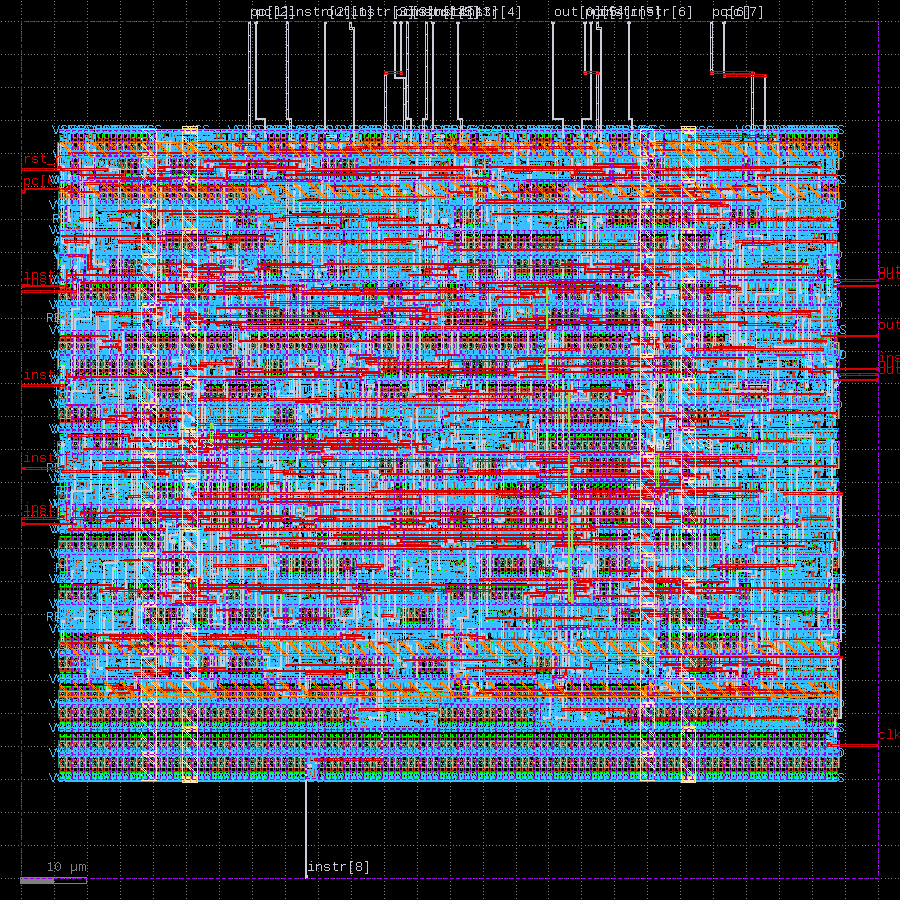 | 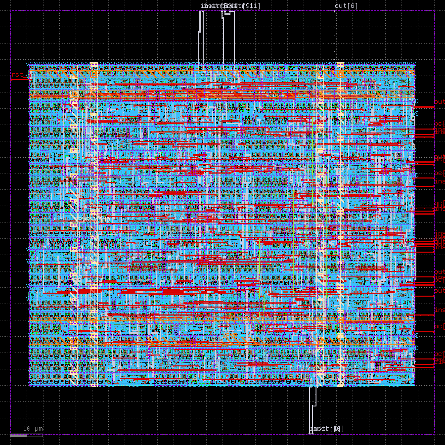 |

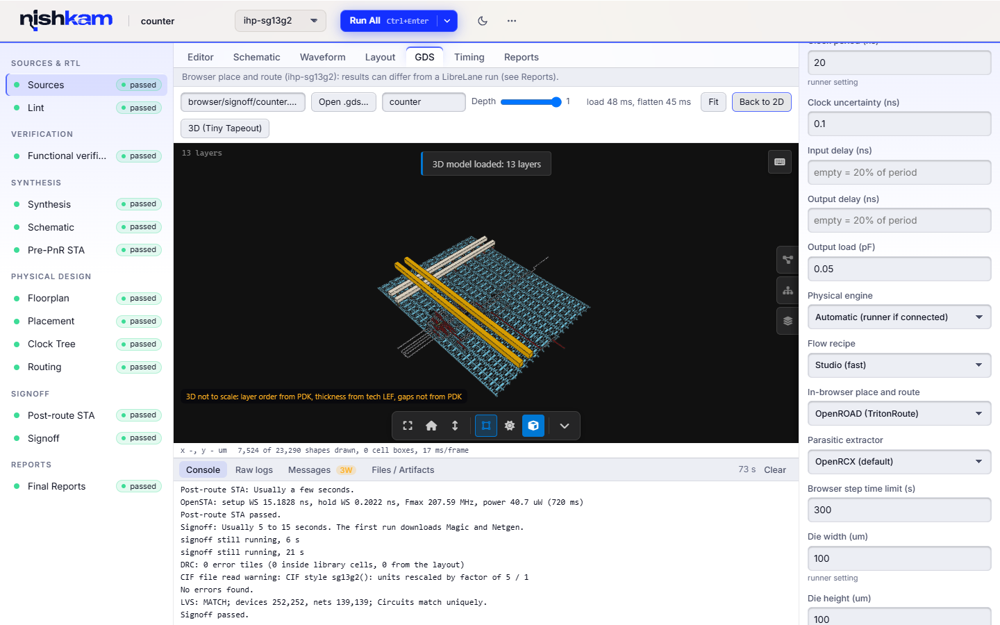

This picture is the 4-bit `counter` run (13 stages). The later `counter10` Edge run shown further down (18 stage chips passed) is a different run; no numbers were recorded for it, and why 13 and 18 differ was not recorded.

**Native KLayout DRC on the browser GDS (re-run 2026-11-23, #207).** `ihp-sg13g2.drc` (581 rule categories, `no_recommended=true`, `run_mode=deep`, KLayout 0.30.8 in `gf180v`) reports **0 violations** on the browser (Studio recipe) GDS of `tiny8`, `counter10` and `shreg4`. Log and report: `logs/klayout-drc-207-208.txt`, `logs/klayout-drc-ihp-counter10.lyrdb`. Browser `counter10` GDS drawn in KLayout with `sg13g2.lyp` (no native side-by-side picture was made for `counter10`):

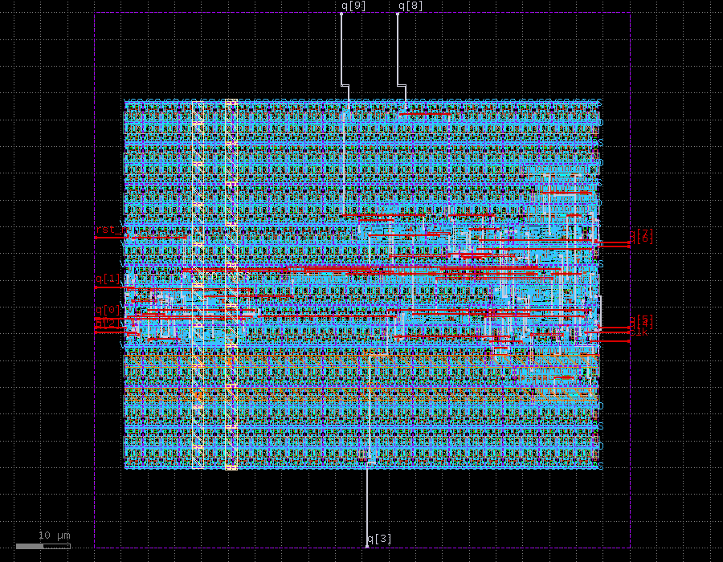

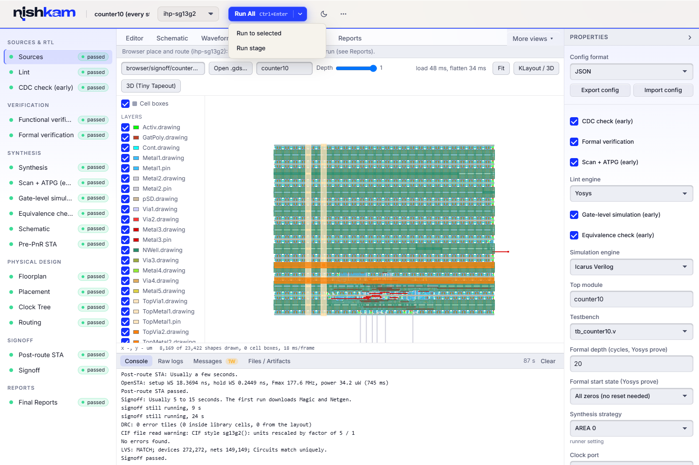

**Wire RC before placement (review of #207, fixed).** Before 2026-11-23 the browser flow ran placement and CTS with the average of all routing layers (including `Metal1`, from the LEF) and applied the PDK's RC only in timing repair (and then the ORFS `Metal3`/`Metal5` choice). Native LibreLane 3.0.2 sets the PDK's `LAYERS_RC` and `VIAS_R` in every step (`/foss/pdks/ihp-sg13g2/libs.tech/librelane/config.tcl` lines 171-210; `*_WIRE_RC_LAYER(S)` are not set) and `librelane/scripts/openroad/common/set_rc.tcl` then averages the constrained routing layers (`Metal2`-`TopMetal2`). Studio now does the same in place, CTS, repair and route (`earlyRc` in `web/studio/pdk.js`). The numbers in Tables 29A/29B were re-run after the change (Node, `pdk-flow.selftest.mjs`). The native LibreLane numbers did not change (the native flow was already correct), so they were not re-run. Effect: `tiny8` wire 11,218 to 11,274 µm, vias 2,487 to 2,477, setup 14.347 to 14.321 ns; `counter10` wire 1,330 to 1,290 µm, vias 299 to 294; `shreg4` and `adder2` unchanged.

### Numbers (`ihp-sg13g2`)

**Table 29A. `tiny8` (`130 x 130 um`, 20 ns, 50% density): Browser Studio vs Browser LibreLane Classic vs Native LibreLane 3.0.2.**

| Metric | Browser (Studio recipe) | Browser (LibreLane Classic recipe) | Native LibreLane 3.0.2 | Verdict & reason |
|---|---|---|---|---|
| Yosys synth cells / area | 282 / 4,730.9 µm² | 282 / 4,730.9 µm² (347 final stdcells, 5,546.6 µm²) | 375 final stdcells / 6,519.1 µm² | **differs** (Yosys 0.68 vs 0.64; both place 0 tapcells/endcaps) |
| Clock buffers (`sg13g2_buf_*`) | 34 | 9 (`buf_16`) | 9 | **match** on LibreLane Classic (9 vs 9); Studio recipe differs |
| Routed wirelength | 11,274 µm | 10,102 µm | 9,414 µm | **close** on Classic (+7.3%); Studio +19.8% (larger CTS tree) |
| Vias | 2,477 | 2,284 | 2,263 | **match/close** on Classic (+0.9%); Studio +9.5% |
| TritonRoute DRC | 0 | 0 | 0 | **both 0** (each flow on its own layout) |
| Magic DRC (`drc(full)`) | 0 (0 in cells, 0 layout) | 0 (0 in cells, 0 layout) | 0 | **both 0** (each flow on its own layout) |
| Native KLayout DRC (`ihp-sg13g2.drc`, 581 rules) | **0** (re-run 2026-11-23 on the current GDS) | not run | **0** | **both 0** (each on its own GDS) |
| Netgen LVS | Match (`3510/3510` dev, `1790/1790` nets) | Match (`3340/3340` dev, `1705/1705` nets) | 0 errors | **both clean** (browser transistor-level Netgen; LibreLane's own LVS is a different, cell-level check, so not the same comparison) |
| LEC (Yosys equiv vs RTL) | proven | proven | n/a | **pass** |
| Post-route setup WNS (`nom_typ_1p20V_25C`) | 14.321 ns | 13.734 ns | 13.415 ns | **close** (+0.32 ns Classic / +0.91 ns Studio) |
| Post-route hold WNS (`nom_typ_1p20V_25C`) | 0.187 ns | 0.188 ns | 0.302 ns | **differs** (-0.11 ns; LibreLane adds hold-margin buffering across 3 corners) |
| Slow corner setup (`nom_slow_1p08V_125C`) | 13.408 ns | not run (`MC=0`) | 12.073 ns | **differs** (different netlist + single-corner repair) |
| Fast corner setup (`nom_fast_1p32V_m40C`) | 14.874 ns | not run (`MC=0`) | 14.222 ns | **close** (+0.65 ns) |
| PDNSim worst IR drop (`VDD`, 1.2 V) | 0.632 mV (0.053%) | 0.582 mV (0.049%) | not extracted | sanity checked |
| Total power (`nom_typ_1p20V_25C`) | 586 µW | 335 µW | 403 µW | **differs** (buffer count and default activity) |

**Table 29B. Additional `ihp-sg13g2` designs (Browser Studio recipe vs Native LibreLane where run).**

| Design (die, period) | Synth cells / area | GLS / LEC | Wire / Vias | TritonRoute / Magic / KLayout DRC | LVS | Post-route setup / hold (`nom_typ_1p20V_25C`) | Native LibreLane (`counter10`) |
|---|---|---|---|---|---|---|---|
| `counter10` (`100×100`, 20 ns) | 30 / 727.6 µm² | 0 mismatch / proven | 1,290 µm / 294 | 0 / 0 / **0** | Match (`586/586`, `298/298`) | 15.031 / 0.172 ns (3 corners: `slow 14.549 < typ 15.031 < fast 15.320`) | 1,473 µm / 363 vias, DRC 0, LVS 0, setup 14.564 / hold 0.425 ns |
| `shreg4` (`80×80`, 20 ns) | 4 / 196.0 µm² | 0 mismatch / proven | 217 µm / 55 | 0 / 0 / **0** | Match (`156/156`, `83/83`) | 15.419 / 0.087 ns (3 corners run; per-corner numbers not listed) | not run |
| `adder2` (`80×80`, comb) | 35 / 375.6 µm² | n/a / proven | 1,075 µm / 313 | 0 / 0 / not run | Match (`376/376`, `206/206`) | pre-STA 10.959 / 7.936 ns (no clock) | not run |

**In-browser run (Microsoft Edge 1440×900, Playwright on `studio.html?mock`):** switching from `sky130A` to `ihp-sg13g2` cleared prior results cleanly, kept `graywolf + qrouter` disabled, and ran `counter` (`100×100`, 20 ns) through all 13 stages to green `passed` (`DRC 0`, `LVS MATCH 252/252`, `VDD` 1.2 V worst IR drop 0.176 mV), KLayout 3D loaded 13 layers (`Metal1`–`Metal5` + `TopMetal1`–`2`), Cell delay lookup loaded `typ_1p20V_25C`/`slow_1p08V_125C`/`fast_1p32V_m40C`, with 0 Studio console or page errors.

### What is NOT validated (`ihp-sg13g2`)

- **Analog SPICE simulation (explicitly unsupported):** IHP SG13G2's transistor, resistor, and varactor models (`psp103va`, `r3_cmc`, `mosvar`) require OpenVAF/OSDI compiled shared libraries (`*.osdi`), which fail in `ngspice-46.wasm` (`dynamic linking not enabled`). `ihp-sg13g2` in Nishkam is digital-only until OSDI can be statically linked or dynamically loaded in WebAssembly.
- **Density & antenna KLayout decks (`density.drc`, `antenna.drc`):** only `ihp-sg13g2.drc` (`main`, `no_recommended=true`) was run on the browser GDS; metal fill generation (`filler.py`) and seal-ring rules were not run.
- Designs larger than `tiny8`, macros, SRAMs, multi-clock designs, native OpenSTA on identical SPEF/netlist, and browsers other than Microsoft Edge.
- Evidence scope: GLS is shown for `counter10` and `shreg4` only; the Classic recipe ran with `MC=0` (no 3-corner numbers); PDNSim IR drop and power have no native number to compare with (and the IR drop changed between Node runs of the same design, 0.45 / 0.98 / 0.63 mV on `tiny8`, so treat it as a sanity check only); the 4-bit `counter` Edge run has no native reference. Native KLayout DRC was run on `tiny8`, `counter10`, `shreg4` browser GDS (not `adder2`, not the Classic recipe GDS); no native-vs-browser side-by-side picture exists for `counter10`, `shreg4`, `adder2` or the Classic recipe.
## 30. Threaded OpenROAD in the browser (issue #196)

Status: early. Claim made here, and no other: the threaded OpenROAD build `web/vendor/openroad-pnr/6f3f28c-mt/` gives the same results as the single-thread build `6f3f28c-viz/` (`6f3f28c-viz` itself was not compared with native OpenROAD; section 8.x compared the shipped `6f3f28c` build, and the viz SOURCE.md records byte-identical DEFs against it with frames off), and routes faster on bigger designs. Not a claim that the result is good, or that it matches LibreLane.

**Setup.** Designs: tiny8 (135.52 x 133.28 um, 24 ns, density 50, 407 cells after placement) and rmult16 (16 x 16 registered multiplier, synthesized netlist from the spike, 320 x 320 um, 24 ns). Machine: Windows 11, 16 hardware threads, Node 26 (OpenROAD runs inside Studio's own worker modules, `tools/openroad-pnr/threads/bench.mjs`). Flow per run: place (live frames every 10 iterations), CTS (frames every iteration), global + detailed route (frames every iteration), as Studio runs it.

**How our flow was built.** Engine: OpenROAD master 6f3f28c, OpenSTA 84c4d7e, emscripten/emsdk 3.1.74. The threaded build adds Emscripten pthreads, an OpenMP runtime for WebAssembly (the compiler turns the `#pragma omp` loops into `__kmpc_*` calls; emsdk has no library for them), `-sMALLOC=mimalloc`, and OpenSTA held to one thread. Thread count is set with `set_thread_count N` (Studio uses min(4, cores - 1)). Exact steps and both patches: `web/vendor/openroad-pnr/6f3f28c-mt/SOURCE.md`. Studio loads it only when the page is cross-origin isolated (`web/_headers`, Studio pages only); otherwise the single-thread build.

**How the reference was run.** The reference is the single-thread browser build `6f3f28c-viz` (the shipped `6f3f28c` with live frame hooks; the tiny8 wire and vias here, 10,125 um and 1,883, are not the 9,789 um and 1,857 of section 8.x on the same die, and the reason for that difference was not traced; its own check is in `web/vendor/openroad-pnr/6f3f28c-viz/SOURCE.md`), run by the same script with `set_thread_count 1`. Native OpenROAD is not used in this section; section 8 compares the single-thread build with native.

**Results (DEF = sha256 of the DEF file, first 16 hex).**

| Design | Build, threads | Route stage (s) | place DEF | CTS DEF | routed DEF | Frames (place / CTS / route) | DRC | Wire (um) | Vias | Mark |
|---|---|---:|---|---|---|---|---:|---:|---:|---|
| tiny8 | viz, 1 (reference) | 40.9 | 7b33e30a602c439a | 823af5058c77ea7a | 52e40101c1e137ef | 77 / 10 / 6 | 0 | 10,125 | 1,883 | reference |
| tiny8 | mt, 1 | 38.3 | same | same | same | same | 0 | 10,125 | 1,883 | match |
| tiny8 | mt, 4 | 27.3 | same | same | same | same | 0 | 10,125 | 1,883 | match |
| tiny8 | mt, 8 | 24.3 | same | same | same | same | 0 | 10,125 | 1,883 | match |
| rmult16 | viz, 1 (reference) | 79.8 | 1d7f681959e45d10 | f0f8a8e7b85a4d9a | 81a60fffe12f81d1 | 92 / 13 / 6 | 0 | 43,662 | 8,692 | reference |
| rmult16 | mt, 1 | 82.2 | same | same | same | same | 0 | 43,662 | 8,692 | match |
| rmult16 | mt, 4 | 37.6 | same | same | same | same | 0 | 43,662 | 8,692 | match |
| rmult16 | mt, 8 | 32.4 | same | same | same | same | 0 | 43,662 | 8,692 | match |

Route stage = global route + detailed route + fillers + parasitics extraction + IR drop, wall clock. Speed-up at 4 threads: tiny8 1.5 times, rmult16 2.1 times. Place and CTS stages do not get faster on these two designs (about 11 to 15 s each, 1 to 3 s slower with threads on the small ones): their loops are short and thread start-up costs as much as it saves. Frames are counted per kind and are equal in every run (for example place: 3 snapshots, 70 global-placement frames, 1 repair, 3 legalisation on tiny8). The full Studio flow selftest (`pnr-flow.selftest.mjs tiny8`, 4 threads) passes: TritonRoute 0 violations, Magic DRC 0, Netgen LVS match, post-PnR netlist equivalent to the RTL.

**In the browser.** Edge (Playwright, msedge) through `tools/serve-coi.mjs` (same headers as `web/_headers`): `crossOriginIsolated` true, run log `OpenROAD threads: 4`, live frames appear in the Layout tab, Run All on counter10 passes 18 of 18 stage chips (72.8 s). The same server with `--no-coi`: `crossOriginIsolated` false, log `threads: 1`, 18 of 18 pass (66.9 s). On a design this small the threads do not help. Screenshots: `docs/validation/img/27-threads-isolated-counter10.png`, `docs/validation/img/27-threads-fallback-counter10.png`. Console in both runs: only the localhost-only errors (the API and the analytics beacon refuse `127.0.0.1`).

**Not validated.** Firefox and Safari (Safari needs the same headers; untested); designs above about 1,500 cells (the 7.2k-cell case of #193 is not run); more than 8 threads; the LibreLane recipe (it still uses the single-thread build); a native threaded OpenROAD as a second reference; whether results stay identical on a heavily loaded machine (they were identical on every run here, and TritonRoute commits its workers in a fixed order). Memory: the threaded build reserves more (tiny8 route about 0.5 GB, rmult16 global placement about 1.1 GB; the limit is 4 GB), so a phone or a 4 GB laptop may fail to start it; Studio then falls back to the single-thread build. Firebase sign-in inside Studio (the access-key usage report) loads an iframe from `firebaseapp.com`, which a cross-origin isolated page may block; it is best-effort and not tested here.

---
## Claims under review

An independent review (a different AI model, 2026-11-10, issue #40) went through this report. Points that were right are fixed in the text above. Points that need a new run are here; until the run is done the claim stays narrowed as written above. Each step needs the container (`docker start gf180`; in Git Bash `export MSYS_NO_PATHCONV=1`).

Answered on 2026-11-10 (issue #40), one line each; the detail is in the section named:
1. Native LVS of the OpenROAD flow: done, match (section 2, "Added 2026-11-10").
2. Native Netgen on adder, twoclk, pins40, sr8 and the two negative controls: done, all match (section 2).
3. Native DRC and LVS on the native routed DEF: done, DRC 0 and LVS match; the native `-threads 1` placement rerun: done, identical numbers (section 8.x). Native extraction (OpenRCX) and timing on that DEF, and 8.z on the native route: done 2026-11-23 (#217) with the rules file mounted; both routes within about 0.02 ns of setup slack, DRC 0, LVS match (sections 8.x and 8.z, `logs/item3/`).
4. LibreLane cell split and `parity_eq` logs, `dobuild.sh`: done (section 7; `logs/parity_eq/`, `logs/dobuild.sh`).
5. Run time 56 s against 68 to 76 s: NOT done. It needs one PC and a quiet machine (the LibreLane run is not the issue; the browser runs were not repeated because the PC had about 3 GB of free memory besides Docker).
6. In-page runs: the practice banners c01, c24, c25 are done in Edge on the live site (section 10); the Studio shreg4 flow was run live in Edge (section 12). NOT done in a page: the 135.52 x 133.28 um tiny8 die, and 8.x, 8.y, 8.z (each is a long Studio run; the self-test numbers are from Node). Chrome itself was not used, only Edge.
7. ngspice: done except the Edge in-page deck run with the browser `.spiceinit` (the browser-side `.spiceinit` is what `run-browser.mjs` already uses, in Node): image digest, versions, `m=xx` (explained), native `hsa` rerun and KLU on both sides (section 18).
8. Section 16 native `sta` path: done, same binary (section 16).
9. Section 12 shreg4 without `?mock`: done in Edge (section 12). The explorer's layer counts were NOT read (the explorer is a canvas inside an iframe; no counts could be taken from the page text). `klayout -v` is 0.30.8.
10. Section 13: ABC and Yices versions recorded (section 13). A real Boolector failure for the ERROR path was NOT produced.
