# Validation report

Every time we say a part of the flow "matches" the traditional tool, the proof is here: the test design, how our browser version was built, how the traditional tool was run, the numbers, and what we did not check. Test designs only check the tools. They do not show a design is good.

Logs are in `docs/validation/logs/`, pictures in `docs/validation/img/`. Runs were done between 2026-10-18 and 2026-10-20; each section says which.

## Summary: what is and is not validated

Two place-and-route flows exist in Studio:
- **OpenROAD (TritonRoute)**: the main flow. Section 8.
- **graywolf + qrouter**: the older option, still selectable. It is not DRC clean (Magic still reports errors). Sections 3, 6 and 7.

| Stage | Browser engine (WebAssembly) | Compared with | Result | Not validated |
|---|---|---|---|---|
| Clock tree (section 1) | OpenROAD TritonCTS 61932e8 | native OpenROAD, same commit | identical output DEF on tiny8 (553 of 553 cells) | other designs, multi-clock |
| LVS (section 2) | Netgen 3cb047b (v1.5.324) | native Netgen 1.5.318 | same verdict and counts on 3 designs | many kinds of mismatch (one broken layout only) |
| Magic DRC, extraction, GDS (section 5) | Magic bed8d4f | native Magic 8.3.636 | same DRC count and rule texts, same SPICE, GDS XOR area 0 | DRC tile positions |
| Timing and power (section 4) | OpenSTA defec0b (3.1.0) | native `sta` 3.1.0 | full report text identical on 2 designs | wire parasitics (SPEF), other corners |
| OpenROAD place and route (section 8) | OpenROAD 61932e8 | native OpenROAD, same commit, 1 thread | same netlist; results agree to about 1%; not bit-identical; both end at 0 violations | large or hard designs |
| OpenROAD flow vs LibreLane (section 8B) | Studio recipe | LibreLane 3.0.2 | similar quality, not the same steps; numbers given as percentages | why LibreLane's wire is 29% longer |
| graywolf + qrouter (section 6) | graywolf 33fbcaa, qrouter c8f1111 | same sources built natively | placement files identical; routed DEF differs in wire choices | clocked designs |
| Formal equivalence (section 7, 8) | Yosys | RTL | netlists proven equal to the RTL (tiny8, adder2) | not a general proof |
| RTL grader | Yosys miter + k-induction | native Yosys 0.64 | 5 references proven, 19 wrong designs fail, same in both; a design differing only after cycle 45 passes as "first 40 cycles" (section 10) | CDC problems, x-handling, unreachable-state fallback |

**Scope.** Validated: single-clock designs on gf180mcuD (7-track cells), up to 48 flip-flops, 1,559 nets and 3,150 transistors, 50% density, one corner (tt, 25 C, 5.00 V), in Chrome.

**Not validated:** more than one clock, other corners (ss, ff), signoff-grade extraction (OpenRCX), designs above about 1,600 nets, congestion, antenna and IR-drop checks, Firefox and Safari.

### Terms
- **Studio**: the browser IDE (`web/studio.html`). It runs every tool in this report in WebAssembly.
- **Old flow**: graywolf (placement) + qrouter (routing). **OpenROAD flow**: OpenROAD placement, clock tree and TritonRoute.
- **Runner**: a program on the user's PC that runs real LibreLane for Studio. It is not used anywhere in this report.
- **Grader**: the practice page's checker for RTL answers.
- **DRC error tile**: Magic reports each violation as one or more rectangles ("tiles"). One rule broken in one place can be several tiles, so tile counts are not rule counts. We report tile counts, and compare the rule texts separately (section 5).
- **`$SUB`**: the name Magic gives the substrate net in extracted SPICE. Only this name differs between browser and native.

### Test host
AMD Ryzen 9 6900HS (8 cores, 16 threads), 15.2 GB RAM, Windows 11 Home (10.0.26200). Docker 29.6.2 on WSL2 with 16 threads and 10 GB RAM + 8 GB swap. Node v26.7.0. Chrome 155. WebAssembly builds use Emscripten 3.1.74. Times in this report come from this PC, often with other programs running.

### Tool versions: native (container) and browser
Native: image `hpretl/iic-osic-tools:chipathon26`, container `gf180`, PDK gf180mcuD, read from inside the container.

| Tool | Native (container) | Browser build | What we changed |
|---|---|---|---|
| OpenROAD | 26Q2-254-g61932e897 | commit 61932e8 | 33-file patch (section 8) |
| OpenSTA | `sta` 3.1.0 | commit defec0b (3.1.0) | none |
| Netgen | 1.5.318 | 3cb047b (1.5.324) | one use-after-free fix in `netcmp.c` |
| Magic | 8.3.636 | bed8d4f (version number not recorded in `SOURCE.md`) | relinked with two flags (stack size, function pointer casts) |
| Yosys | 0.64 | `@yowasp/yosys` 0.68.1207 | none |
| LibreLane | 3.0.2 (native only) | not in browser | none |
| graywolf | built from commit 33fbcaa with gcc | 33fbcaa | `wasm.patch` (old C code fixes, `system()` emulated); same patch used natively |
| qrouter | built from commit c8f1111 with gcc | c8f1111 and `c8f1111-drc` | `c8f1111-drc` adds one call to upstream's `apply_drc_blocks()` |

The browser and native versions differ for Yosys, Netgen and Magic. Where that could matter it is said in the section. Each browser build has a `web/vendor/<tool>/<version>/SOURCE.md`.

### Benchmark designs
| Design | Function | Cells (Yosys) | Clock | Die used | Sections |
|---|---|---|---|---|---|
| adder2 | 8-bit adder + XOR, no clock | 43 (old flow) / 35 (OpenROAD flow) / 45 (LibreLane) | none | 77.28 x 74.48 um (parity, 8); auto-sized in 3, 5 | 2, 3, 5, 6, 7, 8 |
| adder | same logic as adder2, different RTL names | 43 | none | auto | 2 |
| tiny8 | small 8-bit CPU, 48 flip-flops (`squeeze-tiny8` problem) | 236 / 255 / 287 (see 8B) | 24 ns | 135.52 x 133.28 um (7, 8A, 8B); 250 x 250 um (8 browser run); auto 103.6 x 101.9 um (2, 3, 5) | 1 to 8 |
| mult8 | 8x8 multiplier | not recorded | none | auto | 2, 3 |
| shreg4, sr8 | 4-bit and 8-bit shift registers (`sr8` made by `pd.selftest.mjs 8`, the number is the width) | not recorded | 10 ns (shreg4) | auto | 4, 5 |
| cnt8 | 8-bit counter | not recorded | 10 ns | auto | 4 |
| twoclk | two clocks, two flops, reset | not recorded | two clocks | auto | 2 |
| pins40 | 40 inputs, 2 outputs (pin placement test) | not recorded | none | auto | 2 |

RTL for all of them is in `web/studio/engines/pd.flow.mjs` (`DESIGNS`); tiny8 is also the `squeeze-tiny8` problem file. "Auto" means the flow chose the die from the cell area.

## 1. Clock tree (TritonCTS) matches native OpenROAD on tiny8

**Claimed:** the browser clock tree gives the same result as native OpenROAD.

**Test design:** tiny8 (48 flops), the placed DEF LibreLane wrote (`web/studio/demo/34-openroad-detailedplacement/tiny8.def`, 343 cells before CTS) and the SDC LibreLane used (`web/studio/engines/cts.tiny8.sdc`).

**Our flow:** OpenROAD commit 61932e8 built to WebAssembly (`web/vendor/openroad-cts/61932e8/SOURCE.md`). Same commit as the container's OpenROAD. Run it with `node web/studio/engines/cts.selftest.mjs`.

**Traditional flow:** native OpenROAD 26Q2-254-g61932e897 in the container, TritonCTS run from `cts_golden.tcl` on the same placed DEF. Its output DEF is kept at `web/studio/demo/35-openroad-cts/tiny8.def`.

**Result:**

| | Native | Browser |
|---|---|---|
| Clock buffers | 9 (clkbuf_8) | 9 |
| Sinks | 48 | 48 |
| Latency | 0.67 ns | 0.67 ns |
| Skew | 0 ns | 0 ns |
| Components in output DEF | 553 | 553 |
| Same cell, position and orientation | 553 of 553 (baseline) | 553 of 553 |

The self-test prints `cts selftest ok`. `node docs/validation/ctsdiff.mjs` does the DEF comparison (log: `logs/ctsdiff.txt`).

**Why section 8 shows 7 buffers, not 9:** this section runs the clock tree on LibreLane's placed DEF (343 cells, from LibreLane's netlist). Section 8 runs it on Studio's own placed DEF (271 cells, from Studio's netlist). Different input, so a different tree. Same code.

| Native OpenROAD | Browser TritonCTS |
|---|---|
| 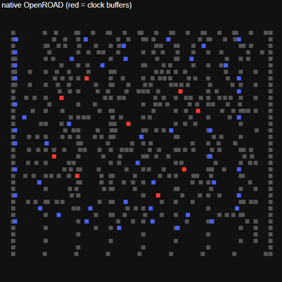 |  |

Red squares are clock buffers, blue are flops, grey are other cells. The pictures are the same because the DEFs are the same.

**Not validated:** only tiny8 and the single-clock case. Wires are not compared (routing happens later). Only clkbuf_8/4/2 are allowed.

Log excerpt (rendered from `logs/cts.txt`, see the note at the end):

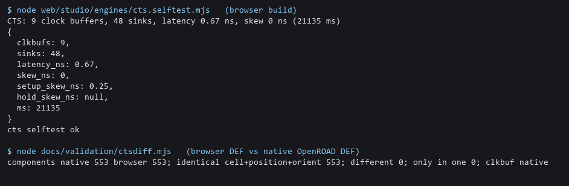

## 2. Netgen LVS matches native Netgen

**Claimed:** the browser Netgen says match or mismatch the same way as native Netgen, and the old browser flow gives LVS match on the test designs.

**Test design:** adder2, mult8, tiny8 through the old flow (Yosys, graywolf, qrouter, Magic extract), at the flow's automatic die size. Also adder, twoclk and pins40 in `pd.cases.selftest.mjs`.

**Our flow:** Netgen commit 3cb047b (v1.5.324) with Tcl 8.6.14 built to WebAssembly, with one fix for a use-after-free in `netcmp.c` (`web/vendor/netgen/3cb047b/SOURCE.md`). Run `node web/studio/engines/lvs.selftest.mjs` and `node web/studio/engines/pd.cases.selftest.mjs`.

**Traditional flow:** `node docs/validation/lvs-dump.mjs <design> <folder>` writes the exact files the browser Netgen compared (`lay.spice`, `cells.spice`, `pg.v`, `setup.tcl`, `run.tcl`). Then in the container, in that folder (set `MSYS_NO_PATHCONV=1` in Git Bash):
`docker exec gf180 bash -lc "cd /foss/designs/nishkam_val/<design> && netgen -batch source run.tcl"`.
Logs: `logs/netgen-native-*.log`. One command re-runs both sides: `bash docs/validation/netgen-compare.sh` (re-run 2026-10-18, same numbers).

**Result (same inputs):**

| Design | Browser devices / nets | Native devices / nets | Both say |
|---|---|---|---|
| adder2 | 256 / 146 | 256 / 146 | match uniquely |
| mult8 | 2321 / 1180 | 2321 / 1180 | match uniquely |
| tiny8 | 3100 / 1537 | 3100 / 1537 | match uniquely |

The tiny8 counts here (3100 / 1537) are from the automatic die (103.6 x 101.9 um). Section 7 and 8B use the larger die 135.52 x 133.28 um and get 3098 / 1536 with the old flow. Different die, different run; both are match.

Other `pd.cases.selftest.mjs` results (all PASS, 0 failed nets, LVS true): twoclk 56/32, adder 256/146, pins40 20/20. `lvs.selftest.mjs`: sr8 matches (224/224 devices, 109/109 nets) and a deliberately broken layout is caught (216 vs 224 devices).

**Flatten check:** `run.tcl` uses `catch {netgen::flatten class {<cell> <file index>}}`, and `catch` hides errors, so we checked that it works. Native Netgen 1.5.318 on adder2 prints 18 "Flattening instances of ..." lines (both files) and compares 256 devices / 146 nets; with the flatten lines removed it prints none and compares 43 devices / 61 nets (still "match uniquely"). So the syntax is right. Logs: `logs/netgen-native-adder2-flatten.log`, `-noflatten.log`.

**Version note:** native Netgen is 1.5.318; the browser build is 1.5.324 plus one fix. Netgen 1.5.324 native was not available.

**Not validated:** mismatch cases beyond one broken layout (a swapped net, an open net and a short are not tested; see section 9), so native and browser may differ on other mismatch reports. This section's flow has no well-tap cells and LVS assumes wells are tied to power. The OpenROAD flow (section 8) adds tap cells and its LVS (3150 devices / 1559 nets) includes them, but that run has no native Netgen comparison.

Log excerpts (rendered from the stored logs). Browser Netgen, then native Netgen on the same files:

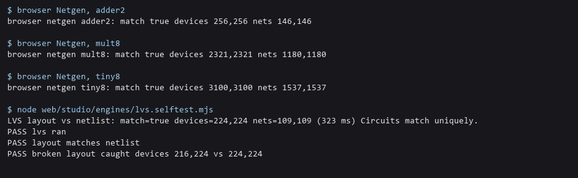

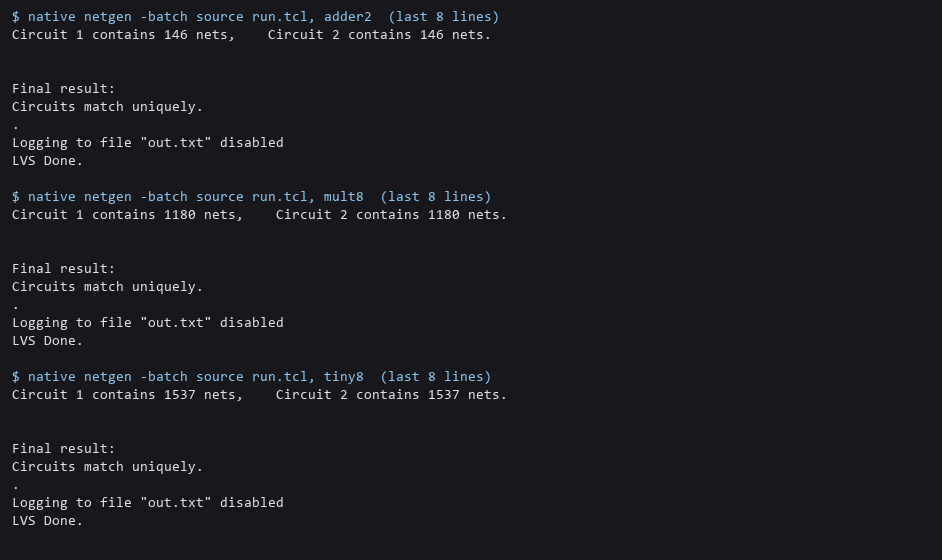

## 3. qrouter fix: fewer Magic DRC errors (old flow)

**Claimed:** blocking wires near vias on Metal1-3 cuts DRC error tiles (adder2 18 to 3, mult8 118 to 39, tiny8 197 to 66) and keeps LVS matching.

**Test design:** adder2, mult8, tiny8 through the old flow at the automatic die, then Magic DRC.

**Our flow:** qrouter commit c8f1111 (unmodified build) and `c8f1111-drc` (one change: call upstream's own `apply_drc_blocks()` on Metal1-3). Details in `web/vendor/qrouter/c8f1111-drc/SOURCE.md`. `node docs/validation/drc-count.mjs <design>` runs one design. To compare with the unmodified build, point `qf` in `web/studio/engines/place.worker.js` at the old qrouter folder, run, then put it back.

**Traditional flow:** none. This is a before/after on our own browser flow. Native LibreLane gives clean routing on these designs, which is the target we have not reached.

**Result (`logs/drc.txt`):**

| Design | Before | After | Failed nets | LVS |
|---|---|---|---|---|
| adder2 | 18 | 3 | 0 | match |
| mult8 | 118 | 39 | 0 | match |
| tiny8 | 197 | 66 | 0 | match |

`pd.selftest.mjs 8` (sr8) now gives 0 error tiles. The same routed DEFs were also run through native Magic (section 5).

**Why other sections show different DRC numbers for the same designs.** The numbers above are at the flow's automatic die. Section 7 uses a forced, larger die (adder2 77.28 x 74.48 um, tiny8 135.52 x 133.28 um) and the old flow gives 2 (adder2) and 88 (tiny8) there. The die is the only input that changed (tiny8: the automatic die is 103.6 x 101.9 um per `parity/stress.mjs`, whose "studio-default" case also gave the 197 before the fix). Each number is right for its own run.

**Not validated:** the remaining tiles are real errors, so the old flow is not DRC clean. The DRC count is Magic's, not signoff. The number of distinct rules broken was not recorded.

Log excerpt (rendered from `logs/drc.txt`):

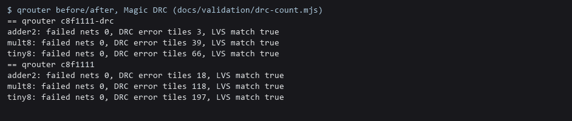

## 4. OpenSTA timing and power match native OpenSTA

**What is checked:** the browser OpenSTA and native `sta` 3.1.0 read the same netlist, liberty and Tcl, and the complete output text is compared: every max and min path report, wns/tns, worst slack and the power report. `bash docs/validation/sta-compare.sh` (native side needs the container). Logs: `logs/sta-native-*.txt`, `logs/sta-browser-*.txt`.

**Test design:** shreg4 and an 8-bit counter (cnt8), clock 10 ns, input/output delay 2 ns, load 0.05 pF.

**Our flow:** OpenSTA commit defec0b (3.1.0) built to WebAssembly, the commit bundled in the container's OpenROAD (`web/vendor/opensta/defec0b/SOURCE.md`). Liberty is the unmodified gf180mcu tt 25C 5V file. Also `node web/studio/engines/opensta.selftest.mjs`.

**Traditional flow:** `/foss/tools/openroad/bin/sta` (3.1.0) in the container, run by the same script (2026-10-18).

| Design | Lines compared | Result | Setup worst slack | Hold worst slack | Total power |
|---|---|---|---|---|---|
| shreg4 | 434 | identical | 6.7093 ns | 0.5372 ns | 279 uW |
| cnt8 | 1172 | identical | 6.0215 ns | 1.2837 ns | 1710 uW |

Only the licence banner differs.

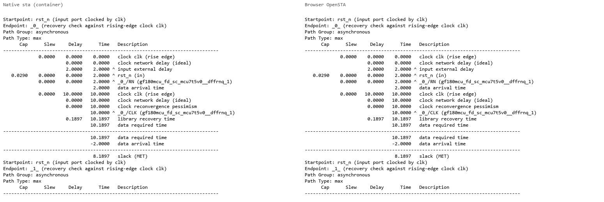

**Not validated:** one liberty corner, two small designs. No wire-parasitic (SPEF) file was used in this comparison, so the SPEF reader and RC delay calculation are not compared with native. Post-route timing on tiny8 (section 8) uses SPEF but only the OpenSTA build is used there.

Log excerpt (rendered from `logs/opensta.txt`):

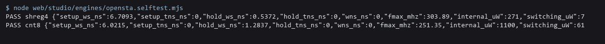

## 5. Magic: DRC, extraction and GDS match native Magic

**Claimed:** browser Magic gives the same DRC count, extraction and GDS as native Magic.

**How:** `bash docs/validation/magic-compare.sh` runs the old browser flow, then browser Magic, then native Magic 8.3.636 in the container on the same routed DEF and the same PDK files (same command list as `magic.worker.js`). It compares the DRC total, the DRC rule texts, the extracted SPICE (apart from the `$SUB` name) and the GDS (KLayout 0.30.8 XOR, `gds-xor.py`). Logs: `logs/magic-native-*.txt`, `logs/magic-browser-*.txt`. Run 2026-10-18.

| Design | DRC tiles native / browser | Rule texts | SPICE | GDS XOR area |
|---|---|---|---|---|
| sr8 | 0 / 0 | same | same | 0 (25 layers) |
| adder2 | 3 / 3 | same | same | 0 (25 layers) |
| tiny8 | 66 / 66 | same | same | 0 (25 layers) |

| adder2 | tiny8 |
|---|---|
| 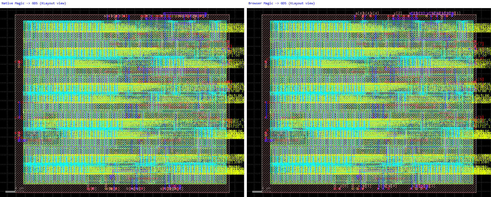 | 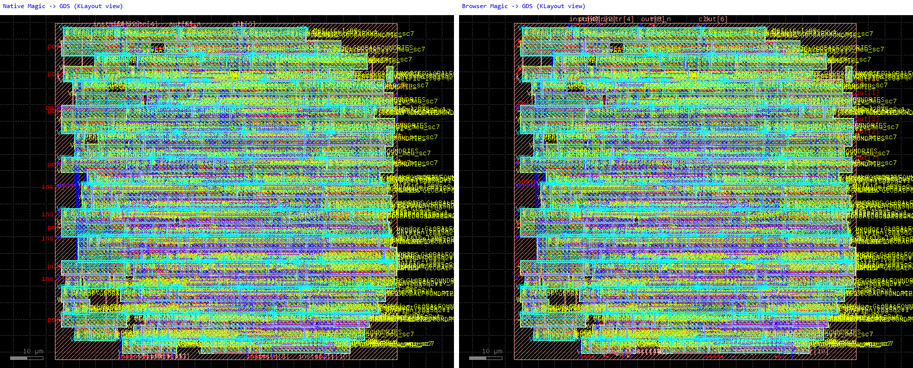 |

Left half of each picture is native Magic's GDS, right half is the browser's, both drawn by KLayout (`render-gds.py`). They match because the GDS geometry is the same.

**Not validated:** the DRC tile positions were not compared, only count and rule texts (the GDS match covers the layout itself). Same Magic tech file on both sides. Browser Magic is a different version from the container's. Only old-flow layouts were used here.

Log excerpt (rendered from the stored logs: browser lines and the last lines of the native logs):

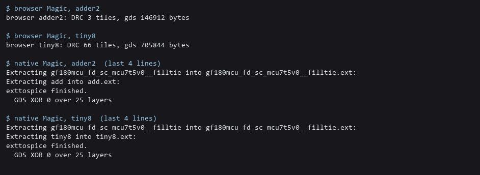

## 6. graywolf and qrouter against the same sources built natively (adder2)

**Question:** are the WebAssembly builds of graywolf, qflow's helpers and qrouter the same as the same sources built natively?

**Setup:** adder2, run in Node (`web/studio/engines/parity/browser.mjs adder2`), every tool call recorded. Each native tool got the same arguments and input files. Native tools were built in a throwaway container from the same image (`docker run --rm`, gcc and cmake from the image) at the same commits (graywolf 33fbcaa, qrouter c8f1111, qflow 52ecda1), with the same patches as our WebAssembly build. Details in `qflow-native.md`.

**Result (sha256 of the whole file; "same" means byte for byte):**

| Step | File | Result |
|---|---|---|
| qrouter -i | add.info | same |
| vlog2Cel | add.cel | same |
| graywolf chain (syntax, Mincut, TimberWolfMC, TimberWolfSC) | add.pl1, add.pl2, add.pin | same |
| addspacers | add_filled.def, add.obsx | same |
| qrouter (route) | add_route.def | **differs** |

The routed DEF differs in 223 lines, all inside the wires of some nets (header, components and pins are identical). Native: 438 wire segments, 417 vias; browser: 443 and 425. Both report "No failed routes". Magic DRC and Netgen LVS on both routed DEFs: 3 DRC tiles and LVS match each. A native build with `-ffp-contract=off` gave the same output as the normal native build, so fused multiply-add is not the cause. A 32-bit native build was not possible in the image. The cause is not known; word size is the remaining guess.

**Not validated:** only adder2, no clocked design, graywolf intermediate files not compared one by one.

## 7. LibreLane against the old browser flow, RTL to GDS (adder2, tiny8)

Run 2026-10-18 (browser numbers re-measured 2026-10-20 with the same result). Same RTL, PDK, clock, clock-buffer choice and die. Layouts differ by design: different placer and router, and LibreLane adds port, repair and tap cells. What can be proven is that both layouts are the same circuit.

**Dies.** adder2 77.28 x 74.48 um, tiny8 135.52 x 133.28 um. LibreLane needs more room than the old flow, so these are the smallest tried that LibreLane passed (tiny8 130 x 130 and adder2 74.48 x 68.88 failed with DPL-0036). The old flow was made to produce exactly these dies by changing only its spare-room setting, then the numbers were given to LibreLane as `DIE_AREA`.

**How LibreLane was run.** Image `hpretl/iic-osic-tools:chipathon26`, container `gf180`, LibreLane 3.0.2, in `/foss/designs/nishkam_jobs/parity_<design>_<tag>`: `librelane config.json --run-tag run`. Config written by `node web/studio/engines/parity/librelane.mjs <design> <W> <H> 50 <outdir> <tag>`; everything else is LibreLane's default (tap distance 20, routability-driven placement on):

```json
{ "meta": {"version": 3, "flow": "Classic"}, "PDK": "gf180mcuD",
  "FP_SIZING": "absolute", "DIE_AREA": [0, 0, 135.52, 133.28],
  "CLOCK_PERIOD": 24, "CLOCK_PORT": "clk",
  "CTS_CLK_BUFFERS": ["gf180mcu_fd_sc_mcu7t5v0__clkbuf_8", "gf180mcu_fd_sc_mcu7t5v0__clkbuf_4", "gf180mcu_fd_sc_mcu7t5v0__clkbuf_2"],
  "CTS_ROOT_BUFFER": "gf180mcu_fd_sc_mcu7t5v0__clkbuf_8",
  "PL_TARGET_DENSITY_PCT": 50, "DESIGN_NAME": "tiny8", "VERILOG_FILES": ["dir::tiny8.v"] }
```

For adder2, `DIE_AREA` is `[0, 0, 77.28, 74.48]` and `CLOCK_PORT` is null. LibreLane timing is its own `final/metrics.json` at corner `nom_tt_025C_5v00`. The old flow ran with `node web/studio/engines/parity/browser.mjs <design> <outdir>`.

**Formal equivalence.** Yosys 0.64 in the container, cell functions from the PDK liberty. Script `web/studio/engines/parity/equiv.sh`. Proof A: `equiv_make / equiv_simple / equiv_induct / equiv_status -assert` pairs every flop and output by name and proves by induction that they agree (tiny8: 48 of 48 points). Proof B (adder2 only): a miter circuit proved never to differ. Proof C: bounded `sat -seq` from the zero state.

| Design | Check | Proof A (unbounded) | Proof B (unbounded) | Proof C (bounded) |
|---|---|---|---|---|
| adder2 | old-flow synthesis netlist = LibreLane synthesis netlist | proven | proven | proven |
| adder2 | RTL = LibreLane final netlist | proven | proven | proven |
| adder2 | RTL = old-flow final netlist | proven | proven | proven |
| adder2 | RTL = LibreLane synthesis netlist | proven | proven | proven |
| adder2 | negative control (one gate swapped) | fails as it should | fails | fails |
| tiny8 | old-flow synthesis netlist = LibreLane synthesis netlist | proven | not run | not finished in 600 s |
| tiny8 | RTL = LibreLane final netlist | proven | not run | not finished in 600 s |
| tiny8 | RTL = old-flow final netlist | proven | not run | not finished in 600 s |
| tiny8 | RTL = LibreLane synthesis netlist | proven | not run | not finished in 600 s |
| tiny8 | negative control (one gate swapped) | fails as it should | not run | fails |

For tiny8, proof A carries the claim; B was not run and C did not return (not a failure). Full logs are in `parity_eq/` next to the LibreLane jobs on the test PC (not copied into this repo). With LVS passing on both sides, the chain is: RTL = final netlist (proof) = drawn layout (LVS).

**Signoff, same die, tt 25 C 5.00 V:**

| | adder2 old flow | adder2 LibreLane | tiny8 old flow | tiny8 LibreLane |
|---|---|---|---|---|
| LVS | match (256/256 devices, 146/146 nets) | 0 errors | match (3098/3098, 1536/1536) | 0 errors |
| Magic DRC tiles | 2 | 0 | 88 | 0 |
| Setup WNS / TNS (ns) | no clock | no clock | 12.90 / 0 | 9.62 / 0 |
| Hold WNS / TNS (ns) | no clock | 10.5 / 0 | 0.956 / 0 | 0.665 / 0 |
| Power (uW) | not measured | 488 | 4,120 | 6,972 |
| Run time (s) | 10 | 99 | 56 | 156 |

The old flow's remaining errors are Metal1/2/3 minimum-spacing rules (M1.2a, M2.2a, M3.2a), none inside library cells. Power is not a validated number: the switching-activity assumptions were not aligned. LibreLane's setup and hold differ from ours partly because LibreLane uses a different parasitic extractor (section 8B).

**Physical comparison, tiny8** (old flow against LibreLane; the percentage is against the LibreLane value):

| tiny8 | Old flow | LibreLane | Delta |
|---|---|---|---|
| Std cells | 263 | 488 | -46% |
| Cell area (um2) | 8,610 | 11,211 | -23% |
| Wire length (um) | 13,644 | 15,669 | -12.9% |
| Vias | 3,088 | 2,546 | +21.3% |
| Clock buffers | 5 | 9 | -44% |
| Clock skew (ns) | 0.01 | 0.27 | not comparable: ours from our OpenSTA, LibreLane's from its own report |

| adder2 | Old flow | LibreLane | Delta |
|---|---|---|---|
| Std cells | 43 | 119 | -64% |
| Cell area (um2) | 812 | 2,164 | -62% |
| Wire length (um) | 1,117 | 1,903 | -41% |
| Vias | 367 | 395 | -7% |

LibreLane's extra cells are port buffers, repair buffers and tap cells (tiny8: 56 repair buffers, 84 tap cells, 9 clock buffers).

Layouts, same die, same renderer (KLayout). Left old flow, right LibreLane:

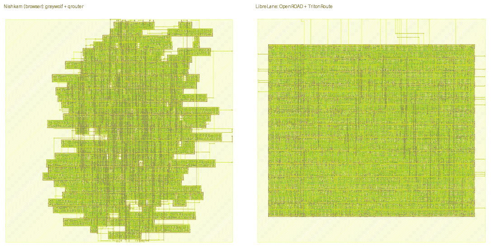

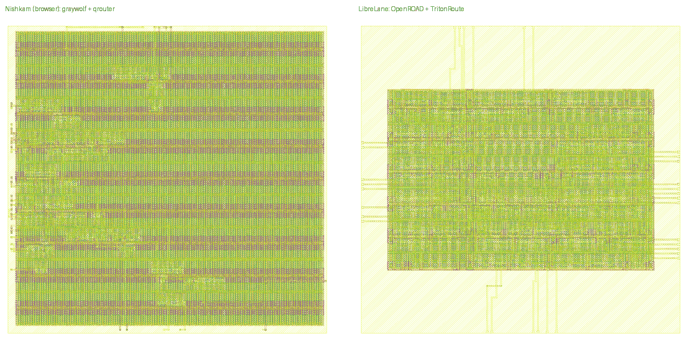

**Stress runs of the old flow** (`web/studio/engines/parity/stress.mjs`, wall time on the test PC):

| Case | Die (um) | Result | Time |
|---|---|---|---|
| tiny8 x5 (parity die) | 135.5 x 133.3 | 5 of 5 give identical placement and route hashes; all LVS match | 68 to 76 s |
| tiny8, smallest die, no spare room | - | fails: clock tree stage stops (no room for clock buffers) | 41 s |
| tiny8, Studio default die | 103.6 x 101.9 (81.5% full) | passes: 0 failed nets, LVS match, 197 DRC tiles (before the qrouter fix) | 68 s |
| adder2, smallest die | 34.2 x 31.4 | fails: 1 failed net, LVS mismatch | 10 s |
| rmult20 (2,595 cells) | 243.6 x 243.0 | fails: LVS mismatch with equal device and net counts (open issue), 1272 DRC tiles | 1254 s (with other jobs running) |

**Not validated:** layout equality (not possible, different tools); old-flow DRC cleanliness (11 to 1,272 tiles on these designs); power; timing with different constraints; the formal proof covers logic function from the same reset state, not timing, clock-domain or physical correctness, and it trusts Yosys and each cell's liberty function. Only two small designs.

## 8. OpenROAD place and route in the browser

Two separate questions:
- **A. Is OpenROAD built to WebAssembly the same tool as native OpenROAD?** Same commit (61932e8), same Tcl, same input files, one thread: native in the container against WebAssembly in Node.
- **B. Does the Studio flow (a short fixed Tcl recipe) give a layout of similar quality to a full LibreLane run?** The two flows are not the same steps (see "Differences that stay"), so this is a sanity check on quality, not a proof of equality.

Run 2026-10-20 (A and B in Node with `node web/studio/engines/pnr-flow.selftest.mjs`; browser run in Chrome, below).

**Designs and setup.** adder2 (no clock) and tiny8 (one clock, 24 ns), same RTL and dies as section 7: adder2 77.28 x 74.48 um, tiny8 135.52 x 133.28 um (the browser run below uses 250 x 250 um, and was repeated in Node at that die), target density 50%, gf180mcuD 7-track cells, tt 25 C 5.00 V. One corner.

**How OUR browser flow was built.** OpenROAD commit 61932e8 (plus OpenSTA defec0b) built to WebAssembly with the patch `tools/openroad-pnr/openroad-61932e8-wasm.patch` (`web/vendor/openroad-pnr/61932e8/SOURCE.md`, rebuild steps in `tools/openroad-pnr/BUILD.md`). One thread. Other engines as in the version table. Steps, exactly as `web/studio/engines/pnr.worker.js` runs them:
1. Floorplan: written as a DEF (die, rows, tracks) and read with `read_def -floorplan_initialize`, because this build has no `initialize_floorplan`. Core margins 12 sites left/right and 4 rows top/bottom, as in the LibreLane DEFs.
2. `tapcell` (distance 20), `pdngen` (Metal4/Metal5 stripes, Metal1 rails), `global_placement -skip_io`, `place_pins`, `global_placement`, `buffer_ports`, `repair_design`, `detailed_placement -max_displacement {500 100}`.
3. Clock tree (clocked designs): TritonCTS, same script as section 1, but run on Studio's own placed DEF.
4. `global_route -congestion_iterations 50`, `detailed_route -droute_end_iter 64 -or_seed 42`, `filler_placement`.
5. Magic GDS + DRC + extraction, Netgen LVS, OpenSTA on Magic's SPEF.

**What the WebAssembly patch changes (33 files).** Placement, routing and clock-tree algorithms are not edited. The patch removes parts of OpenROAD these steps do not call, makes everything single thread, and fixes build problems. The effect of each removed module:

| Removed | What it does | In the browser flow instead | Effect on results |
|---|---|---|---|
| `ifp` | floorplan commands (`initialize_floorplan`, `make_tracks`) | floorplan written as a DEF | none on the layout; the DEF carries the same numbers |
| `rcx` (OpenRCX) | wire parasitic extraction | Magic extraction + OpenSTA | timing differs from LibreLane's own report (hold +35.5%, see 8B); not validated against OpenRCX |
| `psm` | IR-drop analysis | none | no IR-drop check in the browser flow |
| `mpl`, `par`, `ram`, `rmp`, `cgt`, `dft`, `exa`, `fin`, `pad`, `upf` | macro placement, partitioning, RAM generator, resynthesis, clock gating, scan, examples, fill, pads, power intent | not used | none for these designs; no macros, scan or pads |
| web server, GUI, distributed router | interface only | none | none |
| `cluster_flops` in `gpl` | needs OR-Tools | not available (error if called) | none unless called |

Other changes: OpenMP stubbed, the check in TritonRoute that expects 2 threads deleted, Tcl 8 type definitions in five `.i` files, 8-byte alignment on four odb classes, Boost.Serialization compiled from source. Every command the Studio flow calls is in the build. Applied to a clean tree, the patch gives back the built tree byte for byte (BUILD.md).

**How the TRADITIONAL flow was run.** As in section 7: LibreLane 3.0.2, OpenROAD 26Q2-254-g61932e897 (the same commit as our build; confirmed with `openroad -version` in the container on 2026-10-20), `librelane config.json --run-tag run`, config from `web/studio/engines/parity/librelane.mjs`. The runs are the section 7 runs; they were not repeated, but their step logs and metrics were read again for the counts below.

### A. WebAssembly against native OpenROAD (tiny8, same Tcl, same inputs, one thread)

`docs/validation/pnr-native.mjs` prepares the inputs and `docs/validation/pnr-native.sh` runs `openroad -threads 1` in the container. Place starts from the same synthesized netlist and floorplan DEF. Route starts from the same placed + clock-tree DEF (the one the WebAssembly flow made), so the router is compared on identical input.

| tiny8 | WebAssembly (Node) | Native, 1 thread | Delta |
|---|---|---|---|
| Placed netlist (after buffer_ports, repair_design) | md5 67a3591f... | md5 67a3591f... | identical file |
| Placed components at a different position | 0 of 305 (baseline) | 127 of 305 (41.6%) | not bit-identical |
| HPWL after detailed placement (um) | 8,479.5 | 8,584.3 | +1.2% |
| TritonRoute violations per iteration | 33 / 8 / 7 / 0 | 50 / 10 / 4 / 0 | different path, both end at 0 |
| Wire length (um, router log) | 10,235 | 10,247 | +0.1% |
| Vias | 1,889 | 1,878 | -0.6% |
| Time place / route (s) | 6 to 8 / 33 to 37 | 2.8 / 16.9 | WebAssembly is about 2 to 3 times slower per thread |

The WebAssembly build is not bit-identical to native OpenROAD, but the results agree to about 1% and both route to zero violations. We do not claim identical output. Which command first diverges and by how many microns cells move was not measured (section 9). The clock tree was not re-run natively on this exact run (section 1 does that).

### B. Studio flow against LibreLane (tiny8)

Each column's difference is the percentage against the LibreLane value. No marks are given. Wire length and vias come from ONE parser, `docs/validation/def-stats.mjs`, run on the final routed DEF of every flow. Timing comes from ONE tool chain, `docs/validation/pnr-timing-same-tool.mjs` (our Magic extraction + our OpenSTA), run on every flow's final DEF and netlist, LibreLane's included. "Studio OpenROAD on LibreLane's netlist" starts from LibreLane's own synthesized netlist (`NETLIST=... pnr-flow.selftest.mjs`), which removes the synthesis difference. "Old flow" is graywolf + qrouter (`parity/browser.mjs`, re-run 2026-10-20 with the same numbers as section 7).

| tiny8 | Studio OpenROAD | Delta vs LibreLane | Studio OpenROAD on LibreLane's netlist | Delta vs LibreLane | Old flow | LibreLane |
|---|---|---|---|---|---|---|
| TritonRoute violations | 0 (33/8/7/0) | same | 0 (72/13/9/0) | same | not run | 0 |
| Magic DRC tiles | 0 | same | 0 | same | 88 | 0 |
| LVS, our Netgen (transistor level) | match 3150/3150 devices, 1559/1559 nets | - | match 3156/3156, 1544/1544 | - | match 3098/3098, 1536/1536 | LibreLane's own Netgen is at cell level (356 devices, 372 nets, 0 errors); not comparable |
| Cells from synthesis | 236 | -17.8% | 287 | 0% | 255 | 287 |
| Cells after place (port + repair buffers) | 271 | -21.0% | 322 | -6.1% | 255 | 343 |
| Cells at the end (no tap, endcap, filler) | 279 | -20.7% | 330 | -6.3% | 263 | 352 |
| Cells added before CTS | 35 (33 port `buf_1` + 2 inverters) | -37.5% | 35 | -37.5% | 0 | 56 (54 `dlyb_1` + 2 buffers) |
| Buffers added by repair_timing | not run | - | not run | - | not run | 0 |
| Clock buffers | 7 | -22.2% | 7 | -22.2% | 5 | 9 |
| Wire length (um) | 10,236 | -34.7% | 11,138 | -28.9% | 13,644 | 15,670 |
| Vias | 1,889 | -25.8% | 2,167 | -14.9% | 3,088 | 2,546 |
| Setup: time the critical path uses = 24 ns - slack (ns) | 12.44 | -14.1% | 12.04 | -16.9% | 11.10 | 14.48 |
| Setup slack (ns), for reference | 11.56 | +21.4% | 11.96 | +25.6% | 12.90 | 9.52 |
| Hold slack (ns) | 0.901 | -6.0% | 0.953 | -0.5% | 0.957 | 0.958 |

All columns except the last: same extraction (Magic) and same OpenSTA. LibreLane's own report, which uses OpenRCX and OpenSTA, gives setup 9.62 ns and hold 0.665 ns. Against that number our hold slack (0.901 ns) is +35.5% higher; the gap is the extractor, not the layout (see the last bullet).

Parasitic extractor, as a 2-row table (LibreLane's final layout, same tt corner):

| Extractor | Hold slack (ns) | Setup slack (ns) |
|---|---|---|
| Magic + our OpenSTA (same-tool chain) | 0.958 | 9.52 |
| OpenRCX + OpenSTA (LibreLane's own report) | 0.665 | 9.62 |

What the table says, in plain words:
- In LibreLane, `repair_timing` added 0 buffers (setup 0, hold 0, from the step metrics). The 56 cells added before CTS were 33 port buffers (`dlyb_1` delay cells) and 23 from `repair_design`. We add 33 port buffers (`buf_1`) and 2 inverters. So the buffers are not the main reason for LibreLane's longer wires.
- The flows do not start from the same netlist. Yosys gives 236 cells in the Studio OpenROAD flow, 255 in the old flow and 287 in LibreLane. The old-flow and LibreLane netlists are proven equal to the RTL in section 7; the OpenROAD flow's is covered by the equivalence check below. The synthesis difference comes from different Yosys scripts and versions (0.68.1207 against 0.64); which of the two matters was not tested. With LibreLane's netlist the Studio flow gets 11,138 um instead of 10,236 um, so about 900 um of the gap is the netlist. About 4,500 um (29% of LibreLane's wire) remains and we do not know why. LibreLane turns on routability-driven placement and uses different pin buffers and a different power grid; we did not test which matters.
- Timing, like with like: with the same extraction and the same OpenSTA, LibreLane's layout gives hold 0.958 ns and ours 0.901 ns (-6%), and the critical path uses 14.48 ns against our 12.44 ns (-14%). Slack as a percentage is a weak measure (it depends on the clock we picked), so setup is compared as the time the path takes; hold does not depend on the clock.
- Magic extraction was not validated against OpenRCX.

### Logic equivalence of the place-and-route netlist

`pnr-flow.selftest.mjs` also proves with Yosys (`equiv_make`, `equiv_simple`, `equiv_induct`, cell functions from the liberty, same recipe as section 7) that (1) the netlist after place + clock tree (with port, repair and clock buffers) is equivalent to the netlist Yosys made before place, and (2) it is equivalent to the RTL. A negative control (one gate swapped for its dual) makes the proof fail, as it must. tiny8 and adder2 pass all three. This closes the gap that LVS alone leaves (LVS only compares the layout with the place-and-route tool's own netlist). It checks this build's netlist edits on these two designs; it is not a general proof.

### adder2

| adder2 (no clock) | Studio OpenROAD | Delta vs LibreLane | Old flow | LibreLane |
|---|---|---|---|---|
| TritonRoute violations / Magic DRC tiles | 0 (9 / 0) / 0 | same | not run / 2 | 0 / 0 |
| LVS, our Netgen | match 382/382 devices, 209/209 nets | - | match 256/256, 146/146 | cell level (82 devices, 96 nets); not comparable |
| Cells from synthesis | 35 | -22% | 43 | 45 |
| Cells at the end (no tap, endcap, filler) | 68 | -13% | 43 | 78 |
| Wire length (um) | 1,459 | -23% | 1,117 | 1,903 |
| Vias | 315 | -20% | 367 | 395 |
| Whole flow time (s) | about 24 (Yosys 2.6, place 6.8, route 11.9, Magic 1.9, Netgen 0.3) | - | 7.5 | 99 |
| Timing | not compared | - | not compared | not compared |

adder2 has no clock and Studio's timing step needs a clock port, so no timing number is compared for it (section 9).

### Run time

LibreLane's 156 s (tiny8) is the whole container run: synthesis to signoff, including KLayout XOR and DRC, antenna checks, RCX and the IR-drop report. The comparable Studio number is the whole flow in Node: Yosys 5.5 + place 7.0 + CTS 19.2 + route 34.1 + Magic 12.0 + Netgen 0.5 + OpenSTA 4.1 = about 82 s, on the same PC (the 250 x 250 um rerun below took 107 s with other programs running). Step by step, LibreLane (default threads) took 1.8 s for global placement, 1.6 s for detailed placement, 20.2 s for CTS, 1.7 s for global route and 21.8 s for detailed route. The one-thread native run of our Tcl took 2.8 s (place) and 16.9 s (route) (table A). Peak WebAssembly memory: 100 MB placing, 249 MB routing (299 MB at 250 x 250 um); the build allows 2 GB.

### Differences that stay (so "same steps" is NOT claimed)
- Our recipe has no routability-driven placement and no `repair_timing`; LibreLane's config has routability-driven placement on and ran `repair_timing` (it changed nothing here).
- Different synthesis script and Yosys version, a different buffer cell on the ports (`buf_1` against `dlyb_1`).
- LibreLane checks several corners; we run one (tt).
- LibreLane's own timing uses OpenRCX; ours uses Magic. Only the same-tool rows are like with like.

### In the browser (Studio), and the same die in Node

Browser run, 2026-10-20, Chrome 155 on Windows 11, Studio opened from a local server (`studio.html?mock=1`), example tiny8, clock 24 ns, **die 250 x 250 um**, density 50%, "In-browser place and route = OpenROAD (TritonRoute)", "Run All". One run. Total 96 s. The Node column is the same flow at the same die (`node web/studio/engines/pnr-flow.selftest.mjs tiny8 250 250`, run 2026-10-20, log `logs/pnr-node-tiny8-250.txt`).

| tiny8, 250 x 250 um | Chrome (Studio page) | Node (same code) |
|---|---|---|
| Placement instances (with tap cells) | 696 | 696 |
| Clock buffers / sinks / latency / skew | 7 / 48 / 1.01 ns / 0 ns | 7 / 48 / 1.01 ns / 0 ns |
| TritonRoute violations per iteration | 42, 3, 3, 0 | 42, 3, 3, 0 |
| Wire length (um) / vias | 11,776 / 1,848 | 11,776 / 1,848 |
| Magic DRC tiles | 0 | 0 |
| Netgen LVS | match, 3150 devices, 1559 nets | match, 3150 devices, 1559 nets |
| Signoff setup / hold slack (ns) | 11.45 / 0.92 | 11.445 / 0.9211 |
| Time place / CTS / route (s) | 6.3 / 20.0 / 33.0 | 9.4 / 26.9 / 38.1 (PC busier) |

So the browser page and Node give the same layout at this die. Native OpenROAD was not run at 250 x 250 um; the browser-to-native link is table A at the 135.52 x 133.28 um die, so "browser = Node = native" is shown in two steps, not one table. Other browser rows: Timing (STA after routing) setup 12.79 ns, hold 0.99 ns, Fmax 89.19 MHz; signoff timing with Magic wire delays setup 11.45 ns, hold 0.92 ns, Fmax 79.65 MHz.

No browser console errors were seen after the run started (console was read only from then on; load-time errors were not checked). Switching the select to graywolf + qrouter and running Placement still works. Only Chrome was tried.

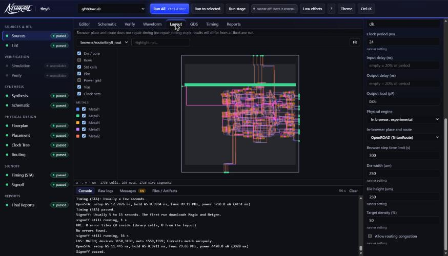

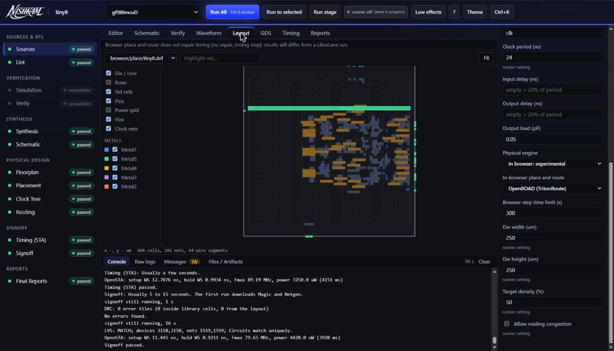

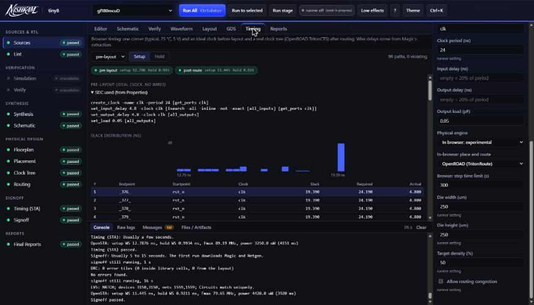

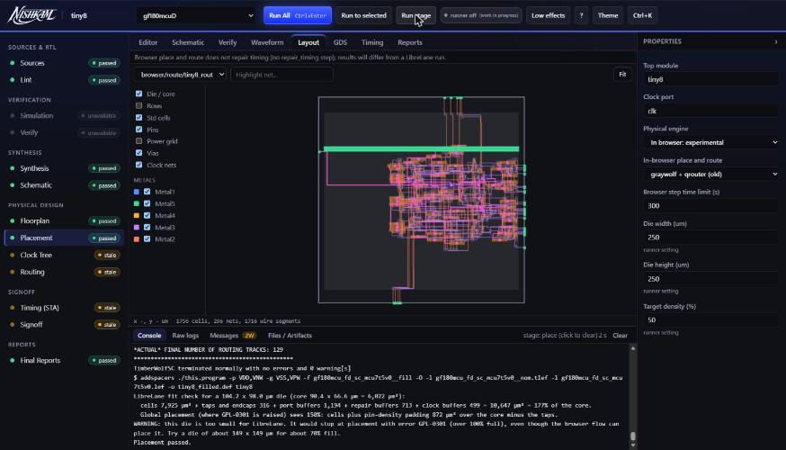

### 8.x Newer OpenROAD build (master 6f3f28c), now the default (#61)

Built the same way as above from OpenROAD master 6f3f28c (2026-10-24, emsdk 3.1.74, patches in `tools/openroad-pnr/openroad-6f3f28c-wasm.patch`, recipe in `web/vendor/openroad-pnr/6f3f28c/SOURCE.md`). Browser clock tree and place and route now both use this one binary (it contains TritonCTS). Run with `node web/studio/engines/pnr-flow.selftest.mjs tiny8` (the old build: `OR_PNR_VER=61932e8 OR_CTS_DIR=<openroad-cts/61932e8>`).

**Native reference built from the same commit.** Docker image `or-native-61:6f3f28c`: OpenROAD source at 6f3f28cc85, `cmake /src -DCMAKE_BUILD_TYPE=Release -DBUILD_GUI=OFF -DCMAKE_PREFIX_PATH=/opt/or-deps $(cat /src/deps-prefixes.sh)`, then `make -j6 openroad` (script `dobuild.sh` on the test PC, `C:\Users\Asus\eda\designs\or-native-61\dobuild.sh`); dependencies under /opt/or-deps; binary `/build/bin/openroad`, version 26Q4-1108-g6f3f28cc85. It has no PDK: the same gf180 LEF, liberty and tech files as the browser are mounted. Run: `docker run --rm --entrypoint bash -v <dir>:/w or-native-61:6f3f28c -c 'cd /w; /build/bin/openroad -exit place.tcl; ...'` with the Tcl written by `web/studio/engines/pnr-native.mjs` (`/w/` paths unchanged). Logs: `logs/or-native-6f3f28c/`. Same synthesized netlist, same Tcl as the browser scripts, die 135.52 x 133.28 um, 50% density, 24 ns clock, one run each.

| Step (tiny8) | Native 6f3f28c | Wasm 6f3f28c (default) | Result | Earlier: native 61932e8 / wasm 61932e8 |
|---|---|---|---|---|
| Instances after place | 407 | 407 | match | 407 / 407 |
| HPWL after detailed placement (um) | 8044.8 | 8044.8 | match | 8584.3 / 8479.5 |
| Placement DEF cells at the same spot as native | 407 of 407 | 407 of 407 | match | 283 of 407 |
| After CTS: cells at the same spot | 415 of 415 | 415 of 415 | match | n/a |
| Clock buffers / sinks | 6 / 48 | 6 / 48 | match | 6 / 7 |
| CTS skew (ns), latency | 0.01 (0.95) | 0.01 (0.94) in the full flow | match (rounding) | n/a |
| Route wire (um) / vias | 9752 / 1858 | 9789 / 1857 | close: wire +0.4%, vias -0.05% | 10461 / 1872 vs 10235 / 1889 |
| TritonRoute violations per iteration | 31 / 11 / 6 / 0 | 33 / 7 / 4 / 0 | final 0 both; path differs | 47-15-5-0 vs 33-8-7-0 |
| Magic DRC / LVS / equivalence / negative control | n/a | 0 / match / pass / pass | | |
| Setup / hold worst slack (ns, extracted) | n/a | 11.527 / 0.913 | | 11.563 / 0.901 (old wasm) |

CTS golden (LibreLane tiny8 placed DEF, `cts.selftest.mjs`), regenerated with native 6f3f28c using the browser's own CTS Tcl on the same pre-processed DEF: 9 clkbuf_8, 48 sinks, latency 0.67 ns, **skew 0.01 ns** (was 0.00 with 61932e8; the upstream commit changed it, and the native run of the new commit gives 0.01 too). The wasm result has the same COMPONENTS as native line for line, and the NETS have the same words; only DEF annotations (`+ USE SIGNAL`, the NDR name, row lines) differ, which the browser removes for its own router. Selftest golden updated to skew 0.01.

Reading: with the native binary built from the same commit, the browser placement and clock tree are identical to native (every cell, HPWL to 0.1 um), and routing is within 0.4% in wire length. The earlier cell and HPWL gap (8584 vs 8044) was the upstream commit change, not the wasm port. Router violation counts per iteration differ (TritonRoute single thread against native threads) but both end at 0. This is now held to the same bar as the older build (about 1%, not bit-identical), and met more tightly for placement.
Also not covered: the unresolved `_Unwind_GetIP` symbol (never reached in these runs), Firefox/Safari, designs other than tiny8, the old build is no longer the browser default.

**NOT validated in section 8.**
- Bit-identical results to native OpenROAD (they are not; table A).
- Why LibreLane's wire is 29% longer than ours on the same netlist.
- Magic extraction against OpenRCX; other corners (ss, ff).
- Large or hard designs. Both designs are tiny, at 50% density with a relaxed 24 ns clock (setup slack above 9 ns). Congestion, tight timing and the browser memory limit are not tested on anything bigger.
- Firefox and Safari. Power. adder2 timing. A side-by-side native layout picture. The clock tree natively on this exact run.

## 8.y OpenRCX parasitics and PDNSim IR drop (2026-10-25, #65, #68)

**How ours was built.** The 6f3f28c wasm of section 8.x with two more modules switched on (`rcx`, `psm`; patch `tools/openroad-pnr/openroad-6f3f28c-rcx-psm.patch`, recipe in `web/vendor/openroad-pnr/6f3f28c/SOURCE.md`). Studio runs them in the route step of `engines/pnr.worker.js`: `set_extraction_rules_file` (ORFS gf180 rules, 1p5m 9k OPTB, typical corner, fetched at run time from jsDelivr at ORFS 5c761de72dd0 and sha256-checked; not stored in the repo), `extract_parasitics`, `write_spef`; then `set_pdnsim_net_voltage` (5 V read from the liberty, 0 V for VSS) and `analyze_power_grid` for VDD and VSS. Post-route STA reads that SPEF.

**How native was run.** Docker image `or-native-61:6f3f28c` (section 8.x), `openroad -threads 1 -exit post.tcl` with the same Tcl and the same inputs: the routed tiny8 DEF written by the browser flow (`node web/studio/engines/pnr-flow.selftest.mjs tiny8`, OUT=dir), gf180 LEF/tlef, liberty and rules file. Script and both logs: `docs/validation/logs/or-native-6f3f28c/rcx-psm/` (post.tcl, nat.log, wasm.log).

| tiny8 routed DEF | Native 6f3f28c | Wasm 6f3f28c | Result |
|---|---|---|---|
| Nets in SPEF (*D_NET) | 294 | 294 | match |
| SPEF text, except date and version lines | | | 0 differing lines |
| VDD worst IR drop | 2.60e-3 V | 2.60e-3 V | match |
| VDD average IR drop | 4.98e-4 V | 4.98e-4 V | match |
| VSS worst / average | 1.05e-3 / 4.69e-4 V | 1.05e-3 / 4.69e-4 V | match |
| Total power used | 4.93e-3 W | 4.93e-3 W | match |

In the Studio flow (170 um die default) the Reports card shows worst 0.593 mV on VDD (0.012% of 5 V). Post-route setup/hold slack on tiny8 moved from 11.527 / 0.913 ns (Magic SPEF, section 8.x) to 11.706 / 0.876 ns (OpenRCX SPEF).

**NOT validated.** One design (tiny8), one corner (typical), one rules file. The IR numbers use default switching activity, not real activity, and the power grid is our own pdngen script, not LibreLane's. We compared against native OpenROAD, not against Magic, a signoff extractor, or silicon. OpenRCX against Magic extraction was not compared net by net. The rules file has no licence, so it is fetched, not shipped. No IR heat map yet (follow-up).

## 8.z Timing repair after the clock tree (2026-10-25, #70)

**How ours was built.** Same 6f3f28c wasm as section 8.x. In `engines/cts.worker.js` the OpenROAD CTS script now ends, when Properties "Timing repair" is on (default), with: gf180 layer RC from OpenROAD-flow-scripts `platforms/gf180/setRC.tcl` (`set_layer_rc` Metal2 to Metal5; signal wires on Metal2, clock wires on Metal4), `estimate_parasitics -placement`, `repair_timing -setup`, `repair_timing -hold`, `detailed_placement`, `check_placement`. `repair_design` already ran in the place step (after `buffer_ports`). The dont_use list (`drc_exclude.cells`) is applied before, so repair cannot pick the excluded cells; CTS itself still uses clkbuf_8/4/2 only. Global-route repair is NOT done (the browser route step has no SDC and would need a second global route).

**How native was run.** Image `or-native-61:6f3f28c` (section 8.x), `openroad -threads 1 -exit` on the Tcl written by `engines/pnr-native.mjs` (`PERIOD=7 REPAIR=1`), same synthesized netlist as the browser run (`PERIOD=7 node web/studio/engines/pnr-flow.selftest.mjs tiny8`, `RAW=1` prints the OpenROAD log). Logs: `logs/or-native-6f3f28c/repair/`. The traditional flow (LibreLane/ORFS) was not run for this step.

tiny8, die 135.52 x 133.28 um, 7 ns clock (input/output delay 20%). A 7 ns clock makes tiny8 fail setup on purpose (24 ns, used elsewhere, has 11 ns slack and nothing to repair).

| tiny8, 7 ns | Repair off | Repair on (wasm) | Native, repair on | Result |
|---|---|---|---|---|
| Setup WNS / TNS after CTS, estimated (ns) | -1.643 / -15.94 (before repair) | 0.017 / 0 | 0.017 / 0 | wasm = native, every printed digit |
| Hold WNS after CTS (ns) | 0.711 | 0.712 | 0.712 | match |
| Repair moves | | 3 buffers inserted, 21 resized up, 1 pin swap, no hold violations | same | match |
| Cells / cell area after CTS | 279 / 8776 um2 | 282 / 8996 um2 (+2.5%) | 282 / 8996 um2 | match |
| Final netlist, wasm vs native | | | | 0 differing lines |
| Post-route setup / hold WNS, OpenRCX (ns) | -1.894 / 0.739 | -0.087 / 0.750 | n/a | repair closes 95% of the setup gap; not fully, route adds wire delay the estimate did not have |
| TritonRoute violations / Magic DRC / LVS / equivalence | 0 / 0 / match / pass | 0 / 0 / match / pass | route: 0 (native wire 10184 um, 1902 vias, wasm 10142 um, 1911 vias) | |

Default 24 ns run (nothing violates, so repair does nothing): setup/hold 11.709 / 0.882 ns, DRC 0, LVS match, same as before. Run `REPAIR=0 PERIOD=7 node web/studio/engines/pnr-flow.selftest.mjs tiny8` for the "off" column.

**NOT validated.** One design (tiny8), one clock. Repair quality (does it beat LibreLane's repair on the same design): not compared, LibreLane was not run. Repair after global route is absent. A 3 ns clock on tiny8 was tried: repair ran about 1100 iterations, grew area 30%, and still left -6.7 ns WNS, so very tight clocks are not fixed by this step. The ORFS setRC values were used for repair only; placement and CTS still use the average layer RC from the tech LEF. aes (ORFS stress test, #64) is re-run separately and not part of this table.

## 9. Known limits and next checks

Things we know are open. None is claimed as validated.

1. **Cell-position difference in table A (127 of 305 cells).** Not yet traced: which command first diverges (`global_placement` or `detailed_placement`), the cause (for example 32-bit against 64-bit arithmetic or ordering), and the mean and maximum cell move in microns. Next: dump the placement after each command in both builds and compare.
2. **SPEF timing.** Section 4 compares OpenSTA without wire parasitics. Next: feed tiny8's Magic SPEF to both browser and native `sta` and diff the reports.
3. **Combinational timing.** adder2 has no clock, so no timing is compared. Next: add a virtual clock or `set_max_delay` to `pnr-timing-same-tool.mjs`.
4. **LVS negative controls.** Only one broken layout (a missing device) is tested. Next: add equal-device-count cases (two swapped nets, an open net, a power-to-ground short) and compare browser and native diagnostics.
5. **Side-by-side layout picture** of WebAssembly against native OpenROAD for table A, and a browser run at the 135.52 x 133.28 um die, so the page, Node and native can share one die.
6. **Reproducibility.** `drc-count.mjs` needs a hand edit to compare the two qrouter builds (section 3); it should take the qrouter folder as an argument. The LibreLane runs in sections 7 and 8 are on the test PC only.
7. **RTL grader.** Now covered in section 10. Not covered there: the five CDC problems (rule and bounded checks, `web/cdc.test.mjs`, never claimed as proven) and the Studio flow problem.
8. **Runner.** The statement "runner round trip verified (shreg4 signoff clean 14/14)" has no stored log. The runner is not part of this report.
9. **Missing counts.** Synthesis cell counts for mult8, shreg4, sr8, cnt8, twoclk and pins40 were not recorded, so the benchmark table says so.

## 10. RTL practice grader (Yosys miter, k-induction)

**What is claimed.** The practice page says "proven" when a design equals the reference for every input and every cycle after reset, and "first 40 cycles" when it could only check that far. This section tests both statements. It covers the five non-CDC RTL problems.

**How ours runs.** `web/grader.js` loads the reference and the user design, builds a miter, and runs `sat -verify -tempinduct -maxsteps 40 -seq 40` starting from undefined state with reset asserted on cycle 1. If that does not succeed, it runs a plain `sat -seq 40` search. A counterexample from either run is a real difference. A pass of the plain search is shown as "first 40 cycles", never "proven". Outputs where the reference is x are not compared. Engine: `@yowasp/yosys` 0.68.1207 (WebAssembly), run in Node.

**How native was run.** The same cases, with the exact same two scripts the grader writes (`prove.ys` first, then `bound.ys` if that fails), run by `/foss/tools/bin/yosys` 0.64 in the `gf180` container (image `hpretl/iic-osic-tools:chipathon26`), one case at a time: `docker exec gf180 bash /foss/designs/grader_val/run.sh` (copy in `logs/grader-cases/run-native.sh`). The native result is "proven" if `prove.ys` exits clean, "first 40 cycles only" if only `bound.ys` does, and "fails" if both stop with an error. Note the versions differ (0.68 against 0.64); the results still agree.

**Cases.** For every problem: the reference against itself, and three or four deliberate mistakes (off-by-one, wrong reset value, missing enable, swapped condition, wrong pattern, wrong shift, and similar). Then four tricky counter cases: two that are equal only if reset is ignored or never used, one that differs only from about cycle 30 (inside the 40 cycle bound), and one that differs only from about cycle 45 (outside it). Every case is stored as files in `logs/grader-cases/cNN/` (`ref.v`, `user.v`, `prove.ys`, `bound.ys`).

**Results.** Run `node web/grader.validation.mjs` (log `logs/grader.validation.txt`; the older `node web/grader.test.mjs` log is `logs/grader.test.txt`). The cycle is counted with reset as cycle 1. The solver returns some counterexample inside the 40 cycles, not the shortest one, so the cycle shown for the late-difference case (40) is where the output first differs in that run, not the earliest possible.

| Case | Problem | Design | Expected | Ours | Native Yosys | Match |
|---|---|---|---|---|---|---|
| ..\docs\validation\logs\grader-cases\c01 | counter-en | reference vs itself | proven | proven | undefined | DIFFERS |
| ..\docs\validation\logs\grader-cases\c02 | rise-edge | reference vs itself | proven | proven | undefined | DIFFERS |
| ..\docs\validation\logs\grader-cases\c03 | seq-1011 | reference vs itself | proven | proven | undefined | DIFFERS |
| ..\docs\validation\logs\grader-cases\c04 | gray-counter | reference vs itself | proven | proven | undefined | DIFFERS |
| ..\docs\validation\logs\grader-cases\c05 | rr-arbiter | reference vs itself | proven | proven | undefined | DIFFERS |
| ..\docs\validation\logs\grader-cases\c06 | counter-en | off-by-one (counts by 2) (first mismatch seen at cycle 3) | fails | fails | undefined | DIFFERS |
| ..\docs\validation\logs\grader-cases\c07 | counter-en | wrong reset value (1) (first mismatch seen at cycle 2) | fails | fails | undefined | DIFFERS |
| ..\docs\validation\logs\grader-cases\c08 | counter-en | missing enable (first mismatch seen at cycle 3) | fails | fails | undefined | DIFFERS |
| ..\docs\validation\logs\grader-cases\c09 | counter-en | swapped condition (en low counts) (first mismatch seen at cycle 3) | fails | fails | undefined | DIFFERS |
| ..\docs\validation\logs\grader-cases\c10 | rise-edge | wrong reset value (p=1) (first mismatch seen at cycle 2) | fails | fails | undefined | DIFFERS |
| ..\docs\validation\logs\grader-cases\c11 | rise-edge | falling edge instead of rising (first mismatch seen at cycle 2) | fails | fails | undefined | DIFFERS |
| ..\docs\validation\logs\grader-cases\c12 | rise-edge | level instead of edge (first mismatch seen at cycle 3) | fails | fails | undefined | DIFFERS |
| ..\docs\validation\logs\grader-cases\c13 | seq-1011 | wrong pattern 1101 (first mismatch seen at cycle 6) | fails | fails | undefined | DIFFERS |
| ..\docs\validation\logs\grader-cases\c14 | seq-1011 | wrong reset value (1111) (first mismatch seen at cycle 5) | fails | fails | undefined | DIFFERS |
| ..\docs\validation\logs\grader-cases\c15 | seq-1011 | window one bit short (3 bits) (first mismatch seen at cycle 4) | fails | fails | undefined | DIFFERS |
| ..\docs\validation\logs\grader-cases\c16 | gray-counter | plain binary output (first mismatch seen at cycle 6) | fails | fails | undefined | DIFFERS |
| ..\docs\validation\logs\grader-cases\c17 | gray-counter | missing enable (first mismatch seen at cycle 3) | fails | fails | undefined | DIFFERS |
| ..\docs\validation\logs\grader-cases\c18 | gray-counter | wrong shift (<<) (first mismatch seen at cycle 3) | fails | fails | undefined | DIFFERS |
| ..\docs\validation\logs\grader-cases\c19 | rr-arbiter | wrong reset pointer (0) (first mismatch seen at cycle 2) | fails | fails | undefined | DIFFERS |
| ..\docs\validation\logs\grader-cases\c20 | rr-arbiter | search starts at last (not last+1) (first mismatch seen at cycle 6) | fails | fails | undefined | DIFFERS |
| ..\docs\validation\logs\grader-cases\c21 | rr-arbiter | pointer never updates (first mismatch seen at cycle 4) | fails | fails | undefined | DIFFERS |
| ..\docs\validation\logs\grader-cases\c22 | counter-en | equal only after reset: no reset input used, q starts undefined (first mismatch seen at cycle 2) | fails | fails | undefined | DIFFERS |
| ..\docs\validation\logs\grader-cases\c23 | counter-en | equal only after reset: reset ignored after first use (age flag) (first mismatch seen at cycle 2) | fails | fails | undefined | DIFFERS |
| ..\docs\validation\logs\grader-cases\c24 | counter-en | differs only from cycle ~30 (inside 40) (first mismatch seen at cycle 40) | fails | fails | undefined | DIFFERS |
| ..\docs\validation\logs\grader-cases\c25 | counter-en | differs only from cycle ~45 (outside 40) | see text | first 40 cycles only | undefined | DIFFERS |

**Reading the table.**
- All five references are proven equal to themselves, in both tools.
- All 19 wrong designs fail with a counterexample, in both tools. The two "reset" tricks fail at cycle 2: a design that does not clear its state on reset starts undefined, and the grader treats that as different.
- The case that differs only from about cycle 30 is caught, because it is inside the 40 cycle search.
- **The case that differs only from about cycle 45 is NOT caught.** Induction cannot prove it (the extra counter is hard for induction), the plain search cannot see past cycle 40, so the grader passes it and the banner reads "first 40 cycles" rather than "proven". Native Yosys gives the same answer. This is the stated limit of the bound, not a hidden pass, but a wrong design can pass with that banner.

**What is NOT validated.**
- Only five problems and 25 cases (24 expected results plus the cycle 45 case); this shows the method works on them, not on every possible design.
- Designs that differ only after cycle 40 and that induction cannot settle will pass as "first 40 cycles". The size of that blind spot is not measured.
- Induction can fail on states that can never happen. Then the grader falls back to the bounded search, so a correct design can end up with the weaker banner. No such correct design was found among the cases here, but it was not looked for systematically.
- Outputs where the reference is x are skipped (`-ignore_gold_x`). A design that is wrong only where the reference is x passes. Not tested.
- Reset is forced only on cycle 1. Designs that rely on reset later, or on asynchronous reset behaviour, are not tested; the grader turns asynchronous resets into synchronous ones first.
- Browser (WebAssembly) against the Node run was not compared in a real browser; Node uses the same engine file.
- The practice page does not run a testbench; it only checks equality with the reference.

## 11. How to repeat

Needs Node, a folder with `@yowasp/yosys` in `node_modules` (run commands from the repo root), Docker, and Git Bash on Windows.

Start the traditional side (the container with the same image; `~/eda/designs` is shared as `/foss/designs`):

```bash
docker pull hpretl/iic-osic-tools:chipathon26
docker run -d --name gf180 -v "$HOME/eda/designs:/foss/designs" hpretl/iic-osic-tools:chipathon26 --wait
export MSYS_NO_PATHCONV=1      # Git Bash on Windows: stops path mangling in docker exec
docker exec gf180 bash -lc "openroad -version; sta -version; netgen -batch quit; yosys -V; pip show librelane | head -2"
```

Browser-side tests, from the repo root:

```bash
node web/studio/engines/cts.selftest.mjs
node web/studio/engines/lvs.selftest.mjs
node web/studio/engines/opensta.selftest.mjs
node web/studio/engines/pd.cases.selftest.mjs
node web/studio/engines/pd.selftest.mjs 8        # 8 = shift-register width (sr8)
node web/studio/engines/selftest.node.mjs
node web/grader.test.mjs
node docs/validation/ctsdiff.mjs
```

Native side by side (each script copies its files to `$HOME/eda/designs/nishkam_validation` and writes logs here):

```bash
bash docs/validation/sta-compare.sh
bash docs/validation/magic-compare.sh
bash docs/validation/netgen-compare.sh
```

OpenROAD place and route (section 8):

```bash
OUT=$PWD/out node web/studio/engines/pnr-flow.selftest.mjs tiny8              # 135.52 x 133.28 um die
OUT=$PWD/out node web/studio/engines/pnr-flow.selftest.mjs tiny8 250 250      # the browser-run die
node web/studio/engines/pnr-flow.selftest.mjs adder2
NETLIST=<file> node web/studio/engines/pnr-flow.selftest.mjs tiny8            # start from another flow's netlist
node docs/validation/pnr-native.mjs $PWD/out tiny8                            # WebAssembly against native
bash docs/validation/pnr-native.sh tiny8
node docs/validation/def-stats.mjs <final.def> ...
node docs/validation/pnr-timing-same-tool.mjs <top> <final.def> <final netlist.v>
```

LibreLane baseline (sections 7 and 8; one job at a time):

```bash
node web/studio/engines/parity/librelane.mjs tiny8 135.52 133.28 50 $HOME/eda/designs/nishkam_jobs/parity_tiny8_x x
docker exec -w /foss/designs/nishkam_jobs/parity_tiny8_x gf180 bash -lc "librelane config.json --run-tag run"
```

Old flow and formal checks: `node web/studio/engines/parity/browser.mjs <design> <outdir>` (set `HEADROOM=0,8970` for tiny8, `0,4400` for adder2 to get the section 7 dies); proofs with `web/studio/engines/parity/equiv.sh` inside the container.

**Note on the log images.** The `img/term-*.png` pictures are log text drawn into an image by `python docs/validation/make-terminal-images.py` from the stored files in `logs/`. They are not screenshots of a terminal; the text is not edited. The `img/pnr-browser-*.png` pictures are real browser screenshots.

## 12. Tiny Tapeout Explorer 3D view (2026-10-25, issue #63)

**Setup.** Studio opens the GDS in the Tiny Tapeout Explorer (`web/vendor/tt-explorer/59a43fb/`, upstream binary, only the layer names edited) inside an iframe. Browser: Chrome/Vivaldi, served from `python -m http.server`. Designs: tiny8 (`web/studio/demo/final/gds`), shreg4, add and m8 (LibreLane `final/gds` from earlier runner jobs). Traditional side: KLayout (container `gf180`, `klayout -b -r`), counting shapes of the top cell recursively per GDS layer.

**What we compared.** The explorer prints per-layer rectangle counts in its own log. Via layers are single rectangles, so they can be compared one to one. Mapping (the explorer's wasm uses sky130 slot names): MCON = Via1 (35/0), VIA1 = Via2 (38/0), VIA2 = Via3 (40/0), VIA3 = Via4 (41/0), MET4 = Metal5 (81/0).

| Design | Via1 35/0 | Via2 38/0 | Via3 40/0 | Via4 41/0 | Metal5 81/0 | Cells (KLayout / Studio 2D parser) | Result |
|---|---|---|---|---|---|---|---|
| tiny8 | 1355 / 1355 | 1104 / 1104 | 127 / 127 | 18 / 18 | 2 / 2 | 41 / 41 | match |
| shreg4 | 93 / 93 | 85 / 85 | 54 / 54 | 18 / 18 | 2 / 2 | 14 (KLayout) | match |
| add | 251 / 251 | 206 / 206 | 33 / 33 | 18 / 18 | 2 / 2 | 19 (KLayout) | match |
| m8 | 1289 / 1289 | 940 / 940 | 109 / 109 | 18 / 18 | 2 / 2 | 52 (KLayout) | match |

(each pair is KLayout / explorer). For tiny8 the Studio 2D parser also gives the same flattened polygon count as KLayout on every drawing layer (the KLayout excess on the `/10` datatypes is text labels, e.g. Metal2 1024 + 21 polygons vs 1024 + 21 labels). Top cell tiny8, shreg4, add, m8 found correctly. Load plus process time in the explorer: 58 to 190 ms.

**Differs.** Metal layers are cut into rectangles by the explorer, so counts are higher than polygon counts (tiny8 Metal2: 2138 rects vs 1024 polygons; Metal3 601 vs 451). Not compared further. Colours: since the colour edit (#63) the layer colours in `circuit_viewer.js` are the gf180 PDK colours from `gf180-layers.json`, the same as Studio 2D (Metal1 yellow, Metal2 lime, ...). Heights are the explorer's own display values; the layer order is correct. A "not to scale" note is shown.

**Behaviour fixes in our wrapper.** A file that is not GDSII, or a damaged file, now gives "Could not open the 3D view" (checked with 20 junk bytes and a valid header followed by garbage); upstream otherwise shows its loading text forever.

**In-browser flow checked (2026-10-25).** Studio `?mock`, Examples > shreg4, Run All (LVS match), GDS tab, then the Tiny Tapeout Explorer button: the 3D view opened from the in-browser Magic GDS (patched power labels), no error text, new colours visible. Not compared against KLayout 3D.

**NOT validated.** Metal and poly/diffusion geometry against KLayout (only via counts and 2D counts); the 3D picture against a KLayout 3D render; labels and net highlighting; large designs (largest tested: m8, 650 KB); Safari/Firefox; GDS from the in-browser Magic flow on every example.

## 13. Formal tab: SymbiYosys in the browser (2026-10-25, issue #66)

**Setup.** Studio, Properties, "Formal tab (SymbiYosys)" on. SBY 0.64 (Python, unmodified, `web/vendor/sby/0.64/`) runs under Pyodide 0.27.7 in a Web Worker. SBY starts tools as processes; the browser cannot, so `web/studio/engines/formal_shim.py` replaces `subprocess.Popen`: commands SBY would run (`yosys`, `yosys-abc`) are run by JavaScript in the same YoWASP Yosys 0.68.1207 that Lint and Synthesis use (ABC is inside it, run through the `abc -script` pass), then SBY is restarted and replays the results (about 6 restarts per run). `yosys-witness` runs as Python. Engines: `abc pdr` (mode prove), `abc bmc3` (mode bmc) and, since 2026-10-26 (issue #66), `smtbmc` (modes prove, bmc, cover). Not available: `smtbmc` with yices, z3, bitwuzla (no proven WebAssembly build exists for them, see below); SBY refuses mode cover with abc engines.
**smtbmc, how ours differs.** `yosys-smtbmc` (Python, unmodified, `web/vendor/sby/0.64/smtbmc_main.py`, from the same container) runs in the shim like SBY. Its solver is Boolector 3.2.3 (`@yowasp/boolector@3.2.3-6.30`, the YoWASP WebAssembly build). smtbmc talks to the solver through a pipe and a thread, which Pyodide cannot do, so the shim replaces `SmtIo`'s pipe methods at run time (the files stay unmodified): each time smtbmc waits for an answer the run stops, JavaScript runs Boolector on the script written so far, and smtbmc is started again from the beginning (it is deterministic). The solver always runs non-incrementally (`--noincr`). Whatever solver the `.sby` names (or none), the browser uses Boolector and says so in the log. Traces come from smtbmc's own VCD writer, so no `sim` replay is needed for smtbmc tasks.
**Solvers checked:** npm has `@yowasp/boolector` only; `@yowasp/yices2`, `@yowasp/z3`, `@yowasp/bitwuzla` do not exist (404, checked 2026-10-26). The native container has yices but not Boolector.
**Our flow differs from native in one place:** the YoWASP Yosys has no `sim` pass, and SBY's other trace route needs yices. So the counterexample VCD is made by replaying ABC's witness (`trace.aiw`) on SBY's own AIGER model (`design_aiger.aig`), in `formal_shim.py`. The `vcd_sim on` option is added to the .sby for this.

**Traditional flow.** Container `gf180` (oss-cad-suite), `SBY v0.64-dirty`, `Yosys 0.64`, native ABC. Same files: `sby -f <file>.sby` (script `web/studio/engines/formal.native.sh`). Ours: `node web/studio/engines/formal.selftest.mjs <dir>` then `node web/studio/engines/formal.compare.mjs <dir>` (cases in `formal.cases.mjs`). Also checked in the browser (Studio ?mock, Chrome, local server): the counter (formal) example gives PASS, PASS, FAIL and opens the failing waveform in Surfer.

| Case (task) | Ours | Native | Result |
|---|---|---|---|
| counter, prove (abc pdr) | PASS | PASS | match |
| counter, bmc (abc bmc3) | PASS | PASS | match |
| counter, bug (bmc3) | FAIL step 6, 7 cycles | FAIL step 6, 7 cycles | match, all 3 signals identical |
| deep, prove | FAIL step 13, 14 cycles | FAIL step 13, 14 cycles | match, identical |
| deep, bmc | FAIL step 13, 14 cycles | FAIL step 13, 14 cycles | match, identical |
| fifo-ok, prove / bmc | PASS / PASS | PASS / PASS | match |
| fifo-bug, bmc | FAIL step 6, 7 cycles | FAIL step 6, 7 cycles | match, 9 signals identical |
| fifo-bug, prove | FAIL step 6, 7 cycles | FAIL step 6, 7 cycles | status and length match; `count` differs |
| tog, smtbmc prove (base case + induction) | PASS | PASS | match |
| tog, smtbmc bmc depth 12 | PASS | PASS | match |
| deep, smtbmc bmc depth 20 (assert fails) | FAIL step 13, 14 cycles | FAIL step 13, 14 cycles | match, 5 signals identical |
| tog, cover, two reachable points (q==5, q==9) | PASS step 10; traces 7 and 11 cycles | PASS step 10; traces 7 and 11 cycles | match, 5 signals identical in both traces |
| tog, cover, one reachable, one never | FAIL step 6; one trace, 7 cycles | FAIL step 6; one trace, 7 cycles | match (SBY reports FAIL when any cover point is unreached); trace identical |
| counter (formal example), cover q==9, smtbmc | PASS step 10, 11 cycles | PASS step 10, 11 cycles | match, 5 signals identical |

Native runs use yices, ours Boolector, on the same `.sby` files (engine line `smtbmc`). The smtbmc rows are the same status, step and traces; a different solver could choose other free input values in a trace, but none of these traces differ. Cost: Boolector is started once per solver answer (24 to 92 times per task here); a task takes 3 to 16 s in Node on a busy PC, longer for deeper or larger designs. The `tog` design is a 4-bit counter 0 to 9 with `assert (q <= 9)` and `cover` lines; the others are the designs above.

The one difference: PDR may pick another valid counterexample (here the unconstrained start value of `count`); both fail the same assert at the same step. Time: 3 to 8 s per file in Node after the downloads.

**NOT validated.** `smtbmc` with solvers other than Boolector, `smtbmc` options (`--basecase`, `--induction`, `smtc`, `--keep-going`, `unroll off`, memories with `nomem off`), cover on large designs or deep depths (the restart scheme is quadratic in the depth), `aiger`/`btor` and other engines, mode live, `append`, multi-clock and memories, large designs (largest tested: a 4-entry FIFO), the first-run download size and time on a slow link, Safari/Firefox, the live site's console for smtbmc and cover (checked once on 2026-10-26: https://nishkam.world/studio, counter (formal) example gives PASS, PASS, FAIL, REACHED and the cover task ran Boolector from jsDelivr; console showed no errors, but console capture began after page load). Trace values are checked against native on the cases above only.

## 14. Two STA steps: Pre-PnR and Post-route (2026-10-26, issue #71)

**Setup.** Design tiny8 (the `squeeze-tiny8` design), clock 24 ns, input and output delay 4.8 ns (20%), output load 0 pF, clock uncertainty 0.1 ns, gf180mcu 7t5v0, typical corner (tt 25C 5V). Two OpenSTA runs:
- **Pre-PnR STA** (Studio stage after Synthesis): the Yosys netlist, ideal clock, no parasitics.
- **Post-route STA** (stage after Routing): the netlist after the clock tree (OpenROAD TritonCTS), `set_propagated_clock`, and the SPEF written by OpenRCX during Routing.
Each run prints setup and hold (`report_checks -path_delay max` and `min`), `check_setup -verbose`, and `report_check_types -max_slew -max_capacitance -max_fanout -violators`. The Timing tab shows both and a table that compares them. The "difference" column is post minus pre, computed by the page from OpenSTA's numbers.

**Our flow.** OpenSTA defec0b built to WebAssembly (`web/vendor/opensta/defec0b/SOURCE.md`), the same engine as section 4. Netlists and SPEF come from `node web/studio/engines/pnr-flow.selftest.mjs tiny8` (Yosys 0.68.1207, OpenROAD 6f3f28c place, CTS, route, OpenRCX), with `OUT=<dir>` to keep the files. The script text OpenSTA runs is `script()` in `web/studio/engines/opensta.worker.js`.

**Traditional flow.** Container `gf180` (image `hpretl/iic-osic-tools:chipathon26`), native `/foss/tools/openroad/bin/sta`, version 3.1.0. The same Tcl script (generated from `script()`), the same three input files (synthesized netlist, post-CTS netlist, OpenRCX SPEF), the same SDC, and the container's `gf180mcu_fd_sc_mcu7t5v0__tt_025C_5v00.lib`. Command: `sta -no_splash -exit pre.tcl` and `post.tcl`. Both run only the STA step on the same inputs, so this checks the STA engine and our script, not the place-and-route steps (those are sections 8 to 8.z).

| Number | Pre-PnR ours | Pre-PnR native | Post-route ours | Post-route native | Result |
|---|---|---|---|---|---|
| Setup worst slack (ns) | 12.6876 | 12.6876 | 11.6089 | 11.6089 | match |
| Hold worst slack (ns) | 0.6956 | 0.6956 | 0.7818 | 0.7818 | match |
| Setup / hold TNS (ns) | 0 / 0 | 0 / 0 | 0 / 0 | 0 / 0 | match |
| `report_checks` max text (every path, 50 per group) | | | | | identical, line by line |
| `report_checks` min text | | | | | identical, line by line |
| `check_setup -verbose` | no output | no output | no output | no output | match |
| max slew / cap / fanout violators | no output | no output | no output | no output | match |
| Worst setup path | instr[9] to _411_ | same | instr[9] to _412_ | same | match |
| `report_power` table | | | | | identical (the browser file also keeps its `@@POWER` marker line, cosmetic) |

What the clock tree and wires cost on tiny8: setup slack drops by 1.0787 ns (12.6876 to 11.6089) and hold slack rises by 0.0862 ns (0.6956 to 0.7818). Hold goes up because the clock tree delays the capture clock. These are one design and one corner.

**Differences found.** The two reports are byte-identical once surrounding blank lines are trimmed. Nothing differs in the numbers.

**NOT validated.** Designs other than tiny8; other corners (Studio uses tt 25C 5V only); any case where `check_setup` or the max slew / capacitance / fanout lists are not empty (the lists were empty on tiny8, so only the "empty" output is compared); the Magic extractor path of Post-route STA (the Magic SPEF is checked in sections 4 and 8.y, not re-run here); the runner (LibreLane) mapping of its own `stapostpnr` reports into the same Timing tab; SDC with false paths or multicycle paths (not offered in Properties); Safari/Firefox.
